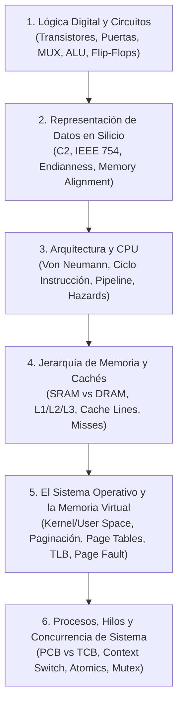

# 🧱 Capa 0: Silicio, Arquitectura de Computadores y Sistemas Operativos

He dividido esta capa en **6 bloques esenciales**, filtrando el ruido académico obsoleto y quedándome con los conceptos nucleares que **no puedes no saber**.

---

## Bloque 1: Lógica Digital y Circuitos (El Hardware desde la base)

Aquí se explica cómo la electricidad se convierte en decisiones lógicas y memoria.

### 1.1 Puertas Lógicas y Niveles de Voltaje
* **El Transistor como interruptor (CMOS):** La base física. Un voltaje alto o bajo abre o cierra el paso de corriente (NMOS conduce con 1, PMOS conduce con 0).
* **Puertas universales (NAND y NOR):** Saber por qué con solo puertas NAND (o NOR) puedes construir cualquier circuito digital del universo (computación funcionalmente completa).

### 1.2 Circuitos Combinacionales (Sin memoria, la salida solo depende de la entrada actual)
* **Multiplexor (MUX):** Un selector de canales. Tiene $N$ entradas de datos, $\log_2(N)$ líneas de control/selección y 1 salida. Fundamental para que la CPU decida qué dato pasa a un bus.
* **Demultiplexor / Decodificador:** Lo inverso. Toma un código binario (por ejemplo, una dirección de memoria de 4 bits) y activa exactamente una de las $2^4 = 16$ líneas de salida. Es el corazón del direccionamiento físico de memoria.
* **Sumador (Half-Adder y Full-Adder):** Cómo sumar bits con puertas XOR y AND. Entender cómo el acarreo (*Carry*) se propaga (Ripple-Carry Adder frente a Carry-Lookahead).
* **ALU (Unidad Aritmético-Lógica):**
  * **Qué es:** El bloque combinacional que realiza operaciones matemáticas (suma, resta) y lógicas (AND, OR, NOT, desplazamientos binarios).
  * **Entradas:** Operando A, Operando B y un código de operación (**Opcode** de $k$ bits que selecciona la operación).
  * **Salidas:** El resultado y los **Flags de estado**:
    * `Z` (*Zero*): si el resultado es 0.
    * `C` (*Carry*): acarreo sin signo.
    * `V` (*Overflow*): desbordamiento con signo.
    * `N` o `S` (*Negative/Sign*): si el bit más significativo es 1.
    * *Por qué importan:* Las instrucciones de salto condicional del procesador (`if`, `while`, `jmp_if_equal`) se basan físicamente en consultar estos flags de la ALU.

### 1.3 Circuitos Secuenciales (Con memoria, la salida depende de la entrada y del estado anterior)
* **El Reloj (Clock):** Una onda cuadrada oscilante que define el ritmo del procesador. Las transiciones (flancos de subida o bajada) marcan el momento exacto en que los circuitos actualizan su estado.
* **Latches y Flip-Flops (D Flip-Flop):**
  * El átomo de la memoria estática. Un circuito realimentado que retiene **1 bit**.
  * El Flip-Flop tipo D captura el dato de la entrada `D` en el flanco del reloj y lo mantiene estable en la salida `Q`.
* **Registros:** Varios Flip-Flops puestos en paralelo (8, 32, 64 bits) gobernados por la misma línea de reloj para almacenar una palabra de datos.
* **Contador de Programa (PC - Program Counter):** Un registro especial que almacena la dirección de memoria de la siguiente instrucción a ejecutar y se incrementa automáticamente cada ciclo (salvo en saltos).

---

## Bloque 2: Representación de la Información a Nivel Físico

Cómo se codifican los datos en patrones de bits y cómo interactúa el hardware con ellos.

* **Enteros y Complemento a Dos (C2):**
  * Cómo se representan los negativos: invertir los bits y sumar 1 ($\sim x + 1$).
  * *Por qué el hardware usa C2:* Porque la ALU puede realizar la resta $A - B$ usando el mismo circuito sumador haciendo $A + (\sim B + 1)$. No necesita un circuito restador independiente.
  * **Overflow:** Qué pasa cuando el resultado de una operación excede el número de bits disponibles (ej. $127 + 1 = -128$ en un entero de 8 bits con signo).
* **Punto Flotante (IEEE 754):**
  * División del registro: **Signo (1 bit) + Exponente con sesgo + Mantisa (fracción)**.
  * *Consecuencias reales:* Imprecisión binaria (por qué $0.1 + 0.2 \neq 0.3$), valores especiales (`+Inf`, `-Inf`, `NaN`) y el fenómeno de *Underflow* (números desnormalizados).
* **Endianness (Little-Endian vs Big-Endian):**
  * Si tienes el número hexadecimal `0x12345678` ocupando 4 bytes en memoria:
    * **Big-Endian:** Guarda el byte más significativo primero (`12 34 56 78`). Usado tradicionalmente en protocolos de red de bajo nivel.
    * **Little-Endian:** Guarda el byte menos significativo primero (`78 56 34 12`). Usado en arquitecturas x86 y la mayoría de procesadores ARM.
* **Alineamiento de Memoria y Padding (Data Alignment):**
  * El bus de datos de la CPU lee la memoria en bloques del tamaño de palabra (típicamente 4 u 8 bytes).
  * Si un entero de 4 bytes está en una dirección no múltiplo de 4, la CPU tendría que hacer dos lecturas de memoria y desplazar bits para recomponer el dato.
  * Por eso los compiladores insertan *bytes de relleno (padding)* en los `structs` para que cada variable caiga en una dirección múltiplo de su tamaño.

---

## Bloque 3: Arquitectura y Organización del Computador (Microarquitectura)

Cómo se organiza una CPU para ejecutar programas.

### 3.1 El Modelo Von Neumann vs Harvard
* **Von Neumann:** Datos e instrucciones comparten el mismo bus y el mismo espacio de memoria principal (cuello de botella de Von Neumann: la CPU no puede leer una instrucción y leer un dato simultáneamente por el mismo bus).
* **Harvard:** Buses y memorias separados para instrucciones y datos (muy usado internamente en las cachés L1 de las CPUs modernas: L1 Instruction Cache y L1 Data Cache).

### 3.2 El Ciclo de Instrucción
Cada instrucción pasa por una secuencia rígida de pasos:
1. **Fetch (Búsqueda):** Leer la instrucción de memoria en la dirección que marca el `PC`.
2. **Decode (Decodificación):** La Unidad de Control descompone los bits de la instrucción (código de operación, registros fuente, registro destino).
3. **Execute (Ejecución):** La ALU realiza la operación o calcula la dirección efectiva.
4. **Memory Access (Acceso a Memoria):** Leer o escribir en RAM si es una instrucción de carga/almacenamiento (`load`/`store`).
5. **Write-Back (Escritura):** Guardar el resultado final en el banco de registros de la CPU.

### 3.3 El Pipeline (Segmentación de Instrucciones)
* **La idea central:** En lugar de esperar a que una instrucción termine completamente sus 5 fases antes de empezar la siguiente, se ejecutan en paralelo distintas fases de instrucciones consecutivas (como una cadena de montaje de coches).
* **Riesgos del Pipeline (Hazards):** Qué frena el pipeline:
  * **Riesgos Estructurales:** Dos fases intentan usar el mismo recurso hardware a la vez.
  * **Riesgos de Datos (RAW - Read After Write):** Una instrucción necesita el resultado de la instrucción inmediatamente anterior, que aún no ha llegado a la fase de Write-Back.
    * *Solución hardware:* **Forwarding / Bypassing** (enviar el resultado directamente desde la salida de la ALU de la fase de ejecución a la entrada de la siguiente instrucción sin esperar a escribirlo en el registro).
  * **Riesgos de Control:** Provocados por saltos condicionales (`if`). La CPU no sabe cuál es la siguiente instrucción hasta que se evalúa la condición.
    * *Solución hardware:* **Branch Prediction** (predicción estática y dinámica de saltos) y ejecución especulativa. Si la predicción falla, hay que vaciar el pipeline (*pipeline flush*), perdiendo ciclos.

### 3.4 Filosofías de Juego de Instrucciones (ISA)
* **CISC (Complex Instruction Set Computer - x86):** Instrucciones de longitud variable, complejas, capaces de hacer operaciones de memoria y aritmética en una sola instrucción.
* **RISC (Reduced Instruction Set Computer - ARM, RISC-V):** Arquitectura *Load/Store* estricta. Las operaciones aritméticas solo ocurren entre registros. Instrucciones de tamaño fijo, simples y diseñadas para pipelines uniformes de un ciclo por fase.

---

## Bloque 4: La Jerarquía de Memoria (De Registros al Disco)

El compromiso universal de la ingeniería de computadores: la memoria no puede ser simultáneamente ultrarrápida, gigantesca y barata.

### 4.1 Principios de Localidad
Todo el diseño de computadores funciona gracias a esto:
* **Localidad Temporal:** Si un dato o instrucción se usa ahora, es muy probable que se vuelva a usar pronto (ej. variables dentro de un bucle).
* **Localidad Espacial:** Si se accede a una dirección de memoria, es muy probable que se acceda a direcciones contiguas poco después (ej. recorrer un array secuencial).

### 4.2 Tecnologías de Memoria
* **SRAM (Static RAM):** 6 transistores por bit. No necesita refresco. Extremadamente rápida (~0.5 - 2 ns), cara y consume área de silicio. Se usa para las **Cachés (L1, L2, L3)** dentro del chip de la CPU.
* **DRAM (Dynamic RAM):** 1 transistor y 1 minúsculo condensador por bit. Como el condensador pierde carga eléctrica, necesita ser **refrescado periódicamente** miles de veces por segundo. Más lenta (~50 - 100 ns), barata y densa. Se usa para la **RAM principal**.
* **Almacenamiento Secundario (Flash NAND / SSD vs HDD):** No volátil. Persistente mediante trampas de carga en celdas de silicio (SSD) o magnetismo en platos giratorios (HDD). Latencias de microsegundos a milisegundos (órdenes de magnitud más lentas que la RAM).

### 4.3 Funcionamiento Interno de la Memoria Caché
* **Línea de Caché (Cache Line):** La unidad básica de transferencia. La CPU **nunca** lee 1 solo byte de la RAM: siempre trae un bloque contiguo completo (típicamente **64 bytes**).
* **Estructura de una dirección de memoria para la caché:**
  Una dirección se descompone en 3 campos:
  $$\text{Dirección} = [\text{Tag} \mid \text{Index (Conjunto)} \mid \text{Offset (Desplazamiento dentro de la línea)}]$$
* **Tipos de Mapeo:**
  * **Mapeo Directo:** Cada bloque de memoria tiene exactamente una línea de caché posible donde colocarse. Simple, pero propenso a colisiones frecuentes.
  * **Totalmente Asociativa:** Un bloque puede colocarse en cualquier línea de la caché. Cero colisiones, pero buscar un dato requiere hardware de comparación muy caro.
  * **Asociativa por Conjuntos (Set-Associative - El estándar real):** La caché se divide en conjuntos de $N$ vías (ej. 8-way set-associative). El índice selecciona el conjunto, y el dato puede estar en cualquiera de las $N$ líneas de ese conjunto.
* **Los 3 tipos de Fallos de Caché (Cache Misses):**
  1. **Compulsory (Cold):** La primera vez que se accede a un dato; inevitable.
  2. **Capacity:** El conjunto de trabajo activo del programa es más grande que el tamaño total de la caché.
  3. **Conflict:** Múltiples datos caen por diseño en el mismo conjunto de la caché y se expulsan mutuamente, aunque haya espacio libre en otros conjuntos.
* **Políticas de Escritura:**
  * **Write-Through:** Escribe el dato en la caché y en la RAM principal al mismo tiempo. Seguro pero lento.
  * **Write-Back:** Modifica solo la línea de caché y marca un bit de suciedad (*Dirty Bit*). Solo se escribe en la RAM principal cuando esa línea de caché va a ser expulsada por otra.

---

## Bloque 5: El Sistema Operativo y la Gestión de Memoria

Cómo el software del sistema toma el control del hardware para proporcionar abstracción y seguridad.

### 5.1 Modos de Ejecución y la Frontera del Kernel
* **User Mode (Anillo 3) vs Kernel Mode (Anillo 0):**
  * La CPU tiene un bit en sus registros de control que indica el privilegio.
  * En modo usuario, ciertas instrucciones máquina están prohibidas (tocar registros de interrupción, configurar tablas de páginas, acceder directamente al hardware).
* **Llamadas al Sistema (Syscalls):**
  * La única puerta de entrada segura al kernel. El programa de usuario prepara los argumentos en registros y ejecuta una instrucción de software especial (`syscall` / `sysenter` o `int 0x80`), que provoca una excepción controlada, cambia la CPU a modo kernel y salta a una tabla predefinida de manejadores de interrupción.

### 5.2 Memoria Virtual y Paginación (Paging)
* **El problema que resuelve:**
  * Sin memoria virtual, los programas escribirían directamente en direcciones físicas de la RAM, pudiendo corromper otros programas o el propio sistema operativo. Además, requerirían bloques de RAM perfectamente contiguos.
* **Espacio de Direcciones Virtuales:**
  * Cada proceso cree que tiene toda la memoria para él solo (ej. de `0x0000000000000000` a `0x7FFFFFFFFFFFFFFF` en 64 bits), empezando en direcciones estándar.
* **Páginas y Marcos (Frames):**
  * El espacio virtual se divide en bloques de tamaño fijo llamados **Páginas** (típicamente **4 KB**).
  * La memoria RAM física se divide en bloques del mismo tamaño llamados **Marcos de Página (Page Frames)**.
* **Traducción de Direcciones (MMU - Memory Management Unit):**
  * La dirección virtual se descompone en:
    $$\text{Dirección Virtual} = [\text{Virtual Page Number (VPN)} \mid \text{Offset}]$$
  * La **MMU** (hardware integrado en la CPU) consulta la **Tabla de Páginas** del proceso para convertir el VPN en un **Physical Frame Number (PFN)**:
    $$\text{Dirección Física} = [\text{Physical Frame Number (PFN)} \mid \text{Offset}]$$
  * El *Offset* no se traduce, se copia idéntico (indica la posición exacta dentro de los 4 KB).
* **Tablas de Páginas Multinivel:**
  * Una tabla plana para un espacio de 64 bits ocuparía terabytes solo para almacenar las traducciones. Por eso se usan árboles de tablas jerárquicas (4 niveles en x86-64), asignando memoria para la tabla solo para los rangos de memoria que el proceso realmente usa.
* **TLB (Translation Lookaside Buffer):**
  * Como consultar una tabla de páginas de 4 niveles en RAM requeriría 4 accesos a memoria por cada lectura de una variable, la CPU tiene una caché hardware ultrarrápida llamada **TLB** que guarda las traducciones recientes de VPN $\to$ PFN.
* **Fallo de Página (Page Fault):**
  * Una excepción software que lanza la MMU cuando:
    1. La página solicitada es válida pero **no está en la RAM física** (está en el disco de intercambio / swap). El kernel pausa el proceso, lee el bloque de disco, lo carga en un marco libre de RAM, actualiza la tabla de páginas y reanuda el proceso en la misma instrucción.
    2. El acceso es ilegal (ej. escribir en una página de solo lectura o acceder a una dirección no asignada). El kernel envía una señal de terminación al proceso (**Segmentation Fault / SIGSEGV**).

---

## Bloque 6: Procesos, Hilos y Concurrencia de Sistema

### 6.1 Proceso vs Hilo a Nivel de Sistema Operativo
* **Proceso:**
  * Entidad de aislamiento y propiedad de recursos.
  * Dispone de su propio espacio de memoria virtual, descriptores de fichero abiertos, variables de entorno y un **PCB (Process Control Block)** en el kernel.
* **Hilo (Thread):**
  * Entidad de planificación y ejecución en la CPU.
  * Varios hilos viven dentro del mismo proceso. **Comparten:** el mismo espacio de direcciones virtual (el código, el Heap y las variables globales) y los ficheros abiertos.
  * **Tienen privado e independiente:** Sus propios Registros de CPU, su propio **Program Counter (PC)** y su propio **Stack (Pila de llamadas)**, controlados por un **TCB (Thread Control Block)**.

### 6.2 Cambio de Contexto (Context Switch)
* Qué ocurre cuando el planificador del SO quita la CPU a un hilo/proceso para dársela a otro:
  1. Salvar los registros de la CPU actual en el PCB/TCB.
  2. Si es un cambio entre **procesos distintos**: cambiar el registro base de la tabla de páginas (`CR3` en x86), lo que provoca la **invalidación de las entradas del TLB**. Esto hace que un cambio de proceso sea órdenes de magnitud más caro que un cambio entre hilos del mismo proceso (donde la tabla de páginas no cambia).
  3. Cargar los registros guardados del nuevo hilo/proceso.
  4. Restaurar el `PC` para continuar la ejecución.

### 6.3 Sincronización y Primitivas Hardware
* **Sección Crítica & Race Condition:** Cuando dos o más hilos leen y modifican memoria compartida concurrentemente y el resultado final depende del orden impredecible de ejecución.
* **Soporte Hardware:** El software no puede solucionar las condiciones de carrera sin ayuda del silicio. Se necesitan **Instrucciones Atómicas**:
  * `Test-and-Set`
  * `Compare-and-Swap` (CAS): Compara el contenido de una dirección de memoria con un valor esperado y, solo si coinciden, escribe el nuevo valor de forma indivisible a nivel de bus.
* **Primitivas de Sincronización:**
  * **Spinlock:** Bucle de espera activa usando instrucciones atómicas (`while(!lock)`). Desperdicia CPU; solo útil si se espera que el bloqueo dure poquísimos ciclos de reloj.
  * **Mutex (Mutual Exclusion):** Si el recurso está ocupado, el hilo pide al kernel que lo ponga en estado dormido/bloqueado (*Sleep*), liberando la CPU para otros procesos hasta que sea despertado cuando el recurso se libere.
  * **Semáforo:** Generalización del mutex mediante un contador entero para controlar el acceso a un número finito de recursos compartidos.

---

### 🎯 Lo que debes ignorar (Filtrando el "Ruido Académico")

Para no perder tiempo en este nivel, puedes descartar con total seguridad:
* ❌ Minimización de funciones booleanas a mano con Mapas de Karnaugh de 5 variables.
* ❌ Temporogramas minuciosos y tiempos de propagación en picosegundos de puertas lógicas individuales.
* ❌ Diseño de circuitos secuenciales con biestables JK o T (en la industria real solo se usa tipo D).
* ❌ Arquitecturas arcaicas y segmentación de memoria en modo real del Intel 8086.
* ❌ Algoritmos antiguos de planificación de cabezales de discos duros mecánicos (SCAN, C-SCAN, LOOK).

---

¿Tiene este alcance exactamente el nivel de detalle y enfoque que buscabas para afianzar esta base genérica antes de dar el salto a las capas superiores?