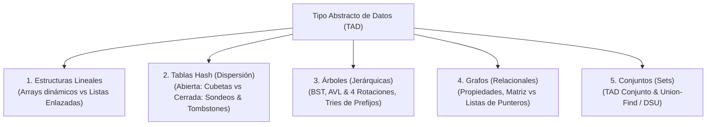
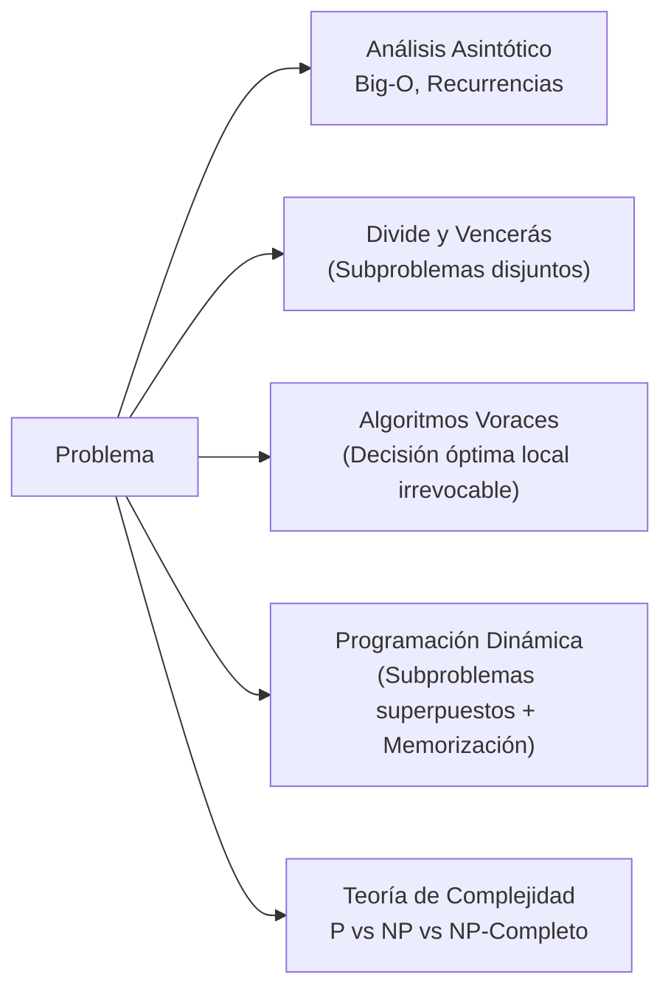

# 🧠 Capa 1: Estructuras de Datos y Algoritmia (AED1 & AED2)

Basándonos en tus notas de [[AED1]] y [[AED2]], aquí tienes el extracto de los conceptos fundamentales que sustentan el software moderno, organizados en los dos grandes bloques que has propuesto:

---

## Bloque 1: Estructuras de Datos (AED1) — Modelos de Memoria y Trade-offs

El núcleo de este bloque responde a una sola pregunta: **¿Cómo organizo la información en memoria para que acceder a ella o modificarla cueste lo mínimo posible en tiempo, espacio y ciclos de CPU?**

Las estructuras de datos se clasifican según la topología de las relaciones entre sus elementos:



### 1.1 El Fundamento: TAD vs Estructura Física
* **TAD (Tipo Abstracto de Datos):** La interfaz matemática externa (**qué hace**: operaciones como `insertar`, `buscar`, `borrar`) con ocultamiento de implementación.
* **Estructura de Datos:** La disposición física real en la memoria del computador (**cómo lo hace**: contiguo en RAM vs nodos dispersos con punteros).
* **Principio de sustitución:** El mismo TAD (ej. *Diccionario / Mapa*) puede implementarse internamente con una tabla hash, un árbol AVL, un árbol B o una lista de claves, ofreciendo contratos idénticos con rendimientos y patrones de acceso a hardware radicalmente distintos.

---

### 1.2 Estructuras Lineales: Arrays vs Listas Enlazadas (Operaciones al Detalle)

En las estructuras lineales, cada elemento (salvo el primero y el último) tiene un único predecesor y un único sucesor. Sin embargo, la disposición en memoria física cambia drásticamente el coste de cada operación.

#### A. Arrays (Estáticos y Dinámicos)
Memoria contigua en un único bloque de RAM.

* **1. Consulta (Acceso por índice o búsqueda):**
  * **Por índice `A[i]` — $O(1)$ estricto:** La dirección física se resuelve con una sola operación matemática en la ALU:
    $$\text{Dirección}(\text{A}[i]) = \text{Base} + i \times \text{sizeof}(\text{Tipo})$$
    No requiere saltos de punteros ni traversal. Además, la **localidad espacial (Capa 0)** permite que el hardware traiga una línea de caché completa (64 bytes, ~16 enteros), haciendo que las lecturas subsiguientes sean instantáneas (~1 ns).
  * **Búsqueda por valor — $O(N)$ o $O(\log N)$:** Si no está ordenado, requiere escaneo lineal $O(N)$. Si está ordenado en memoria contigua, permite **Búsqueda Binaria en $O(\log N)$** gracias al acceso indexado $O(1)$ al punto medio.
* **2. Inserción:**
  * **Al final — $O(1)$ amortizado:** Si hay capacidad reservada, se escribe en la posición libre y se incrementa el contador. Si el buffer se llena, ocurre un **realojo**: se reserva un bloque nuevo del doble de tamaño, se copian los $N$ elementos ($O(N)$) y se libera el antiguo. En promedio, cada inserción cuesta $O(1)$, pero causa picos puntuales de latencia.
  * **En cabeza o en posición intermedia $k$ — $O(N)$:** Exige desplazar físicamente todos los elementos desde la posición $k$ hasta el final una posición a la derecha (`memmove`) para abrir el hueco antes de escribir.
* **3. Borrado:**
  * **Al final — $O(1)$:** Basta con decrementar el tamaño lógico del array.
  * **En cabeza o en posición intermedia $k$ — $O(N)$:** Exige desplazar todos los elementos posteriores una posición a la izquierda para tapar el hueco y mantener la contigüidad.

#### B. Listas Enlazadas (Simples, Dobles y Circulares)
Nodos individuales dispersos en el *Heap*, conectados mediante punteros explícitos (`next`, `prev`).

* **1. Consulta:**
  * **Por índice o por valor — $O(N)$ obligatorio:** No existe aritmética de punteros. Para acceder al elemento en la posición $k$, es imprescindible partir de la cabecera (`head`) y desreferenciar punteros uno a uno ($k$ saltos en memoria). Cada salto suele provocar un **fallo de caché (cache miss)** en CPU porque los nodos residen en direcciones lejanas del Heap.
  * **No permite búsqueda binaria:** Incluso si los datos están ordenados, no se puede saltar al elemento central en $O(1)$.
* **2. Inserción:**
  * **En cabeza (`push_front`) — $O(1)$ estricto:** Se reserva el nodo nuevo, se asigna `nuevo->next = head; head = nuevo;`. Operación sin realojos ni desplazamientos de memoria.
  * **En posición intermedia con el puntero al nodo previo en mano — $O(1)$:** Solo se actualizan 2 punteros (`nuevo->next = prev->next; prev->next = nuevo;`).
  * **En posición intermedia buscando primero la posición — $O(N)$:** El coste no está en enlazar los punteros, sino en los $N$ pasos previos para llegar al punto de inserción.
* **3. Borrado:**
  * **En cabeza (`pop_front`) — $O(1)$:** `temp = head; head = head->next; free(temp);`.
  * **Con puntero al nodo en mano (en lista doble) — $O(1)$:** Se reasignan `nodo->prev->next = nodo->next` y `nodo->next->prev = nodo->prev`, liberando el nodo inmediatamente.
  * **Borrando por valor — $O(N)$:** Se debe recorrer la lista hasta localizar el elemento antes de reconectar los punteros.

| Operación | Array Contiguo | Lista Enlazada |
| :--- | :--- | :--- |
| **Acceso indexado `[i]`** | **$O(1)$** (aritmética de punteros) | **$O(N)$** (traversal nodo a nodo) |
| **Búsqueda (ordenado)** | **$O(\log N)$** (búsqueda binaria) | **$O(N)$** (secuencial) |
| **Inserción en cabeza** | $O(N)$ (desplaza todo el array) | **$O(1)$** (enlaza nuevo head) |
| **Inserción al final** | **$O(1)$ amortizado** (salvo realojo) | **$O(1)$** (con puntero `tail`) |
| **Inserción en medio** | $O(N)$ desplazamiento | **$O(1)$** (con nodo en mano) / $O(N)$ (si busca) |
| **Borrado en medio** | $O(N)$ desplazamiento | **$O(1)$** (con nodo en mano) / $O(N)$ (si busca) |
| **Sobrecarga de RAM** | Mínima (0 bytes extra por dato) | **Alta** (8–24 bytes de punteros + alineación) |
| **Amabilidad con la Caché** | **Máxima** (localidad espacial continua) | **Pésima** (saltos de memoria aleatorios en Heap) |

---

### 1.3 Tablas Hash (Dispersión): Modelos de Resolución de Colisiones

El objetivo es lograr búsqueda, inserción y borrado en tiempo medio constante **$O(1)$** proyectando una clave arbitraria $k$ a un índice de array $0 \le i < M$ mediante una función hash $h(k)$. Las colisiones ($h(k_1) = h(k_2)$) son inevitables por el principio del palomar (**teorema de Dirichlet**).

```
                           RESOLUCIÓN DE COLISIONES
                                     │
         ┌───────────────────────────┴───────────────────────────┐
         ▼                                                       ▼
  DISPERSIÓN ABIERTA                                      DISPERSIÓN CERRADA
  (Encadenamiento / Chaining)                             (Direccionamiento Abierto)
  • Celdas = punteros a listas/árboles                    • Todos los datos dentro del array
  • Crece fuera del array principal                       • Sondeos: lineal, cuadrático, doble hash
  • Tolera factor de carga α > 1                          • Exige factor de carga α < 0.7 - 0.8
  • Peor localidad de caché                               • Máxima localidad de caché
  • Borrado simple (liberar nodo)                         • Borrado exige TOMBSTONES
```

#### A. Dispersión Abierta (Encadenamiento / Separate Chaining)
* **Estructura física:** El array principal es un vector de cabeceras de cubetas (*buckets*). Cada celda contiene un puntero al inicio de una estructura secundaria (típicamente una lista enlazada simple o un árbol).
* **Inserción:** Se computa $i = h(k) \pmod M$. Si hay colisión, se crea un nodo nuevo en el *Heap* y se encadena a la lista de esa cubeta en $O(1)$.
* **Búsqueda y Borrado:** Se va a la cubeta $i$ y se recorre su lista en $O(L)$, donde $L$ es la longitud de la cadena de colisiones ($L \approx \alpha = N/M$). El borrado simplemente desengancha el nodo con `free()` sin afectar a otras cubetas.
* **Ventajas:** Tolera $\alpha > 1.0$ sin bloquearse; borrado trivial.
* **Optimización moderna (ej. Java 8+ HashMap):** Si una cubeta supera 8 elementos colisionados, transmuta la lista en un **Árbol Rojo-Negro** balanceado ($O(\log k)$ en el peor caso absoluto).

#### B. Dispersión Cerrada (Direccionamiento Abierto / Open Addressing)
* **Estructura física:** Todos los elementos residen exclusivamente dentro de las $M$ celdas del array principal. No hay punteros fuera del array.
* **Estrategias de Sondeo ante colisión:**
  1. **Sondeo Lineal ($i$):**
     $$\text{pos}_i = (h(k) + i) \pmod M$$
     *Excelente localidad espacial de caché, pero sufre de **Agrupamiento Primario**: bloques de celdas ocupadas contiguas que crecen y ralentizan todas las inserciones cercanas.*
  2. **Sondeo Cuadrático ($c_1 i + c_2 i^2$):**
     $$\text{pos}_i = (h(k) + c_1 i + c_2 i^2) \pmod M$$
     *Rompe el agrupamiento primario con saltos crecientes, pero claves con el mismo hash inicial siguen idéntica secuencia (**Agrupamiento Secundario**).*
  3. **Dispersión Doble (Double Hashing):**
     $$\text{pos}_i = (h_1(k) + i \times h_2(k)) \pmod M$$
     *Usa un segundo hash $h_2(k) \neq 0$ como tamaño de paso. Elimina agrupamientos primarios y secundarios.*
* **El mecanismo indispensable: Tombstones (Marcas de borrado 🪦):**
  * Si claves colisionadas ocupan celdas continuas (`ana` en [2], `sol` en [3], `mar` en [4]) y se borra `sol` vaciando la celda [3], la búsqueda de `mar` se detendrá en [3] al ver una celda vacía y retornará erróneamente que no existe (**falso negativo**).
  * **Solución:** La celda se marca con el centinela **TOMBSTONE**. La búsqueda sigue avanzando al ver el tombstone, mientras que la inserción puede reutilizar esa celda vaciada.
* **Factor de Carga ($\alpha = N / M$) y Rehash:** Exige $\alpha < 0.7 - 0.8$. Al superarlo, se dispara el **Rehash ($O(N)$)**: se reserva un array del doble de tamaño y se reubican todas las claves vivas, eliminando los tombstones acumulados.

---

### 1.4 Árboles (Estructuras Jerárquicas): BST, AVL (y sus 4 Rotaciones) y Tries

#### A. Árboles Binarios de Búsqueda (BST) y Árboles Balanceados (AVL)
Un BST mantiene el orden de las claves: todo nodo a la izquierda es menor y todo nodo a la derecha es mayor. Si se insertan datos ya ordenados (1, 2, 3, 4, 5), la altura degenera a $h = N$, convirtiéndose en una lista enlazada $O(N)$.

El **Árbol AVL** es un árbol binario de búsqueda auto-balanceado que garantiza que la altura nunca supere $h \approx 1.44 \log_2 N$.
* **Factor de Equilibrio (FE):**
  $$\text{FE}(\text{nodo}) = \text{altura}(\text{subárbol\_derecho}) - \text{altura}(\text{subárbol\_izquierdo}) \in \{-1, 0, +1\}$$

#### Proceso de Inserción y las 4 Rotaciones en un AVL
Al insertar un nodo siguiendo las reglas del BST (en $O(\log N)$), se actualizan las alturas hacia la raíz. Si un nodo alcanza $\text{FE} = \pm 2$, se produce un desbalance que se corrige de inmediato mediante una de las **4 rotaciones canónicas en tiempo constante $O(1)$**:

##### 1. Rotación Simple a la Derecha (RSD) — Caso Izquierda-Izquierda (II)
Ocurre cuando se inserta en el subárbol izquierdo del hijo izquierdo ($\text{FE}(\text{nodo}) = -2$ y $\text{FE}(\text{hijo\_izq}) \le 0$).

```
        Desbalanceado:                   Balanceado (RSD):
             (C) [-2]                           (B) [0]
             /   \                              /     \
         (B) [-1]  T3        ──────►        (A)         (C)
         /   \                              / \         / \
       (A)    T2                           T0  T1      T2  T3
       / \
      T0  T1
```
*Mecanismo:* El nodo `(B)` asciende a la raíz; `(C)` baja a ser su hijo derecho; el subárbol `T2` pasa a ser el hijo izquierdo de `(C)`.

##### 2. Rotación Simple a la Izquierda (RSI) — Caso Derecha-Derecha (DD)
Ocurre cuando se inserta en el subárbol derecho del hijo derecho ($\text{FE}(\text{nodo}) = +2$ y $\text{FE}(\text{hijo\_der}) \ge 0$).

```
        Desbalanceado:                   Balanceado (RSI):
             (A) [+2]                           (B) [0]
             /   \                              /     \
           T0    (B) [+1]    ──────►        (A)         (C)
                 /   \                      / \         / \
                T1   (C)                   T0  T1      T2  T3
                     / \
                    T2  T3
```
*Mecanismo:* El nodo `(B)` asciende a la raíz; `(A)` baja a ser su hijo izquierdo; el subárbol `T1` pasa a ser el hijo derecho de `(A)`.

##### 3. Rotación Doble Izquierda-Derecha (RDID) — Caso Izquierda-Derecha (ID)
Ocurre cuando se inserta en el subárbol derecho del hijo izquierdo ($\text{FE}(\text{nodo}) = -2$ y $\text{FE}(\text{hijo\_izq}) = +1$). El desbalance forma una forma en "zig-zag".

```
     Desbalanceado:            Paso 1: RSI en hijo (B)      Paso 2: RSD en raíz (C)
          (C) [-2]                     (C) [-2]                     (X) [0]
          /   \                        /   \                        /     \
      (B) [+1] T3       ──────►      (X)    T3       ──────►     (B)       (C)
      /   \                          / \                         / \       / \
     T0   (X)                      (B)  T2                      T0  T1    T2  T3
          / \                      / \
         T1  T2                   T0  T1
```
*Mecanismo:* Se aplica una rotación simple izquierda sobre el hijo `(B)` para alinear la rama, y luego una rotación simple derecha sobre la raíz `(C)`. El nodo interior `(X)` asciende como nueva raíz.

##### 4. Rotación Doble Derecha-Izquierda (RDDI) — Caso Derecha-Izquierda (DI)
Ocurre cuando se inserta en el subárbol izquierdo del hijo derecho ($\text{FE}(\text{nodo}) = +2$ y $\text{FE}(\text{hijo\_der}) = -1$).

```
     Desbalanceado:            Paso 1: RSD en hijo (C)      Paso 2: RSI en raíz (A)
          (A) [+2]                     (A) [+2]                     (X) [0]
          /   \                        /   \                        /     \
         T0   (C) [-1]  ──────►       T0   (X)       ──────►     (A)       (C)
              /   \                        / \                   / \       / \
            (X)    T3                     T1  (C)               T0  T1    T2  T3
            / \                               / \
           T1  T2                            T2  T3
```
*Mecanismo:* Se aplica una rotación simple derecha sobre el hijo `(C)` y luego una rotación simple izquierda sobre la raíz `(A)`.

#### B. Árboles Trie (Árboles de Prefijos)
Estructura de búsqueda por caracteres donde las claves que comparten prefijos comparten los mismos nodos.

* **Ejemplo horizontal de prefijos compartidos:**

```
                  (raíz)
                  ├── m ── a ── r [✓ "mar"]
                  │             ├── e ── a [✓ "marea"]
                  │             └── i ── n ── o [✓ "marino"]
                  └── s ── o ── l [✓ "sol"]
                                └── a ── r [✓ "solar"]
```
* **Propiedad asintótica diferencial:** La búsqueda e inserción cuestan **$O(L)$** ($L$ = longitud de la palabra), independientemente de que existan 1.000 o 1.000.000.000 de palabras ($N$). Ideal para autocompletado, correctores y enrutamiento CIDR IP.

---

### 1.5 Grafos: Propiedades Fundamentales y Modelos de Memoria

Un grafo $G = (V, E)$ es una estructura relacional no lineal formada por un conjunto de vértices o nodos $V$ y un conjunto de aristas o arcos $E$.

#### A. Propiedades Matemáticas y Topológicas de los Grafos
1. **Dirigido (Dígrafo) vs No Dirigido:**
   * En un dígrafo, cada arista es un par ordenado $(u, v)$ con dirección fija ($u \to v$).
   * En uno no dirigido, la arista $\{u, v\}$ es bidireccional: la existencia de $(u, v)$ implica $(v, u)$.
2. **Ponderado vs No Ponderado:**
   * No ponderado: cada arista representa una simple adyacencia booleana (0 o 1).
   * Ponderado: cada arista posee un coste o peso asociado $w(u, v) \in \mathbb{R}$ (latencia de red, distancia física, capacidad de flujo).
3. **Cíclico vs Acíclico (DAG):**
   * Cíclico: contiene al menos un camino cerrado de longitud $\ge 3$ donde el vértice de inicio coincide con el de fin.
   * Acíclico: no existen ciclos. Un **Grafo Acíclico Dirigido (DAG)** es la estructura matemática estándar para modelar dependencias de compilación, flujos de trabajo (*pipelines*) y orquestación de agentes.
4. **Conectividad:**
   * Grafo no dirigido: es **conexo** si existe al menos un camino entre cualquier par de vértices. Si no, se divide en **componentes conexas**.
   * Grafo dirigido: es **fuertemente conexo** (SCC) si existe camino dirigido en ambos sentidos entre cualquier par de nodos ($u \rightsquigarrow v$ y $v \rightsquigarrow u$).
5. **Densidad del Grafo:**
   * **Denso:** El número de aristas es cercano al máximo teórico: $E \approx V^2$.
   * **Disperso (Sparse):** El número de aristas es lineal con los vértices: $E \approx O(V)$ o $E \ll V^2$. La inmensa mayoría de grafos reales (redes sociales, mapas viales, hiperenlaces web) son dispersos.
6. **Grado de un Vértice ($d(v)$):** En no dirigidos, número de aristas incidentes. En dirigidos se divide en **grado entrante** ($d^-(v)$, aristas que llegan) y **grado saliente** ($d^+(v)$, aristas que parten).

#### B. Grafo Canónico de Ejemplo (4 Vértices Ponderados)

```
        (2)
   [0] ─────── [1]
    │           │
 (6)│           │(3)
    │           │
   [2] ─────── [3]
        (4)
```

#### C. Representación en Memoria: Matriz vs Listas de Punteros

* **1. Matriz de Adyacencia ($V \times V$):** Array bidimensional contiguo en RAM.
  ```
       u \ v :   [0]   [1]   [2]   [3]
       ───────────────────────────────
       [0]   :    0     2     6     0
       [1]   :    2     0     0     3
       [2]   :    6     0     0     4
       [3]   :    0     3     4     0
  ```
  * Espacio fijo: **$O(V^2)$**. Consulta de arista $(u, v)$: **$O(1)$**. Iterar vecinos: **$O(V)$**.
  * Ideal para: Grafos densos, matrices de adyacencia procesadas en paralelo en GPU / SIMD.

* **2. Listas de Adyacencia (Array de Cabeceras + Punteros):** Array de tamaño $V$ donde cada posición apunta a una lista enlazada o vector dinámico de aristas salientes:
  ```
     adj[0] ──► (v:1, w:2) ──► (v:2, w:6) ──► null
     adj[1] ──► (v:0, w:2) ──► (v:3, w:3) ──► null
     adj[2] ──► (v:0, w:6) ──► (v:3, w:4) ──► null
     adj[3] ──► (v:1, w:3) ──► (v:2, w:4) ──► null
  ```
  * Espacio: **$O(V + E)$**. Iterar vecinos de $u$: exactamente **$O(\text{grado}(u))$**. Consulta de arista: $O(\text{grado}(u))$.
  * Ideal para: Grafos dispersos del mundo real.

---

### 1.6 Conjuntos (Sets): TAD Conjunto y Union-Find (DSU)

El TAD **Conjunto (Set)** modela una colección de elementos únicos sin orden intrínseco.
* **Operaciones estándar:** `insertar(x)`, `eliminar(x)`, `pertenece(x)`.
* **Implementaciones según contrato:**
  * **HashSet:** Basado en tablas hash. Consultas y modificaciones en **$O(1)$ medio**. No garantiza ningún orden en el recorrido.
  * **TreeSet / Conjunto Ordenado:** Basado en árboles Rojo-Negro o AVL. Operaciones en **$O(\log N)$**. Mantiene los elementos siempre ordenados y permite consultas por rango (*"dame todos los elementos entre X e Y"*).

#### Conjuntos Disjuntos: Union-Find (Disjoint Set Union - DSU)
Estructura especializada diseñada para mantener una partición de un universo de elementos en **conjuntos mutuamente disjuntos** (ningún elemento pertenece a dos conjuntos a la vez).

* **Operaciones del DSU:**
  1. `find(x)`: Determina a qué conjunto pertenece $x$, retornando el representante o raíz del conjunto.
  2. `union(x, y)`: Fusiona los conjuntos que contienen a $x$ y a $y$ en un único conjunto.
* **Disposición física en memoria:** Un simple array plano de enteros `parent[N]`, donde `parent[i] == i` indica que el nodo $i$ es la raíz de su conjunto.
* **Las 2 optimizaciones clave:**
  1. **Unión por Rango:** El árbol con menor profundidad siempre se cuelga bajo la raíz del árbol de mayor profundidad para evitar que la altura crezca linealmente.
  2. **Compresión de Caminos (Path Compression):** Al ejecutar `find(x)`, todos los nodos atravesados en la subida hacia la raíz reasignan su puntero padre directamente a la raíz definitiva:
     ```cpp
     int find(int x) {
       return (parent[x] == x) ? x : (parent[x] = find(parent[x]));
     }
     ```
* **Complejidad Asintótica:** Amortizada en **$O(\alpha(N))$** por operación, donde $\alpha(N)$ es la inversa de Ackermann ($\alpha(N) < 5$ para todo $N \le 10^{80}$). Esencialmente **tiempo constante $O(1)$**.
* **Aplicaciones:** Motor del algoritmo de **Kruskal** para el Árbol de Expansión Mínimo (MST) y detección instantánea de ciclos al agregar aristas en grafos no dirigidos.

---

### 1.7 Recorridos y Algoritmia Fundamental de Grafos

Toda la algoritmia de grafos se construye sobre dos estrategias de exploración sistemática:

```
                               RECORRIDOS DE GRAFOS
                                        │
           ┌────────────────────────────┴────────────────────────────┐
           ▼                                                         ▼
     DFS (Depth-First Search)                                  BFS (Breadth-First Search)
     • Estructura: PILA (LIFO) / Recursión                     • Estructura: COLA (FIFO)
     • Explora una rama hasta el fondo antes de volver         • Explora concéntricamente por "olas" o niveles
     • Complejidad: O(V + E)                                   • Complejidad: O(V + E)
     • Detecta ciclos, puentes y orden topológico              • Encuentra caminos mínimos en grafos sin pesos
```

#### Traza Paso a Paso: ¿Cómo se comportan en el grafo de ejemplo?
Partiendo del nodo **0**:
* **BFS (Cola FIFO):**
  1. Encola `0`. Visitados: `{0}`.
  2. Desencola `0`, examina vecinos: encola `1` y `2`. Cola: `[1, 2]`.
  3. Desencola `1`, examina vecinos: encola `3`. Cola: `[2, 3]`.
  4. Desencola `2`, vecinos ya visitados. Cola: `[3]`.
  5. Desencola `3`, fin.
  * **Orden de visita:** `0 → 1 → 2 → 3`. Garantiza el camino más corto en número de saltos.
* **DFS (Pila LIFO / Recursión):**
  1. Empieza en `0`, avanza al primer vecino: `1`.
  2. Desde `1`, avanza al siguiente vecino no visitado: `3`.
  3. Desde `3`, avanza al vecino no visitado: `2`.
  4. Desde `2`, todos los vecinos (`0`, `3`) están visitados: retrocede (*backtracking*).
  * **Orden de visita:** `0 → 1 → 3 → 2`. Explora en profundidad máxima antes de retroceder.

#### El Ecosistema de Algoritmos Canónicos sobre Grafos

| Algoritmo | Paradigma | Estructura Clave | Complejidad | Propósito Central |
| :--- | :--- | :--- | :--- | :--- |
| **Dijkstra** | Voraz (Greedy) | Min-Heap / Cola Prioridad | $O((V + E) \log V)$ | Camino mínimo con pesos no negativos desde un origen |
| **Bellman-Ford** | Prog. Dinámica | Relajación de aristas | $O(V \times E)$ | Camino mínimo con pesos negativos y detección de ciclos negativos |
| **Prim** | Voraz (Greedy) | Min-Heap | $O(E \log V)$ | Árbol de Expansión Mínimo (MST), óptimo para grafos densos |
| **Kruskal** | Voraz (Greedy) | Union-Find (DSU) + Sort | $O(E \log E)$ | Árbol de Expansión Mínimo (MST), óptimo para grafos dispersos |
| **Kahn / Tarjan** | DFS / Grado entrante | Pila / Cola | $O(V + E)$ | Ordenación Topológica en DAGs (resolución de dependencias y builds) |

---

---

## Bloque 2: Algoritmos y Complejidad (AED2) — Paradigmas de Resolución

Aquí no importa la estructura física de los datos, sino la **estrategia lógica de ataque** para resolver un problema de forma matemáticamente óptima.



### 2.1 El Lenguaje de la Eficiencia: Notación Asintótica
* **Big-O ($O$):** Cota superior asintótica (garantía del peor caso). Describe cómo escala el coste cuando la entrada tiende a infinito ($N \to \infty$).
* **Omega ($\Omega$) y Theta ($\Theta$):** Cota inferior (mejor caso) y cota ajustada (crecimiento exacto).
* **Teorema Maestro:** La fórmula matemática estándar para resolver la complejidad de algoritmos recursivos de la forma:
  $$T(n) = a \, T(n/b) + f(n)$$
  Permite saber instantáneamente si domina el coste de dividir los subproblemas, el de combinarlos o si están en equilibrio.

### 2.2 Divide y Vencerás (Divide and Conquer)
* **La estrategia:** Descomponer el problema en subproblemas del mismo tipo pero más pequeños, **estrictamente disjuntos** (que no se solapan), resolverlos recursivamente y combinarlos.
* **Ejemplos canónicos:**
  * **MergeSort:** Divide en $n/2$, resuelve y combina fusionando listas ordenadas. Siempre es $O(N \log N)$, pero requiere $O(N)$ de memoria auxiliar.
  * **QuickSort:** Elige un pivote, particiona los elementos menores a un lado y mayores al otro. No requiere memoria extra ($O(1)$ auxiliar) y su caso medio es $O(N \log N)$, pero en el peor caso (pivote pésimo) degenera a $O(N^2)$.
  * **Multiplicación de matrices de Strassen:** Reduce las multiplicaciones de 8 a 7 descomponiendo matrices, rebajando el coste de $O(N^3)$ a $O(N^{2.81})$.

### 2.3 Algoritmos Voraces (Greedy)
* **La estrategia:** Construir la solución paso a paso. En cada decisión, elegir la opción que parece **localmente más óptima** bajo una regla heurística, **sin volver atrás jamás** (sin marcha atrás/backtracking).
* **Cuándo funciona:** Solo si el problema cumple la **propiedad de elección voraz** y la **subestructura óptima** (la suma de óptimos locales converge matemáticamente al óptimo global).
* **Ejemplos canónicos:**
  * **Árbol de Expansión Mínimo (MST):**
    * **Kruskal:** Ordena aristas globalmente y las añade una a una usando *Union-Find* para evitar ciclos ($O(E \log E)$, ideal para grafos dispersos).
    * **Prim:** Crece un árbol desde un vértice seleccionando la arista más barata con una cola de prioridad ($O(E \log V)$, ideal para grafos densos).
  * **Camino Mínimo de Dijkstra:** Selecciona vorazmente el nodo no visitado con menor distancia acumulada en grafos con pesos positivos.
  * **Fracaso de Greedy:** El problema de la Mochila 0/1 (donde no puedes partir los objetos). La estrategia voraz (elegir mayor relación valor/peso) puede dar una solución mediocre; requiere Programación Dinámica.

### 2.4 Programación Dinámica (Dynamic Programming - DP)
* **La estrategia:** Se usa cuando los subproblemas **se solapan** (el mismo cálculo se repite una y otra vez, como en Fibonacci o alineamiento de secuencias).
* **Las dos condiciones indispensables:**
  1. **Subestructura Óptima (Principio de Optimalidad de Bellman):** La solución óptima del problema global se construye a partir de las soluciones óptimas de sus partes.
  2. **Subproblemas Superpuestos:** A diferencia de Divide y Vencerás (donde los subproblemas son independientes), aquí los mismos subproblemas aparecen en múltiples ramas del árbol de llamadas.
* **Técnica:**
  * **Top-Down con Memoization:** Recursión estándar guardando los resultados ya calculados en un array o hash table.
  * **Bottom-Up (Tabulación):** Empezar resolviendo sistemáticamente los casos base más pequeños y rellenar una tabla iterativamente hacia arriba sin usar la pila de recursión.
* **Ejemplos canónicos:** Problema de la Mochila 0/1, Algoritmo de Floyd-Warshall (caminos mínimos entre todos los pares de nodos), Distancia de Levenshtein (edición de cadenas).

### 2.5 Teoría de Complejidad Computacional ($P$, $NP$ y $NP$-Completo)
* **Clase P:** Problemas resolubles en tiempo polinómico ($O(N^k)$).
* **Clase NP:** Problemas cuya solución puede ser **verificada** en tiempo polinómico, aunque encontrarla cueste exponencial.
* **NP-Completos:** Los problemas más difíciles de NP. Si se encontrara un algoritmo polinómico para cualquiera de ellos, todos los problemas de NP se resolverían en tiempo polinómico ($P = NP$).
  * *Ejemplos:* Problema del Viajante de Comercio (TSP), Coloración de Grafos, SAT (Satisfacibilidad Booleana).
* **Por qué esto es vital en la industria:** Saber reconocer un problema NP-Completo te evita perder semanas intentando programar un algoritmo exacto imposible. Te dice cuándo abandonar la búsqueda exacta y pasar directamente a **heurísticas de aproximación** o algoritmos de búsqueda guiada.

---

### 💡 Síntesis del Nivel

Si tienes claros estos conceptos, tus decisiones arquitectónicas serán sólidas:
* **AED1** te enseña **dónde residen los datos y cuánto cuesta tocarlos**.
* **AED2** te enseña **qué patrón algorítmico aplicar para no reinventar la rueda de forma ineficiente**.

Con esto cubierto a nivel conceptual, podemos dar el siguiente paso. ¿Pasamos a la **Capa 2: Inteligencia Artificial Simbólica, Representación del Conocimiento y Búsqueda Heurística** (donde entran asignaturas como [[SSII_Sistemas_Inteligentes]] y procesadores de lenguaje de [[CMP_Compiladores]])?