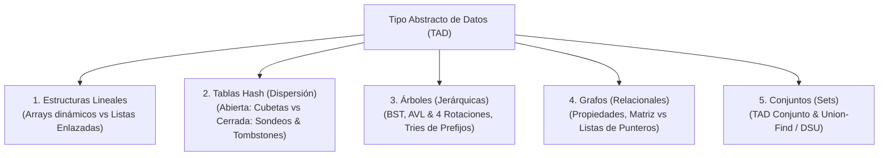
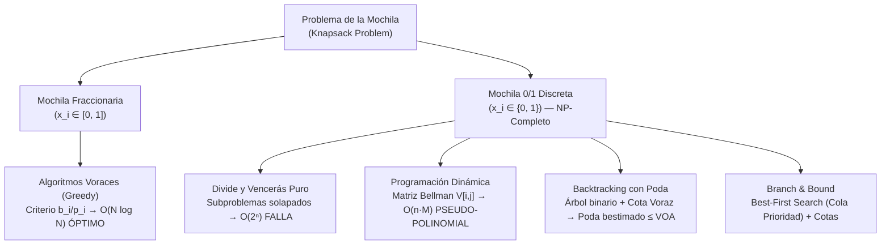
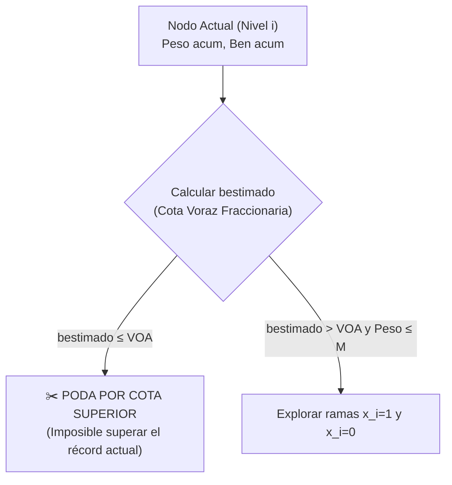

# 🧠 Capa 1: Estructuras de Datos y Algoritmia (AED1 & AED2)

Basándonos en tus notas de [[AED1]] y [[AED2]], aquí tienes el extracto de los conceptos fundamentales que sustentan el software moderno, organizados en los dos grandes bloques que has propuesto:

---

## Bloque 1: Estructuras de Datos (AED1) — Modelos de Memoria y Trade-offs

El núcleo de este bloque responde a una sola pregunta: **¿Cómo organizo la información en memoria para que acceder a ella o modificarla cueste lo mínimo posible en tiempo, espacio y ciclos de CPU?**

Las estructuras de datos se clasifican según la topología de las relaciones entre sus elementos:



### 1.1 El Fundamento: TAD vs Estructura Física
* **TAD (Tipo Abstracto de Datos):** La interfaz matemática externa (**qué hace**: operaciones como `insertar`, `buscar`, `borrar`) con ocultamiento de implementación.
* **Estructura de Datos:** La disposición física real en la memoria del computador (**cómo lo hace**: contiguo en RAM vs nodos dispersos con punteros).
* **Principio de sustitución:** El mismo TAD (ej. *Diccionario / Mapa*) puede implementarse internamente con una tabla hash, un árbol AVL, un árbol B o una lista de claves, ofreciendo contratos idénticos con rendimientos y patrones de acceso a hardware radicalmente distintos.

---

### 1.2 Estructuras Lineales: Arrays vs Listas Enlazadas (Operaciones al Detalle)

En las estructuras lineales, cada elemento (salvo el primero y el último) tiene un único predecesor y un único sucesor. Sin embargo, la disposición en memoria física cambia drásticamente el coste de cada operación.

#### A. Arrays (Estáticos y Dinámicos)
Memoria contigua en un único bloque de RAM.

* **1. Consulta (Acceso por índice o búsqueda):**
  * **Por índice `A[i]` — $O(1)$ estricto:** La dirección física se resuelve con una sola operación matemática en la ALU:
    $$\text{Dirección}(\text{A}[i]) = \text{Base} + i \times \text{sizeof}(\text{Tipo})$$
    No requiere saltos de punteros ni traversal. Además, la **localidad espacial (Capa 0)** permite que el hardware traiga una línea de caché completa (64 bytes, ~16 enteros), haciendo que las lecturas subsiguientes sean instantáneas (~1 ns).
  * **Búsqueda por valor — $O(N)$ o $O(\log N)$:** Si no está ordenado, requiere escaneo lineal $O(N)$. Si está ordenado en memoria contigua, permite **Búsqueda Binaria en $O(\log N)$** gracias al acceso indexado $O(1)$ al punto medio.
* **2. Inserción:**
  * **Al final — $O(1)$ amortizado:** Si hay capacidad reservada, se escribe en la posición libre y se incrementa el contador. Si el buffer se llena, ocurre un **realojo**: se reserva un bloque nuevo del doble de tamaño, se copian los $N$ elementos ($O(N)$) y se libera el antiguo. En promedio, cada inserción cuesta $O(1)$, pero causa picos puntuales de latencia.
  * **En cabeza o en posición intermedia $k$ — $O(N)$:** Exige desplazar físicamente todos los elementos desde la posición $k$ hasta el final una posición a la derecha (`memmove`) para abrir el hueco antes de escribir.
* **3. Borrado:**
  * **Al final — $O(1)$:** Basta con decrementar el tamaño lógico del array.
  * **En cabeza o en posición intermedia $k$ — $O(N)$:** Exige desplazar todos los elementos posteriores una posición a la izquierda para tapar el hueco y mantener la contigüidad.

#### B. Listas Enlazadas (Simples, Dobles y Circulares)
Nodos individuales dispersos en el *Heap*, conectados mediante punteros explícitos (`next`, `prev`).

* **1. Consulta:**
  * **Por índice o por valor — $O(N)$ obligatorio:** No existe aritmética de punteros. Para acceder al elemento en la posición $k$, es imprescindible partir de la cabecera (`head`) y desreferenciar punteros uno a uno ($k$ saltos en memoria). Cada salto suele provocar un **fallo de caché (cache miss)** en CPU porque los nodos residen en direcciones lejanas del Heap.
  * **No permite búsqueda binaria:** Incluso si los datos están ordenados, no se puede saltar al elemento central en $O(1)$.
* **2. Inserción:**
  * **En cabeza (`push_front`) — $O(1)$ estricto:** Se reserva el nodo nuevo, se asigna `nuevo->next = head; head = nuevo;`. Operación sin realojos ni desplazamientos de memoria.
  * **En posición intermedia con el puntero al nodo previo en mano — $O(1)$:** Solo se actualizan 2 punteros (`nuevo->next = prev->next; prev->next = nuevo;`).
  * **En posición intermedia buscando primero la posición — $O(N)$:** El coste no está en enlazar los punteros, sino en los $N$ pasos previos para llegar al punto de inserción.
* **3. Borrado:**
  * **En cabeza (`pop_front`) — $O(1)$:** `temp = head; head = head->next; free(temp);`.
  * **Con puntero al nodo en mano (en lista doble) — $O(1)$:** Se reasignan `nodo->prev->next = nodo->next` y `nodo->next->prev = nodo->prev`, liberando el nodo inmediatamente.
  * **Borrando por valor — $O(N)$:** Se debe recorrer la lista hasta localizar el elemento antes de reconectar los punteros.

| Operación | Array Contiguo | Lista Enlazada |
| :--- | :--- | :--- |
| **Acceso indexado `[i]`** | **$O(1)$** (aritmética de punteros) | **$O(N)$** (traversal nodo a nodo) |
| **Búsqueda (ordenado)** | **$O(\log N)$** (búsqueda binaria) | **$O(N)$** (secuencial) |
| **Inserción en cabeza** | $O(N)$ (desplaza todo el array) | **$O(1)$** (enlaza nuevo head) |
| **Inserción al final** | **$O(1)$ amortizado** (salvo realojo) | **$O(1)$** (con puntero `tail`) |
| **Inserción en medio** | $O(N)$ desplazamiento | **$O(1)$** (con nodo en mano) / $O(N)$ (si busca) |
| **Borrado en medio** | $O(N)$ desplazamiento | **$O(1)$** (con nodo en mano) / $O(N)$ (si busca) |
| **Sobrecarga de RAM** | Mínima (0 bytes extra por dato) | **Alta** (8–24 bytes de punteros + alineación) |
| **Amabilidad con la Caché** | **Máxima** (localidad espacial continua) | **Pésima** (saltos de memoria aleatorios en Heap) |

---

### 1.3 Tablas Hash (Dispersión): Modelos de Resolución de Colisiones

El objetivo es lograr búsqueda, inserción y borrado en tiempo medio constante **$O(1)$** proyectando una clave arbitraria $k$ a un índice de array $0 \le i < M$ mediante una función hash $h(k)$. Las colisiones ($h(k_1) = h(k_2)$) son inevitables por el principio del palomar (**teorema de Dirichlet**).

```
                           RESOLUCIÓN DE COLISIONES
                                     │
         ┌───────────────────────────┴───────────────────────────┐
         ▼                                                       ▼
  DISPERSIÓN ABIERTA                                      DISPERSIÓN CERRADA
  (Encadenamiento / Chaining)                             (Direccionamiento Abierto)
  • Celdas = punteros a listas/árboles                    • Todos los datos dentro del array
  • Crece fuera del array principal                       • Sondeos: lineal, cuadrático, doble hash
  • Tolera factor de carga α > 1                          • Exige factor de carga α < 0.7 - 0.8
  • Peor localidad de caché                               • Máxima localidad de caché
  • Borrado simple (liberar nodo)                         • Borrado exige TOMBSTONES
```

#### A. Dispersión Abierta (Encadenamiento / Separate Chaining)
* **Estructura física:** El array principal es un vector de cabeceras de cubetas (*buckets*). Cada celda contiene un puntero al inicio de una estructura secundaria (típicamente una lista enlazada simple o un árbol).
* **Inserción:** Se computa $i = h(k) \pmod M$. Si hay colisión, se crea un nodo nuevo en el *Heap* y se encadena a la lista de esa cubeta en $O(1)$.
* **Búsqueda y Borrado:** Se va a la cubeta $i$ y se recorre su lista en $O(L)$, donde $L$ es la longitud de la cadena de colisiones ($L \approx \alpha = N/M$). El borrado simplemente desengancha el nodo con `free()` sin afectar a otras cubetas.
* **Ventajas:** Tolera $\alpha > 1.0$ sin bloquearse; borrado trivial.
* **Optimización moderna (ej. Java 8+ HashMap):** Si una cubeta supera 8 elementos colisionados, transmuta la lista en un **Árbol Rojo-Negro** balanceado ($O(\log k)$ en el peor caso absoluto).

#### B. Dispersión Cerrada (Direccionamiento Abierto / Open Addressing)
* **Estructura física:** Todos los elementos residen exclusivamente dentro de las $M$ celdas del array principal. No hay punteros fuera del array.
* **Estrategias de Sondeo ante colisión:**
  1. **Sondeo Lineal ($i$):**
     $$\text{pos}_i = (h(k) + i) \pmod M$$
     *Excelente localidad espacial de caché, pero sufre de **Agrupamiento Primario**: bloques de celdas ocupadas contiguas que crecen y ralentizan todas las inserciones cercanas.*
  2. **Sondeo Cuadrático ($c_1 i + c_2 i^2$):**
     $$\text{pos}_i = (h(k) + c_1 i + c_2 i^2) \pmod M$$
     *Rompe el agrupamiento primario con saltos crecientes, pero claves con el mismo hash inicial siguen idéntica secuencia (**Agrupamiento Secundario**).*
  3. **Dispersión Doble (Double Hashing):**
     $$\text{pos}_i = (h_1(k) + i \times h_2(k)) \pmod M$$
     *Usa un segundo hash $h_2(k) \neq 0$ como tamaño de paso. Elimina agrupamientos primarios y secundarios.*
* **El mecanismo indispensable: Tombstones (Marcas de borrado 🪦):**
  * Si claves colisionadas ocupan celdas continuas (`ana` en [2], `sol` en [3], `mar` en [4]) y se borra `sol` vaciando la celda [3], la búsqueda de `mar` se detendrá en [3] al ver una celda vacía y retornará erróneamente que no existe (**falso negativo**).
  * **Solución:** La celda se marca con el centinela **TOMBSTONE**. La búsqueda sigue avanzando al ver el tombstone, mientras que la inserción puede reutilizar esa celda vaciada.
* **Factor de Carga ($\alpha = N / M$) y Rehash:** Exige $\alpha < 0.7 - 0.8$. Al superarlo, se dispara el **Rehash ($O(N)$)**: se reserva un array del doble de tamaño y se reubican todas las claves vivas, eliminando los tombstones acumulados.

---

### 1.4 Árboles (Estructuras Jerárquicas): BST, AVL (y sus 4 Rotaciones) y Tries

#### A. Árboles Binarios de Búsqueda (BST) y Árboles Balanceados (AVL)
Un BST mantiene el orden de las claves: todo nodo a la izquierda es menor y todo nodo a la derecha es mayor. Si se insertan datos ya ordenados (1, 2, 3, 4, 5), la altura degenera a $h = N$, convirtiéndose en una lista enlazada $O(N)$.

El **Árbol AVL** es un árbol binario de búsqueda auto-balanceado que garantiza que la altura nunca supere $h \approx 1.44 \log_2 N$.
* **Factor de Equilibrio (FE):**
  $$\text{FE}(\text{nodo}) = \text{altura}(\text{subárbol\_derecho}) - \text{altura}(\text{subárbol\_izquierdo}) \in \{-1, 0, +1\}$$

#### Proceso de Inserción y las 4 Rotaciones en un AVL
Al insertar un nodo siguiendo las reglas del BST (en $O(\log N)$), se actualizan las alturas hacia la raíz. Si un nodo alcanza $\text{FE} = \pm 2$, se produce un desbalance que se corrige de inmediato mediante una de las **4 rotaciones canónicas en tiempo constante $O(1)$**:

##### 1. Rotación Simple a la Derecha (RSD) — Caso Izquierda-Izquierda (II)
Ocurre cuando se inserta en el subárbol izquierdo del hijo izquierdo ($\text{FE}(\text{nodo}) = -2$ y $\text{FE}(\text{hijo\_izq}) \le 0$).

```
        Desbalanceado:                   Balanceado (RSD):
             (C) [-2]                           (B) [0]
             /   \                              /     \
         (B) [-1]  T3        ──────►        (A)         (C)
         /   \                              / \         / \
       (A)    T2                           T0  T1      T2  T3
       / \
      T0  T1
```
*Mecanismo:* El nodo `(B)` asciende a la raíz; `(C)` baja a ser su hijo derecho; el subárbol `T2` pasa a ser el hijo izquierdo de `(C)`.

##### 2. Rotación Simple a la Izquierda (RSI) — Caso Derecha-Derecha (DD)
Ocurre cuando se inserta en el subárbol derecho del hijo derecho ($\text{FE}(\text{nodo}) = +2$ y $\text{FE}(\text{hijo\_der}) \ge 0$).

```
        Desbalanceado:                   Balanceado (RSI):
             (A) [+2]                           (B) [0]
             /   \                              /     \
           T0    (B) [+1]    ──────►        (A)         (C)
                 /   \                      / \         / \
                T1   (C)                   T0  T1      T2  T3
                     / \
                    T2  T3
```
*Mecanismo:* El nodo `(B)` asciende a la raíz; `(A)` baja a ser su hijo izquierdo; el subárbol `T1` pasa a ser el hijo derecho de `(A)`.

##### 3. Rotación Doble Izquierda-Derecha (RDID) — Caso Izquierda-Derecha (ID)
Ocurre cuando se inserta en el subárbol derecho del hijo izquierdo ($\text{FE}(\text{nodo}) = -2$ y $\text{FE}(\text{hijo\_izq}) = +1$). El desbalance forma una forma en "zig-zag".

```
     Desbalanceado:            Paso 1: RSI en hijo (B)      Paso 2: RSD en raíz (C)
          (C) [-2]                     (C) [-2]                     (X) [0]
          /   \                        /   \                        /     \
      (B) [+1] T3       ──────►      (X)    T3       ──────►     (B)       (C)
      /   \                          / \                         / \       / \
     T0   (X)                      (B)  T2                      T0  T1    T2  T3
          / \                      / \
         T1  T2                   T0  T1
```
*Mecanismo:* Se aplica una rotación simple izquierda sobre el hijo `(B)` para alinear la rama, y luego una rotación simple derecha sobre la raíz `(C)`. El nodo interior `(X)` asciende como nueva raíz.

##### 4. Rotación Doble Derecha-Izquierda (RDDI) — Caso Derecha-Izquierda (DI)
Ocurre cuando se inserta en el subárbol izquierdo del hijo derecho ($\text{FE}(\text{nodo}) = +2$ y $\text{FE}(\text{hijo\_der}) = -1$).

```
     Desbalanceado:            Paso 1: RSD en hijo (C)      Paso 2: RSI en raíz (A)
          (A) [+2]                     (A) [+2]                     (X) [0]
          /   \                        /   \                        /     \
         T0   (C) [-1]  ──────►       T0   (X)       ──────►     (A)       (C)
              /   \                        / \                   / \       / \
            (X)    T3                     T1  (C)               T0  T1    T2  T3
            / \                               / \
           T1  T2                            T2  T3
```
*Mecanismo:* Se aplica una rotación simple derecha sobre el hijo `(C)` y luego una rotación simple izquierda sobre la raíz `(A)`.

#### B. Árboles Trie (Árboles de Prefijos)
Estructura de búsqueda por caracteres donde las claves que comparten prefijos comparten los mismos nodos.

* **Ejemplo horizontal de prefijos compartidos:**

```
                  (raíz)
                  ├── m ── a ── r [✓ "mar"]
                  │             ├── e ── a [✓ "marea"]
                  │             └── i ── n ── o [✓ "marino"]
                  └── s ── o ── l [✓ "sol"]
                                └── a ── r [✓ "solar"]
```
* **Propiedad asintótica diferencial:** La búsqueda e inserción cuestan **$O(L)$** ($L$ = longitud de la palabra), independientemente de que existan 1.000 o 1.000.000.000 de palabras ($N$). Ideal para autocompletado, correctores y enrutamiento CIDR IP.

---

### 1.5 Grafos: Propiedades Fundamentales y Modelos de Memoria

Un grafo $G = (V, E)$ es una estructura relacional no lineal formada por un conjunto de vértices o nodos $V$ y un conjunto de aristas o arcos $E$.

#### A. Propiedades Matemáticas y Topológicas de los Grafos
1. **Dirigido (Dígrafo) vs No Dirigido:**
   * En un dígrafo, cada arista es un par ordenado $(u, v)$ con dirección fija ($u \to v$).
   * En uno no dirigido, la arista $\{u, v\}$ es bidireccional: la existencia de $(u, v)$ implica $(v, u)$.
2. **Ponderado vs No Ponderado:**
   * No ponderado: cada arista representa una simple adyacencia booleana (0 o 1).
   * Ponderado: cada arista posee un coste o peso asociado $w(u, v) \in \mathbb{R}$ (latencia de red, distancia física, capacidad de flujo).
3. **Cíclico vs Acíclico (DAG):**
   * Cíclico: contiene al menos un camino cerrado de longitud $\ge 3$ donde el vértice de inicio coincide con el de fin.
   * Acíclico: no existen ciclos. Un **Grafo Acíclico Dirigido (DAG)** es la estructura matemática estándar para modelar dependencias de compilación, flujos de trabajo (*pipelines*) y orquestación de agentes.
4. **Conectividad:**
   * Grafo no dirigido: es **conexo** si existe al menos un camino entre cualquier par de vértices. Si no, se divide en **componentes conexas**.
   * Grafo dirigido: es **fuertemente conexo** (SCC) si existe camino dirigido en ambos sentidos entre cualquier par de nodos ($u \rightsquigarrow v$ y $v \rightsquigarrow u$).
5. **Densidad del Grafo:**
   * **Denso:** El número de aristas es cercano al máximo teórico: $E \approx V^2$.
   * **Disperso (Sparse):** El número de aristas es lineal con los vértices: $E \approx O(V)$ o $E \ll V^2$. La inmensa mayoría de grafos reales (redes sociales, mapas viales, hiperenlaces web) son dispersos.
6. **Grado de un Vértice ($d(v)$):** En no dirigidos, número de aristas incidentes. En dirigidos se divide en **grado entrante** ($d^-(v)$, aristas que llegan) y **grado saliente** ($d^+(v)$, aristas que parten).

#### B. Grafo Canónico de Ejemplo (4 Vértices Ponderados)

```
        (2)
   [0] ─────── [1]
    │           │
 (6)│           │(3)
    │           │
   [2] ─────── [3]
        (4)
```

#### C. Representación en Memoria: Matriz vs Listas de Punteros

* **1. Matriz de Adyacencia ($V \times V$):** Array bidimensional contiguo en RAM.
  ```
       u \ v :   [0]   [1]   [2]   [3]
       ───────────────────────────────
       [0]   :    0     2     6     0
       [1]   :    2     0     0     3
       [2]   :    6     0     0     4
       [3]   :    0     3     4     0
  ```
  * Espacio fijo: **$O(V^2)$**. Consulta de arista $(u, v)$: **$O(1)$**. Iterar vecinos: **$O(V)$**.
  * Ideal para: Grafos densos, matrices de adyacencia procesadas en paralelo en GPU / SIMD.

* **2. Listas de Adyacencia (Array de Cabeceras + Punteros):** Array de tamaño $V$ donde cada posición apunta a una lista enlazada o vector dinámico de aristas salientes:
  ```
     adj[0] ──► (v:1, w:2) ──► (v:2, w:6) ──► null
     adj[1] ──► (v:0, w:2) ──► (v:3, w:3) ──► null
     adj[2] ──► (v:0, w:6) ──► (v:3, w:4) ──► null
     adj[3] ──► (v:1, w:3) ──► (v:2, w:4) ──► null
  ```
  * Espacio: **$O(V + E)$**. Iterar vecinos de $u$: exactamente **$O(\text{grado}(u))$**. Consulta de arista: $O(\text{grado}(u))$.
  * Ideal para: Grafos dispersos del mundo real.

---

### 1.6 Conjuntos (Sets): TAD Conjunto y Union-Find (DSU)

El TAD **Conjunto (Set)** modela una colección de elementos únicos sin orden intrínseco.
* **Operaciones estándar:** `insertar(x)`, `eliminar(x)`, `pertenece(x)`.
* **Implementaciones según contrato:**
  * **HashSet:** Basado en tablas hash. Consultas y modificaciones en **$O(1)$ medio**. No garantiza ningún orden en el recorrido.
  * **TreeSet / Conjunto Ordenado:** Basado en árboles Rojo-Negro o AVL. Operaciones en **$O(\log N)$**. Mantiene los elementos siempre ordenados y permite consultas por rango (*"dame todos los elementos entre X e Y"*).

#### Conjuntos Disjuntos: Union-Find (Disjoint Set Union - DSU)
Estructura especializada diseñada para mantener una partición de un universo de elementos en **conjuntos mutuamente disjuntos** (ningún elemento pertenece a dos conjuntos a la vez).

* **Operaciones del DSU:**
  1. `find(x)`: Determina a qué conjunto pertenece $x$, retornando el representante o raíz del conjunto.
  2. `union(x, y)`: Fusiona los conjuntos que contienen a $x$ y a $y$ en un único conjunto.
* **Disposición física en memoria:** Un simple array plano de enteros `parent[N]`, donde `parent[i] == i` indica que el nodo $i$ es la raíz de su conjunto.
* **Las 2 optimizaciones clave:**
  1. **Unión por Rango:** El árbol con menor profundidad siempre se cuelga bajo la raíz del árbol de mayor profundidad para evitar que la altura crezca linealmente.
  2. **Compresión de Caminos (Path Compression):** Al ejecutar `find(x)`, todos los nodos atravesados en la subida hacia la raíz reasignan su puntero padre directamente a la raíz definitiva:
     ```cpp
     int find(int x) {
       return (parent[x] == x) ? x : (parent[x] = find(parent[x]));
     }
     ```
* **Complejidad Asintótica:** Amortizada en **$O(\alpha(N))$** por operación, donde $\alpha(N)$ es la inversa de Ackermann ($\alpha(N) < 5$ para todo $N \le 10^{80}$). Esencialmente **tiempo constante $O(1)$**.
* **Aplicaciones:** Motor del algoritmo de **Kruskal** para el Árbol de Expansión Mínimo (MST) y detección instantánea de ciclos al agregar aristas en grafos no dirigidos.

---

### 1.7 Recorridos y Algoritmia Fundamental de Grafos

Toda la algoritmia de grafos se construye sobre dos estrategias de exploración sistemática:

```
                               RECORRIDOS DE GRAFOS
                                        │
           ┌────────────────────────────┴────────────────────────────┐
           ▼                                                         ▼
     DFS (Depth-First Search)                                  BFS (Breadth-First Search)
     • Estructura: PILA (LIFO) / Recursión                     • Estructura: COLA (FIFO)
     • Explora una rama hasta el fondo antes de volver         • Explora concéntricamente por "olas" o niveles
     • Complejidad: O(V + E)                                   • Complejidad: O(V + E)
     • Detecta ciclos, puentes y orden topológico              • Encuentra caminos mínimos en grafos sin pesos
```

#### Traza Paso a Paso: ¿Cómo se comportan en el grafo de ejemplo?
Partiendo del nodo **0**:
* **BFS (Cola FIFO):**
  1. Encola `0`. Visitados: `{0}`.
  2. Desencola `0`, examina vecinos: encola `1` y `2`. Cola: `[1, 2]`.
  3. Desencola `1`, examina vecinos: encola `3`. Cola: `[2, 3]`.
  4. Desencola `2`, vecinos ya visitados. Cola: `[3]`.
  5. Desencola `3`, fin.
  * **Orden de visita:** `0 → 1 → 2 → 3`. Garantiza el camino más corto en número de saltos.
* **DFS (Pila LIFO / Recursión):**
  1. Empieza en `0`, avanza al primer vecino: `1`.
  2. Desde `1`, avanza al siguiente vecino no visitado: `3`.
  3. Desde `3`, avanza al vecino no visitado: `2`.
  4. Desde `2`, todos los vecinos (`0`, `3`) están visitados: retrocede (*backtracking*).
  * **Orden de visita:** `0 → 1 → 3 → 2`. Explora en profundidad máxima antes de retroceder.

#### El Ecosistema de Algoritmos Canónicos sobre Grafos

| Algoritmo | Paradigma | Estructura Clave | Complejidad | Propósito Central |
| :--- | :--- | :--- | :--- | :--- |
| **Dijkstra** | Voraz (Greedy) | Min-Heap / Cola Prioridad | $O((V + E) \log V)$ | Camino mínimo con pesos no negativos desde un origen |
| **Bellman-Ford** | Prog. Dinámica | Relajación de aristas | $O(V \times E)$ | Camino mínimo con pesos negativos y detección de ciclos negativos |
| **Prim** | Voraz (Greedy) | Min-Heap | $O(E \log V)$ | Árbol de Expansión Mínimo (MST), óptimo para grafos densos |
| **Kruskal** | Voraz (Greedy) | Union-Find (DSU) + Sort | $O(E \log E)$ | Árbol de Expansión Mínimo (MST), óptimo para grafos dispersos |
| **Kahn / Tarjan** | DFS / Grado entrante | Pila / Cola | $O(V + E)$ | Ordenación Topológica en DAGs (resolución de dependencias y builds) |

---

---

## Bloque 2: Algoritmos y Complejidad (AED2) — Paradigmas de Resolución

En este bloque la clave no es la disposición física de la memoria, sino la **estrategia lógica de ataque** para resolver un problema de optimización o búsqueda de forma matemáticamente probada y computacionalmente eficiente.

Tomando como referencia canónica la metodología de **Aho** y el temario de **AED2 (Universidad de Murcia)**, el diseño de soluciones sigue un flujo formal riguroso:
$$\text{Modelo matemático} \longrightarrow \text{Algoritmo informal} \longrightarrow \text{TAD} \longrightarrow \text{Pseudolenguaje} \longrightarrow \text{Estructuras de datos} \longrightarrow \text{Código final}$$

Para comprender en profundidad las fortalezas, fallos y trade-offs de cada paradigma, utilizaremos un **vehículo conceptual unificador**: el **Problema de la Mochila (Knapsack Problem)** en sus variantes continua ($x_i \in [0, 1]$) y discreta ($x_i \in \{0, 1\}$).



---

### 2.1 El Lenguaje de la Eficiencia: Notación Asintótica y Ecuaciones de Recurrencia

El análisis *a priori* (teórico) evalúa el crecimiento del consumo de recursos (tiempo $t(n)$ e instrucciones ejecutadas, o memoria consumida) en función del tamaño de la entrada $n$.

#### La Familia Completa de Notaciones Asintóticas ($O$, $\Omega$, $\Theta$, $o$, $\omega$)

Para clasificar rigurosamente el comportamiento de un algoritmo cuando $n \to \infty$, la ciencia de la computación define cinco operadores fundamentales. Mientras que Big-$O$ y Big-$\Omega$ actúan como cotas "débiles" (admiten igualdad de ritmo), **Little-$o$** y **Little-$\omega$** actúan como cotas "estrictas":

```
                  LA FAMILIA COMPLETA DE COTAS ASINTÓTICAS
  ┌───────────────┬───────────────┬───────────────────────────────┬──────────────┐
  │ Notación      │ Relación      │ Definición de Límite (n → ∞)  │ Significado  │
  ├───────────────┼───────────────┼───────────────────────────────┼──────────────┤
  │ Big-O: O(g)   │ f(n) ≤ g(n)   │ lim [f(n) / g(n)] < ∞         │ Cota superior│
  │ Big-Ω: Ω(g)   │ f(n) ≥ g(n)   │ lim [f(n) / g(n)] > 0         │ Cota inferior│
  │ Big-Θ: Θ(g)   │ f(n) = g(n)   │ lim [f(n) / g(n)] = k ∈ (0,∞) │ Orden exacto │
  │ Little-o: o(g)│ f(n) < g(n)   │ lim [f(n) / g(n)] = 0         │ Cota estricta│
  │ Little-ω: ω(g)│ f(n) > g(n)   │ lim [f(n) / g(n)] = ∞         │ Cota estricta│
  └───────────────┴───────────────┴───────────────────────────────┴──────────────┘
```

##### 1. Definiciones Formales con Cuantificadores
* **$O(g(n))$ (Cota superior débil):**
  $$O(g(n)) = \big\{ f(n) \mid \exists c > 0, n_0 > 0 \text{ tal que } 0 \le f(n) \le c \cdot g(n), \; \forall n \ge n_0 \big\}$$
  *Indica que $f(n)$ no crece más rápido que $g(n)$. Admite cotas holgadas (ej. $n^2 \in O(n^3)$).*

* **$\Omega(g(n))$ (Cota inferior débil):**
  $$\Omega(g(n)) = \big\{ f(n) \mid \exists c > 0, n_0 > 0 \text{ tal que } 0 \le c \cdot g(n) \le f(n), \; \forall n \ge n_0 \big\}$$
  *Indica que $f(n)$ crece al menos tan rápido como $g(n)$.*

* **$\Theta(g(n))$ (Cota ajustada / Orden exacto):**
  $$\Theta(g(n)) = O(g(n)) \cap \Omega(g(n)) = \big\{ f(n) \mid \exists c_1, c_2 > 0, n_0 > 0 \text{ tales que } c_1 g(n) \le f(n) \le c_2 g(n), \; \forall n \ge n_0 \big\}$$
  *Atrapa a la función en un "sándwich" constante. Es la notación más informativa y deseada.*

* **$o(g(n))$ (Little-$o$ / Cota superior estricta):**
  $$o(g(n)) = \big\{ f(n) \mid \forall c > 0, \exists n_0 > 0 \text{ tal que } 0 \le f(n) < c \cdot g(n), \; \forall n \ge n_0 \big\}$$
  *Nótese la diferencia capital frente a Big-$O$: la desigualdad se cumple **para toda constante** $c > 0$ por diminuta que sea ($c = 0.0001$). Significa que $f(n)$ se vuelve **insignificante** comparada con $g(n)$ a medida que $n$ crece.*
  $$\lim_{n \to \infty} \frac{f(n)}{g(n)} = 0$$

* **$\omega(g(n))$ (Little-$\omega$ / Cota inferior estricta):**
  $$\omega(g(n)) = \big\{ f(n) \mid \forall c > 0, \exists n_0 > 0 \text{ tal que } 0 \le c \cdot g(n) < f(n), \; \forall n \ge n_0 \big\}$$
  $$\lim_{n \to \infty} \frac{f(n)}{g(n)} = \infty$$
  *Propiedad de simetría traspuesta:* $f(n) \in o(g(n)) \iff g(n) \in \omega(f(n))$.

---

##### 2. Caso de Estudio Completo: Comparación de Todas las Cotas para $f(n) = 3n^2 + 5n + 10$

Para entender cómo operan los límites y las envolventes, evaluemos la función cuadrática $f(n) = 3n^2 + 5n + 10$ frente a distintas funciones de referencia $g(n)$:

```
Gráfica Conceptual de Envolventes y Cotas:
Coste ↑
      │                                       / g(n) = n³ [o(n³): Se dispara a ∞]
      │                                      /
      │                                /---- c₂·n² = 4n² [O(n²): Techo cuadrático]
      │                         /-----*----- f(n) = 3n² + 5n + 10 [Θ(n²): Real]
      │                  /-----/----- c₁·n² = 3n² [Ω(n²): Suelo cuadrático]
      │           /-----/
      │     /----/                      /--- g(n) = n [ω(n): Se queda abajo]
      │    / |                         /
      └───┴──┼───────────────────────────────→ n
          0  n₀ (Umbral asintótico)
```

1. **Frente a $g(n) = n^2$ (Mismo orden polinómico):**
   $$\lim_{n \to \infty} \frac{3n^2 + 5n + 10}{n^2} = \lim_{n \to \infty} \left( 3 + \frac{5}{n} + \frac{10}{n^2} \right) = 3$$
   * Como el límite es una constante finita estrictamente mayor que cero ($k = 3 \in (0, \infty)$):
     - $\mathbf{f(n) \in \Theta(n^2)}$ (Cota ajustada perfecta).
     - $\mathbf{f(n) \in O(n^2)}$ (con $c = 4$ y $n_0 = 7$: $3n^2 + 5n + 10 \le 4n^2$).
     - $\mathbf{f(n) \in \Omega(n^2)}$ (con $c = 3$ y $n_0 = 1$: $3n^2 \le 3n^2 + 5n + 10$).
     - **¡$f(n) \notin o(n^2)$!** Falla porque el límite es $3 \neq 0$. Big-$O$ permite $3n^2 \in O(n^2)$, pero Little-$o$ lo prohíbe categóricamente porque sus ritmos son idénticos.
     - **¡$f(n) \notin \omega(n^2)$!** Falla porque el límite es $3 \neq \infty$.

2. **Frente a $g(n) = n^3$ (Orden superior):**
   $$\lim_{n \to \infty} \frac{3n^2 + 5n + 10}{n^3} = \lim_{n \to \infty} \left( \frac{3}{n} + \frac{5}{n^2} + \frac{10}{n^3} \right) = 0$$
   * Como el límite es exactamente **0**:
     - $\mathbf{f(n) \in o(n^3)}$ (**Cota superior estricta cumplida**).
     - $\mathbf{f(n) \in O(n^3)}$ (Cota superior válida, aunque holgada).
     - $f(n) \notin \Theta(n^3)$ y $f(n) \notin \Omega(n^3)$.

3. **Frente a $g(n) = n$ (Orden inferior):**
   $$\lim_{n \to \infty} \frac{3n^2 + 5n + 10}{n} = \lim_{n \to \infty} \left( 3n + 5 + \frac{10}{n} \right) = \infty$$
   * Como el límite diverge a **$\infty$**:
     - $\mathbf{f(n) \in \omega(n)}$ (**Cota inferior estricta cumplida**).
     - $\mathbf{f(n) \in \Omega(n)}$ (Cota inferior válida, aunque holgada).
     - $f(n) \notin \Theta(n)$ y $f(n) \notin O(n)$.

> [!TIP]
> **Regla nemotécnica para entrevistas técnicas:**
> Piensa en las notaciones asintóticas como comparadores numéricos entre funciones:
> * $f \in O(g) \iff f \le g$
> * $f \in \Omega(g) \iff f \ge g$
> * $f \in \Theta(g) \iff f = g$
> * $f \in o(g) \iff f < g$ *(estrictamente más rápido el divisor)*
> * $f \in \omega(g) \iff f > g$ *(estrictamente más rápido el dividendo)*

#### Ecuaciones de Recurrencia: División ($n/d$) vs. Sustracción ($n-c$)
Los algoritmos recursivos reducen progresivamente el tamaño del problema. La naturaleza matemática de esa reducción dicta si el algoritmo es escalable o si colapsa exponencialmente:

1. **Recurrencia por División ($n/b$):**
   $$T(n) = a \, T(n/b) + f(n)$$
   El tamaño del problema se fracciona a la mitad o en $b$ partes. La altura del árbol de llamadas recursivas es **logarítmica** ($\log_b n$).
   * *Ejemplo:* MergeSort ($T(n) = 2T(n/2) + O(n) \implies O(n \log n)$).

2. **Recurrencia por Sustracción ($n-c$):**
   $$T(n) = a \, T(n-c) + f(n)$$
   El tamaño del problema se reduce en una constante fija ($c$). La altura del árbol de recursión es **lineal** ($n/c$). Si hay $a \ge 2$ llamadas recursivas por nivel, el número de hojas es **$a^{n/c}$**, produciendo una **explosión combinatoria exponencial**:
   $$T(n) = 2T(n-1) + O(1) \implies O(2^n)$$
   *Este es el destino fatídico si intentas resolver la Mochila 0/1 o Fibonacci con recursión ingenua sin reutilización de estados.*

#### El Teorema Maestro
Permite resolver de forma inmediata recurrencias por división $T(n) = a \, T(n/b) + f(n)$ comparando el peso asintótico de las hojas del árbol ($n^{\log_b a}$) con el coste de dividir y combinar en la raíz ($f(n)$):

| Caso | Condición Matemática | Complejidad Resultante | Dominancia | Ejemplo Canónico |
| :--- | :--- | :--- | :--- | :--- |
| **Caso 1** | $f(n) = O(n^{\log_b a - \epsilon})$ para $\epsilon > 0$ | $T(n) = \Theta(n^{\log_b a})$ | Dominan las **hojas** (división) | Multiplicación de Strassen ($a=7, b=2, f(n)=O(n^2) \implies O(n^{2.807})$) |
| **Caso 2** | $f(n) = \Theta(n^{\log_b a} \log^k n)$ con $k \ge 0$ | $T(n) = \Theta(n^{\log_b a} \log^{k+1} n)$ | **Equilibrio** hojas/combinación | MergeSort ($a=2, b=2, k=0 \implies \Theta(n \log n)$) |
| **Caso 3** | $f(n) = \Omega(n^{\log_b a + \epsilon})$ y $a f(n/b) \le c f(n)$ | $T(n) = \Theta(f(n))$ | Domina la **raíz** (combinación) | Algoritmos con partición pesada y pocas llamadas |

---

### 2.2 Taxonomía del Problema de la Mochila y la Falla de Divide y Vencerás

Dados $n$ objetos, donde cada objeto $i$ posee un beneficio $b_i > 0$ y un peso $p_i > 0$, y una mochila con capacidad máxima de carga $M$:
$$\text{Maximizar } \sum_{i=1}^n b_i x_i \quad \text{sujeto a} \quad \sum_{i=1}^n p_i x_i \le M$$

#### Las Dos Variantes Fundamentales
1. **Problema de la Mochila Fraccionaria:** $x_i \in [0, 1]$. Se permite partir objetos y tomar fracciones continuas. El espacio de soluciones es un politopo convexo navegable en **tiempo polinomial**.
2. **Problema de la Mochila 0/1:** $x_i \in \{0, 1\}$. Restricción de integridad: el objeto se toma íntegro o se descarta. Esta restricción convierte el problema en **NP-Completo**.

> [!NOTE]
> **La Capa del "The So What?":** Al pasar de variables continuas ($[0, 1]$) a discretas ($\{0, 1\}$), el espacio de búsqueda deja de ser una superficie suave optimizable por derivadas o reglas lineales simples y pasa a ser un conjunto discreto de $2^n$ combinaciones posibles.

#### ¿Por qué Divide y Vencerás Puro Fracasa en la Mochila 0/1?
El esquema clásico de Divide y Vencerás exige descomponer el problema en subproblemas **estrictamente disjuntos** (como ordenar la mitad izquierda y la mitad derecha en QuickSort/MergeSort).

Si intentáramos plantear la Mochila 0/1 ramificando recursivamente la decisión del objeto $n$:
$$\text{Mochila}(n, M) = \max\Big(\text{Mochila}(n-1, M), \; b_n + \text{Mochila}(n-1, M - p_n)\Big)$$

Los subproblemas resultantes **no son disjuntos, sino masivamente superpuestos**: ramas independientes en el árbol evaluarán repetidamente la misma tupla $(i, \text{capacidad restante } c)$. Al ser una recurrencia por sustracción ($n-1$), el árbol genera $2^n$ llamadas, recalculando los mismos estados miles de veces. Divide y Vencerás sin persistencia de estados colapsa en $O(2^n)$.

#### 2.2.1 El Paradigma en Acción: Ordenación por Divide y Vencerás (MergeSort vs. QuickSort)

Donde el paradigma Divide y Vencerás brilla con máximo esplendor es en la **ordenación eficiente**, donde los subproblemas sí son **estrictamente disjuntos**. Los dos algoritmos canónicos representan las dos caras opuestas del paradigma: **dónde se paga el trabajo computacional**:

```
                       DIVIDE Y VENCERÁS EN ORDENACIÓN
   ┌───────────────────────────────────┬───────────────────────────────────┐
   │             MERGESORT             │             QUICKSORT             │
   ├───────────────────────────────────┼───────────────────────────────────┤
   │ 1. Dividir: TRIVIAL O(1)          │ 1. Dividir (Partición): PESADA O(N)│
   │    (Punto medio m = (p+q)/2)      │    (Clasificar según pivote)      │
   │ 2. Vencer: 2 llamadas recursivas  │ 2. Vencer: 2 llamadas recursivas  │
   │ 3. Combinar: PESADA O(N)          │ 3. Combinar: ¡GRATIS! O(1)        │
   │    (Fusión con 2 punteros en RAM) │    (El array ya está in-place)    │
   └───────────────────────────────────┴───────────────────────────────────┘
```

---

#### A) MergeSort: Fusión Ordenada (John von Neumann, 1945)

* **Estrategia:** Divide el array exactamente a la mitad sin mirar su contenido ($O(1)$), ordena recursivamente ambas mitades y realiza todo el trabajo pesado en la fase de **Combinar (Merge)**.

```cpp
void mergeSort(std::vector<int>& A, int p, int q) {
  if (p >= q) return; // Caso base: tamaño 0 ó 1 (ya ordenado)
  int m = p + (q - p) / 2; // Dividir: O(1)
  mergeSort(A, p, m);     // Vencer subproblema izquierdo
  mergeSort(A, m + 1, q); // Vencer subproblema derecho
  combinar(A, p, m, q);   // Combinar: O(N) con dos punteros
}
```

##### Traza Paso a Paso sobre $A = [38, 27, 43, 3, 9, 82, 10]$ ($N = 7$):
1. **Fase de Descomposición (Hacia abajo en el árbol):**
   - Nivel 0: $[38, 27, 43, 3, 9, 82, 10]$ se divide en punto medio $m=3$:
     - Mitad izquierda: $[38, 27, 43, 3]$
     - Mitad derecha: $[9, 82, 10]$
   - Nivel 1:
     - $[38, 27, 43, 3] \to [38, 27]$ y $[43, 3]$
     - $[9, 82, 10] \to [9, 82]$ y $[10]$
   - Nivel 2 (Casos base de tamaño 1): $[38], [27], [43], [3], [9], [82], [10]$.
2. **Fase de Combinación / Fusión (Hacia arriba en el árbol):**
   - Se fusiona $[38]$ con $[27]$: compara $38$ y $27 \implies [27, 38]$.
   - Se fusiona $[43]$ con $[3]$: compara $43$ y $3 \implies [3, 43]$.
   - Se fusionan $[27, 38]$ y $[3, 43]$ con dos punteros:
     - Puntero $i$ en $27$, puntero $j$ en $3 \implies$ Menor: $3$.
     - Puntero $i$ en $27$, puntero $j$ en $43 \implies$ Menor: $27$.
     - Puntero $i$ en $38$, puntero $j$ en $43 \implies$ Menor: $38$.
     - Queda resto: $43 \implies$ Resultado sublista izquierda: $\mathbf{[3, 27, 38, 43]}$.
   - Análogamente, la mitad derecha fusiona $[9, 82]$ con $[10] \implies \mathbf{[9, 10, 82]}$.
   - **Fusión final:** Dos punteros sobre $[3, 27, 38, 43]$ y $[9, 10, 82]$:
     - Compara $3$ y $9 \to 3$
     - Compara $27$ y $9 \to 9$
     - Compara $27$ y $10 \to 10$
     - Compara $27$ y $82 \to 27$
     - Compara $38$ y $82 \to 38$
     - Compara $43$ y $82 \to 43$
     - Vuelca $82 \to$ Array final: $\mathbf{[3, 9, 10, 27, 38, 43, 82]}$.

* **Recurrencia:** $T(n) = 2T(n/2) + O(n) \implies \mathbf{\Theta(N \log N)}$ en **todos los casos** (mejor, peor y promedio).
* **Trade-off:** Es un algoritmo **estable** (no altera el orden relativo de elementos con claves duplicadas), pero requiere un buffer de memoria auxiliar de tamaño **$O(N)$** para la fusión.

---

#### B) QuickSort: Partición In-Place (Tony Hoare, 1959)

* **Estrategia:** Realiza el trabajo pesado en la fase de **Dividir** mediante el procedimiento de **Partición**. Elige un elemento pivote y reorganiza los datos directamente en el array para que todos los elementos menores al pivote queden a su izquierda y los mayores a su derecha.
* Como el pivote queda en su posición definitiva y las dos mitades están separadas espacialmente, la fase de **Combinar es $O(1)$ (gratis)**.

```cpp
void quickSort(std::vector<int>& A, int p, int q) {
  if (p >= q) return; // Caso base
  int s = particionLomuto(A, p, q); // Dividir pesada: O(N)
  quickSort(A, p, s - 1);           // Subproblema izquierdo
  quickSort(A, s + 1, q);           // Subproblema derecho
  // Combinar: O(1) (no hace falta hacer nada, ya está in-place)
}
```

##### Traza Paso a Paso sobre $A = [38, 27, 43, 3, 9, 82, 10]$ con Partición de Lomuto:
1. **Elección del Pivote:** Tomamos el último elemento como pivote: $\mathbf{pivote = 10}$ en el rango $[0 .. 6]$.
2. **Barrido de Partición ($O(N)$):**
   - Punteros exploran el array. Cada vez que encontramos un elemento $< 10$, lo intercambiamos al frente:
     - $38 > 10$ (no se mueve).
     - $27 > 10$ (no se mueve).
     - $43 > 10$ (no se mueve).
     - $3 < 10 \implies$ Intercambia con $A[0]$ (38): array pasa a $[3, 27, 43, 38, 9, 82, 10]$.
     - $9 < 10 \implies$ Intercambia con $A[1]$ (27): array pasa a $[3, 9, 43, 38, 27, 82, 10]$.
     - $82 > 10$ (no se mueve).
3. **Colocación Definitiva del Pivote:**
   - Se intercambia el pivote ($10$) con el primer elemento de los mayores ($A[2] = 43$):
     $$\text{Array resultante: } [\underbrace{3, \; 9}_{\text{menores}}, \; \mathbf{\underline{10}}, \; \underbrace{38, \; 27, \; 82, \; 43}_{\text{mayores}}]$$
   - **¡El valor 10 ha alcanzado su posición final absoluta $A[2]$ para siempre!**
4. **Llamadas Recursivas In-Place:**
   - `quickSort(A, 0, 1)` sobre $[3, 9] \implies$ queda $[3, 9]$.
   - `quickSort(A, 3, 6)` sobre $[38, 27, 82, 43] \implies$ elige $43$ de pivote, particiona en $[38, 27]$ y $[82]$, y ordena a $[27, 38, 43, 82]$.
5. **Resultado Final:** $[3, 9, 10, 27, 38, 43, 82]$ in-place sin reservar un solo byte auxiliar.

* **El Dilema del Pivote:**
  - **Caso Promedio / Mejor Caso (Pivote centrado):** $T(n) = 2T(n/2) + O(n) \implies \mathbf{O(N \log N)}$.
  - **Peor Caso (Pivote pésimo, array ya ordenado con pivote extremo):** $T(n) = T(n-1) + O(n) \implies \mathbf{O(N^2)}$.
  - **Solución Industrial:** Elegir pivote aleatorio o **mediana de tres** ($\text{mediana}(A[p], A[\text{centro}], A[q])$). Si la recursión se vuelve muy profunda, los compiladores modernos conmutan a HeapSort (**Introsort**, estándar de `std::sort` de C++).

---

#### C) Matriz Comparativa Canónica: MergeSort vs. QuickSort

| Dimensión | MergeSort | QuickSort |
| :--- | :--- | :--- |
| **Dónde reside el coste** | En la **Combinación (Merge)**: $O(N)$ | En la **División (Partición)**: $O(N)$ |
| **Coste de Combinar** | Pesado: requiere bucle de fusión de 2 punteros | **Gratis**: $O(1)$ (in-place) |
| **Complejidad Mejor Caso** | $\Theta(N \log N)$ | $\Theta(N \log N)$ |
| **Complejidad Caso Promedio** | $\Theta(N \log N)$ | $\Theta(N \log N)$ |
| **Complejidad Peor Caso** | $\Theta(N \log N)$ (inmune a peores casos) | $O(N^2)$ (con pivote extremo no mitigado) |
| **Memoria Auxiliar** | **$O(N)$** (buffer en Heap) | **$O(1)$** in-place ($O(\log N)$ en pila de llamadas) |
| **Estabilidad** | **Sí** (preserva orden relativo de duplicados) | **No** (los swaps a través del pivote alteran orden) |
| **Localidad de Caché CPU** | Regular (saltos continuos entre array y buffer) | **Excelente** (recorrido secuencial contiguo en RAM) |
| **Uso Predilecto en la Industria** | Ordenar listas enlazadas, bases de datos externas (`Timsort` en Python/Java) | Ordenación de propósito general en memoria (`std::sort` en C++/Rust) |

---

### 2.3 Algoritmos Voraces (Greedy): La Búsqueda de la Proporción Óptima

La filosofía voraz encarna la **"miopía estratégica"**: construye la solución paso a paso, tomando en cada etapa la decisión localmente más prometedora según un criterio heurístico, **sin volver atrás jamás** (sin marcha atrás ni backtracking).

#### Evaluación de Criterios de Selección Voraz
Para llenar la mochila, se pueden considerar tres criterios:
1. **Beneficio Máximo ($b_i$):** Sesgo hacia el valor absoluto. Criterio miope: un objeto puede valer mucho pero ocupar casi toda la mochila.
2. **Peso Mínimo ($p_i$):** Sesgo hacia el volumen. Criterio miope: mete muchos objetos diminutos que apenas aportan beneficio.
3. **Proporción Óptima / Densidad de Valor ($b_i / p_i$):** Cuánto beneficio aporta cada unidad de peso consumida (€/kg).

#### Éxito en la Mochila Fraccionaria: Óptimo Global Garantizado
En la variante fraccionaria, ordenar los objetos por $b_i / p_i$ descendente y tomarlos en ese orden hasta agotar la capacidad garantiza matemáticamente el **óptimo global**:
* Se toman al 100% los objetos con mayor densidad.
* Si el último objeto no cabe entero, se toma exactamente la fracción requerida: $x_k = \frac{M_{\text{restante}}}{p_k}$.
* **Complejidad:** $O(n \log n)$ dominada por la ordenación inicial de los $n$ candidatos, seguida de una pasada lineal $O(n)$.
* **Demostración matemática:** Se prueba por el argumento de intercambio (exchange argument). Si existiera una solución óptima distinta, necesariamente sustituye una fracción de un objeto con mayor ratio $b_i/p_i$ por otro con menor ratio, lo que reduce estrictamente el beneficio total acumulado.

#### El Fallo Matroide en la Mochila 0/1: Contraejemplo Formal de AED2
En la Mochila 0/1, la estrategia voraz por densidad **falla estrepitosamente**. La razón teórica es que el problema **no cumple con la propiedad de Matroide**: la indivisibilidad de los objetos impide rellenar los "huecos" restantes con fracciones de otros objetos.

```
CONTRAEJEMPLO MATEMÁTICO CANÓNICO (UMU):
Capacidad de la mochila: M = 100 kg
- Objeto 1: Peso p₁ = 1 kg,   Beneficio b₁ = 2 €    → Ratio = 2.0 €/kg
- Objeto 2: Peso p₂ = 100 kg, Beneficio b₂ = 190 €  → Ratio = 1.9 €/kg

1. Algoritmo Voraz (Greedy):
   Ordena por ratio: primero Objeto 1 (ratio 2.0 > 1.9).
   Toma Objeto 1: peso acumulado = 1 kg, beneficio = 2 €.
   Capacidad restante: 100 - 1 = 99 kg.
   Evalúa Objeto 2: pesa 100 kg > 99 kg → ¡NO CABE!
   Resultado Voraz: Beneficio Total = 2 € (con 99 kg vacíos desaprovechados).

2. Solución Óptima Real (0/1):
   Tomar exclusivamente el Objeto 2 (100 kg).
   Resultado Óptimo: Beneficio Total = 190 € (¡95 veces superior al voraz!).
```

> [!WARNING]
> **Fallo Voraz en Sistemas Monetarios No Canónicos:** El problema del cambio de monedas con greedy funciona en euros (sistema canónico), pero falla ante conjuntos arbitrarios.
> * *Contraejemplo:* Objetivo $M = 8$, monedas $\{7, 3, 2\}$. El voraz toma $7$, le resta $8 - 7 = 1$ y se bloquea sin solución. El óptimo es $3 + 3 + 2 = 8$ (3 monedas).

---

### 2.4 Programación Dinámica (DP): Construcción Bottom-Up de la Mochila 0/1

La Programación Dinámica es la respuesta matemática rigurosa cuando un problema presenta:
1. **Subestructura Óptima (Principio de Optimalidad de Bellman):** Una solución global óptima está compuesta por decisiones óptimas tomadas en cada uno de sus subproblemas intermedios.
2. **Solapamiento Masivo de Subproblemas:** Los mismos subproblemas aparecen una y otra vez en ramas distintas del árbol de exploración. En lugar de recalcularlos, se memorizan.

#### Ecuación de Recurrencia Formal de Bellman
Definimos la matriz $V[i, j]$ como el **beneficio máximo obtenible** considerando únicamente un subconjunto de los primeros $i$ objetos ($1 \le i \le n$) y disponiendo de una capacidad de mochila exacta de $j$ ($0 \le j \le M$).

$$V[i, j] = \begin{cases} 
0 & \text{si } i = 0 \text{ ó } j = 0 \\ 
V[i-1, j] & \text{si } p_i > j \quad \text{(el objeto } i \text{ no cabe, se hereda)} \\ 
\max\Big(V[i-1, j], \; b_i + V[i-1, j - p_i]\Big) & \text{si } p_i \le j \quad \text{(se elige el mejor: no incluir vs. incluir)}
\end{cases}$$

#### Ejemplo Numérico Completo Paso a Paso
Instancia con $n=4$ objetos y capacidad máxima $M = 7$:
* Objeto 1: $p_1 = 1$, $b_1 = 1$
* Objeto 2: $p_2 = 3$, $b_2 = 4$
* Objeto 3: $p_3 = 4$, $b_3 = 5$
* Objeto 4: $p_4 = 5$, $b_4 = 7$

Construcción sistemática de la tabla $V[i, j]$ de tamaño $(4+1) \times (7+1)$:

| $i$ \ $j$ | $0$ | $1$ | $2$ | $3$ | $4$ | $5$ | $6$ | $7$ | Objeto Considerado |
| :---: | :---: | :---: | :---: | :---: | :---: | :---: | :---: | :---: | :--- |
| **$0$** | 0 | 0 | 0 | 0 | 0 | 0 | 0 | 0 | Caso base (sin objetos) |
| **$1$** | 0 | 1 | 1 | 1 | 1 | 1 | 1 | 1 | $O_1 (p=1, b=1)$ |
| **$2$** | 0 | 1 | 1 | **4** | 5 | 5 | 5 | 5 | $O_2 (p=3, b=4) \to \text{en } j=3: \max(1, 4+0)=4$ |
| **$3$** | 0 | 1 | 1 | 4 | 5 | 6 | 6 | **9** | $O_3 (p=4, b=5) \to \text{en } j=7: \max(5, 5+4)=9$ |
| **$4$** | 0 | 1 | 1 | 4 | 5 | 7 | 8 | **9** | $O_4 (p=5, b=7) \to \text{en } j=7: \max(9, 7+1)=9$ |

El beneficio máximo alcanzable se encuentra en la esquina inferior derecha: **$V[4, 7] = 9 €$**.

#### Algoritmo de Recomposición Inversa (Recuperar el Vector de Decisión $X$)
La matriz $V$ solo indica el beneficio óptimo escalar, no qué objetos fueron elegidos. Para reconstruir el vector binario $X = (x_1, x_2, \dots, x_n)$ se realiza un recorrido inverso desde $(n, M)$ hacia $(0, 0)$:

```cpp
// Reconstrucción del vector de decisión X en O(n)
int j = M;
std::vector<int> X(n, 0);

for (int i = n; i > 0; --i) {
  if (V[i][j] != V[i - 1][j]) {
    // Si el valor difiere, el objeto i FUE INCLUIDO obligatoriamente
    X[i - 1] = 1;
    j -= p[i - 1]; // Restamos el peso consumido
  } else {
    // Si el valor es idéntico, el objeto i NO fue incluido
    X[i - 1] = 0;
  }
}
```

**Traza sobre nuestra tabla:**
1. En $(4, 7)$: $V[4, 7] = 9 == V[3, 7] = 9 \implies \mathbf{x_4 = 0}$. La capacidad sigue siendo $j = 7$.
2. En $(3, 7)$: $V[3, 7] = 9 \neq V[2, 7] = 5 \implies \mathbf{x_3 = 1}$. Restamos peso $p_3 = 4 \implies j = 7 - 4 = 3$.
3. En $(2, 3)$: $V[2, 3] = 4 \neq V[1, 3] = 1 \implies \mathbf{x_2 = 1}$. Restamos peso $p_2 = 3 \implies j = 3 - 3 = 0$.
4. En $(1, 0)$: $j = 0 \implies \mathbf{x_1 = 0}$.
* **Solución Óptima:** Incluir Objetos 2 y 3. Peso total = $3 + 4 = 7 \le 7$, Beneficio = $4 + 5 = 9 €$.

#### Análisis de Complejidad y la Trampa "Pseudo-Polinomial"
* **Tiempo:** $O(n \cdot M)$ bucles anidados para computar cada celda en $O(1)$.
* **Espacio:** $O(n \cdot M)$ para la matriz completa (optimizables a $O(M)$ si solo interesa el valor máximo y no la recomposición de los objetos, pues cada fila solo depende de la anterior).
* **¿Por qué es Pseudo-Polinomial?** En ciencias de la computación, el tamaño de la entrada de un número entero $M$ no es el valor $M$, sino su representación binaria: **$k = \log_2 M$ bits**. En función del tamaño real en bits de la entrada, la complejidad temporal es:
  $$O(n \cdot M) = O(n \cdot 2^k)$$
  ¡Es **exponencial** respecto al número de bits necesarios para codificar $M$! Si en un problema $M = 1.000.000.000$, la matriz DP exige gigabytes de RAM y colapsa la memoria antes de terminar.

---

### 2.5 Backtracking: Exploración Sistemática y Poda Inteligente

Cuando la capacidad $M$ es astronómica y la tabla de Programación Dinámica desbordaría la memoria RAM, el **Backtracking** permite explorar el espacio combinatorio mediante un **árbol binario de decisión**, donde cada nivel $i$ representa la elección binaria sobre el objeto $i$: rama izquierda ($x_i = 1$) o rama derecha ($x_i = 0$).

#### El Esquema Canónico de Funciones (Metodología UMU)
Un algoritmo formal de Backtracking se vertebra en cinco funciones de control:
1. `Generar(nivel, nodo)`: Crea las alternativas del objeto actual (primero $x_i = 1$, luego $x_i = 0$).
2. `Criterio(nivel, nodo)`: Poda por restricciones de factibilidad. Comprueba si $\sum_{k=1}^i p_k x_k \le M$. Si excede la capacidad, la rama es inviable y se corta inmediatamente.
3. `Solución(nivel, nodo)`: Determina si hemos alcanzado una hoja ($i = n$). Si el beneficio acumulado supera al mejor récord conocido, se actualiza el **Valor Óptimo Actual (VOA)**.
4. `MasHermanos(nivel, nodo)`: Controla si quedan ramas pendientes por probar en este nodo (pasa de $x_i = 1$ a $x_i = 0$).
5. `Retroceder(nivel, nodo)`: Desapila en la recursión y restaura las variables de estado al ascender en el árbol.

#### Poda por Optimización (Cota Superior / Bound)
El verdadero poder del Backtracking no reside en explorar las $2^n$ ramas, sino en **podar subárboles enteros antes de visitarlos**:



* **Cálculo de `bestimado`:** En cada nodo intermedio, sumamos el beneficio actual acumulado más el resultado de aplicar la **Mochila Voraz Fraccionaria** a los objetos pendientes $\{i+1, \dots, n\}$ con la capacidad residual disponible ($M - \text{peso acumulado}$).
* **Condición de Corte:** Como la Mochila Fraccionaria es una relajación continua que proporciona una **cota superior matemática inalcanzable** para cualquier solución 0/1:
  $$\text{Si } bestimado \le VOA \implies \text{Corte Inmediato (Poda)}$$
  Ninguna combinación posible descendiente de esta rama podrá igualar o superar el récord $VOA$ que ya tenemos en mano.

#### Aceleradores de Ingeniería Críticos
1. **Ordenación Previa:** Ordenar los objetos por $b_i / p_i$ descendente **antes de iniciar el Backtracking**.
2. **Exploración Prioritaria de la Rama $x_i = 1$:** Probar siempre la inclusión antes que la exclusión.
* **Impacto:** Al probar los objetos más densos primero, el algoritmo encuentra rápidamente soluciones factibles de muy alto valor, elevando el umbral $VOA$ en los primeros pasos. Esto provoca que la condición de poda ($bestimado \le VOA$) se active en niveles altos del árbol, podando subárboles masivos de $2^{n-i}$ nodos de un solo golpe.

---

### 2.6 Branch & Bound (Ramificación y Poda)

Branch & Bound traslada el principio de las cotas optimistas a una exploración guiada no en profundidad (DFS), sino por el **nodo vivo globalmente más prometedor**:

* **Estructura de Datos Clave:** Una **Cola de Prioridad (Max-Heap)** de nodos vivos del árbol de búsqueda.
* **Estrategia Best-First Search (LC - Least Cost / Best Bound):**
  1. En lugar de sumergirse ciegamente por la rama izquierda con una pila recursiva, desencola del Heap el nodo con el mayor `bestimado`.
  2. Genera sus hijos ($x_i = 1$ y $x_i = 0$).
  3. Si un hijo viola el peso $M$, se descarta (poda por factibilidad).
  4. Si un hijo tiene $bestimado \le VOA$, se descarta (poda por cota).
  5. Si un hijo es hoja, actualiza el récord $VOA$.
  6. Si es un nodo prometedor intermedio, se inserta en el Heap.
* **Ventaja:** Suele expandir significativamente menos nodos que el Backtracking puro.
* **Desventaja en Memoria:** La cola de prioridad mantiene simultáneamente en memoria todos los nodos de la frontera activa, lo que puede requerir memoria exponencial $O(2^n)$ en el peor caso, a diferencia del Backtracking que solo consume $O(n)$ en la pila de llamadas.

---

### 2.7 Teoría de Complejidad Computacional ($P$, $NP$, $NP$-Completo y $NP$-Hard)

* **Clase P:** Problemas de decisión resolubles por una máquina determinista en tiempo **polinomial** respecto a la longitud en bits de la entrada ($O(n^k)$).
  * *Mochila Fraccionaria:* Pertenece a $P$ ($O(n \log n)$).
  * *Caminos mínimos en grafos (Dijkstra):* Pertenece a $P$ ($O((V+E)\log V)$).
* **Clase NP (Nondeterministic Polynomial time):** Problemas cuya solución, una vez propuesta como un "certificado" o testigo (ejemplo: un vector binario $X = [1, 0, 1, 1]$), puede ser **verificada en tiempo polinomial** evaluando que $\sum p_i x_i \le M$ y $\sum b_i x_i \ge K$.
* **NP-Completos:** Los problemas más difíciles de $NP$. Si se descubriera un algoritmo polinomial exacto para cualquiera de ellos, todos los problemas de $NP$ se resolverían en tiempo polinomial ($P = NP$).
  * La **Mochila 0/1 (versión decisión)** es NP-Completa (mediante reducción polinomial desde el problema *Subset Sum*).
  * Otros problemas canónicos: *SAT (Satisfacibilidad Booleana)*, *Viajante de Comercio (TSP decisión)*, *Coloración de Grafos*, *Clique Máximo*.
* **NP-Hard (NP-Difíciles):** Problemas al menos tan difíciles como los NP-completos, no necesariamente restringidos a respuestas booleanas (ejemplo: la versión de optimización de la Mochila 0/1: "maximizar el beneficio exacto").

---

### 2.8 Síntesis Comparativa de Paradigmas Algorítmicos

La siguiente matriz sintetiza el comportamiento de los paradigmas estudiados ante el problema de la mochila:

| Criterio | Algoritmo Voraz (Greedy) | Programación Dinámica | Backtracking con Poda | Branch & Bound |
| :--- | :--- | :--- | :--- | :--- |
| **Variante Aplicable** | Fraccionaria ($x_i \in [0, 1]$) | Mochila 0/1 ($x_i \in \{0, 1\}$) | Mochila 0/1 ($x_i \in \{0, 1\}$) | Mochila 0/1 ($x_i \in \{0, 1\}$) |
| **Complejidad Temporal** | $O(n \log n)$ (por ordenar) | $O(n \cdot M)$ (pseudo-polinomial) | $O(2^n)$ peor caso; muy ágil con poda | $O(2^n)$ peor caso; mínimo nodos evaluados |
| **Complejidad Espacial** | $O(n)$ (candidatos) | $O(n \cdot M)$ o $O(M)$ | $O(n)$ (pila de recursión) | $O(2^n)$ (cola de prioridad / heap) |
| **Garantía de Óptimo** | Sí en fraccionaria; **No en 0/1** | **Siempre (Exacto)** | **Siempre (Exacto)** | **Siempre (Exacto)** |
| **Estructura Clave** | Array ordenado | Matriz bidimensional $V[i, j]$ | Árbol implícito / Pila DFS | Min/Max Heap (Priority Queue) |
| **Estrategia de Poda** | Ninguna (avance irrevocable) | Reutilización de celdas | Poda $bestimado \le VOA$ | Poda de cotas en la frontera del Heap |
| **Ventaja Principal** | Respuesta instantánea | Tiempo predecible si $M$ es moderado | **Memoria mínima** aunque $M$ sea astronómica | Menor número de expansiones de nodos |
| **Desventaja Crítica** | Puede ser catastrófico en 0/1 | **Inviable si $M > 10^8$** (revienta la RAM) | Tiempo impredecible si las cotas son débiles | Explosión de memoria en la cola del Heap |

#### Veredicto Técnico de Arquitectura de Software ("The So What?")
Ante un problema de optimización en producción:
1. **Si las variables son continuas o divisibles:** Usa **Voraz (Greedy)**. Máxima velocidad sin pagar memoria.
2. **Si el problema es discreto (0/1) y la capacidad $M$ es pequeña o moderada ($M \le 10^5$):** Usa **Programación Dinámica**. Tiempo y consumo de memoria totalmente predecibles y estables en tiempo real.
3. **Si el problema es 0/1, $n$ es moderado ($n \le 40$) pero $M$ es astronómica ($M = 10^{12}$):** La Programación Dinámica es inviable por memoria. Usa **Backtracking con poda por cota superior** (relajación voraz fraccionaria) ordenando previamente los candidatos. Protegerás la memoria física de tus servidores manteniendo exactitud matemática.
4. **Si $n$ y $M$ son ambos gigantescos ($n > 1000$, NP-Hard):** La búsqueda exacta es imposible en tiempo de CPU viable. Pasa inmediatamente a **heurísticas y metaheurísticas** (GRASP, Algoritmos Genéticos, Enfriamiento Simulado) o solvers de programación entera mixta (MILP con Branch & Cut).

---

### 💡 Síntesis Global del Nivel 1

* **AED1 (Estructuras de Datos):** Te enseña **dónde residen físicamente los bytes en la jerarquía de memoria** y cuál es el coste real en ciclos de CPU y transferencias de línea de caché al manipular arrays, listas, tablas hash, árboles, grafos y conjuntos.
* **AED2 (Algoritmia y Complejidad):** Te enseña **qué estrategia lógica de diseño aplicar** (Voraz, Programación Dinámica, Backtracking o Branch & Bound) para evitar la trampa de reinventar soluciones exponenciales ante problemas computacionalmente difíciles.