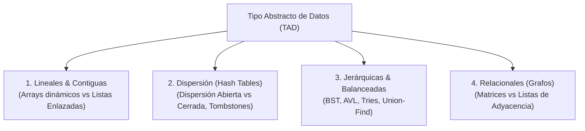
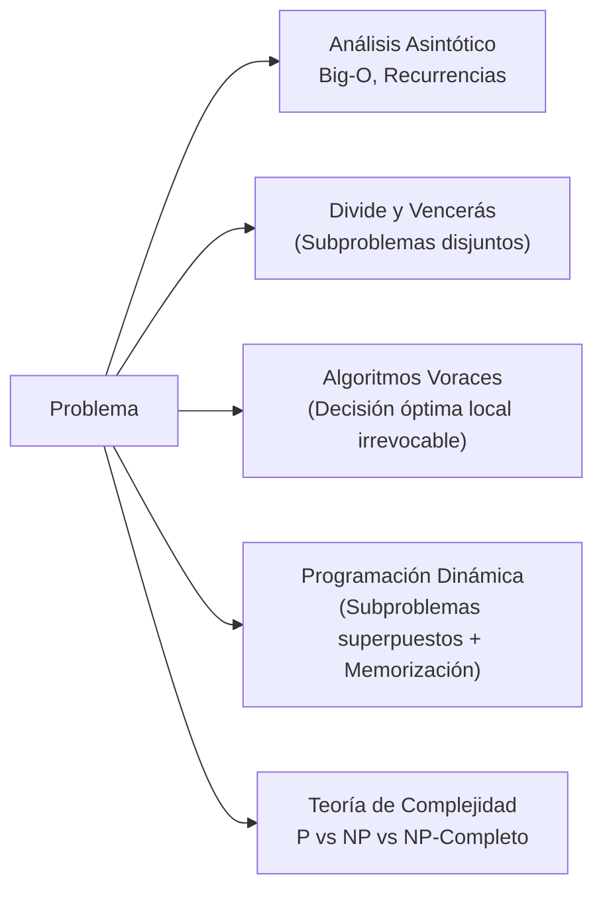

# 🧠 Capa 1: Estructuras de Datos y Algoritmia (AED1 & AED2)

Basándonos en tus notas de [[AED1]] y [[AED2]], aquí tienes el extracto de los conceptos fundamentales que sustentan el software moderno, organizados en los dos grandes bloques que has propuesto:

---

## Bloque 1: Estructuras de Datos (AED1) — Modelos de Memoria y Trade-offs

El núcleo de este bloque responde a una sola pregunta: **¿Cómo organizo la información en memoria para que acceder a ella o modificarla cueste lo mínimo posible?**

### 1.1 El Fundamento: TAD vs Estructura Física
* **TAD (Tipo Abstracto de Datos):** La interfaz matemática externa (**qué hace**: operaciones como `insertar`, `buscar`, `borrar`) con ocultamiento de implementación.
* **Estructura de Datos:** La disposición física real en la memoria del computador (**cómo lo hace**: contiguo en RAM vs nodos dispersos con punteros).

### 1.2 Estructuras Lineales: La Batalla Contigua vs Punteros
* **Arrays Estáticos y Dinámicos:**
  * Acceso indexado en tiempo constante $O(1)$ gracias a la aritmética de punteros física: $\text{dir} = \text{base} + i \times \text{size}$.
  * *Ventaja oculta de bajo nivel:* Máxima **localidad espacial** (Capa 0); la línea de caché de la CPU carga los elementos contiguos automáticamente.
  * Inserción/borrado en medio: $O(N)$ (requiere desplazar la memoria en bloque).
* **Listas Enlazadas (Simples y Dobles):**
  * Inserción/borrado local en $O(1)$ si ya tienes el puntero al nodo.
  * *Coste real en producción:* Búsqueda en $O(N)$, sobrecarga de memoria por almacenar punteros (4 u 8 bytes extra por cada dato) y **destrucción de la caché de la CPU** porque los nodos están fragmentados y dispersos por todo el *Heap*.

### 1.3 Tablas de Dispersión / Hash Tables (Diccionarios y Conjuntos)
* **La meta:** Conseguir búsqueda, inserción y borrado en tiempo medio constante **$O(1)$** mediante una función de dispersión $h(k)$ que proyecta claves a índices de un array.
* **Resolución de Colisiones (Cuando dos claves dan el mismo índice):**
  * **Dispersión Abierta (Encadenamiento / Cubetas):** Cada celda del array es un puntero a una lista enlazada de sinónimos. La tabla nunca se llena físicamente, pero el tiempo degrada a $O(N)$ si la función hash agrupa todas las claves en la misma cubeta.
  * **Dispersión Cerrada (Direccionamiento Abierto):** Todos los elementos van dentro del propio array. Si la celda está ocupada, se busca la siguiente mediante redispersión lineal o cuadrática.
    * **El concepto clave que debes saber:** **Tombstones (Marcas de borrado)**. Si borras una celda en direccionamiento cerrado dejándola vacía, romperás la cadena de búsqueda de los elementos que colisionaron después. Por eso hay que marcarla con un valor especial "eliminado" para que las búsquedas sepan que deben seguir explorando hacia adelante.
* **Factor de Carga ($\alpha = N / M$):** Si la tabla se llena demasiado ($\alpha > 0.7$), las colisiones se disparan y hay que hacer un **Rehash** ($O(N)$): reservar un array nuevo del doble de tamaño y reubicar todos los elementos.

### 1.4 Árboles Avanzados: Acceso Logarítmico y Prefijos
* **Árboles Binarios de Búsqueda (BST):** Mantienen los datos ordenados. Si el árbol está equilibrado, buscar cuesta $O(\log N)$. Si se insertan datos ya ordenados, degenera en una lista enlazada con coste $O(N)$.
* **Árboles Balanceados (AVL):**
  * Garantizan que la diferencia de altura entre subárboles nunca sea mayor a 1.
  * Si se desbalancea al insertar/borrar, se restaura en $O(1)$ mediante **rotaciones simples** (alineadas) o **rotaciones dobles** (patrones en zig-zag).
  * *Trade-off:* Búsquedas extremadamente rápidas garantizadas en $O(\log N)$, pero las escrituras son más lentas por las rotaciones.
* **Árboles Trie (Árboles de Prefijos):**
  * Estructura donde las palabras comparten nodos por sus letras iniciales.
  * *Complejidad:* La búsqueda no depende del número de elementos $N$, sino de la **longitud de la clave $L$** ($O(L)$). Fundamental para autocompletado, correctores ortográficos y motores de búsqueda.
* **Conjuntos Disjuntos (Union-Find):**
  * Modela relaciones de equivalencia y componentes conexas (árboles invertidos con punteros al padre almacenados en un array plano).
  * **Unión por Rango + Compresión de Caminos:** Durante la búsqueda recursiva, se reorientan los punteros de todos los nodos visitados para que apunten **directamente a la raíz**. Hace que la complejidad amortizada sea prácticamente constante $O(\alpha(N))$ (función inversa de Ackermann).

### 1.5 Representación de Grafos
* **Matriz de Adyacencia:** Espacio $O(V^2)$. Comprobar si existe la arista $(u, v)$ cuesta $O(1)$. Ideal para grafos **densos** ($E \approx V^2$).
* **Listas de Adyacencia:** Espacio $O(V + E)$. Iterar sobre los vecinos de un nodo cuesta $O(\text{grado}(u))$. Ideal para grafos **dispersos** ($E \ll V^2$).

---

## Bloque 2: Algoritmos y Complejidad (AED2) — Paradigmas de Resolución

Aquí no importa la estructura física de los datos, sino la **estrategia lógica de ataque** para resolver un problema de forma matemáticamente óptima.

### 2.1 El Lenguaje de la Eficiencia: Notación Asintótica
* **Big-O ($O$):** Cota superior asintótica (garantía del peor caso). Describe cómo escala el coste cuando la entrada tiende a infinito ($N \to \infty$).
* **Omega ($\Omega$) y Theta ($\Theta$):** Cota inferior (mejor caso) y cota ajustada (crecimiento exacto).
* **Teorema Maestro:** La fórmula matemática estándar para resolver la complejidad de algoritmos recursivos de la forma:
  $$T(n) = a \, T(n/b) + f(n)$$
  Permite saber instantáneamente si domina el coste de dividir los subproblemas, el de combinarlos o si están en equilibrio.

### 2.2 Divide y Vencerás (Divide and Conquer)
* **La estrategia:** Descomponer el problema en subproblemas del mismo tipo pero más pequeños, **estrictamente disjuntos** (que no se solapan), resolverlos recursivamente y combinarlos.
* **Ejemplos canónicos:**
  * **MergeSort:** Divide en $n/2$, resuelve y combina fusionando listas ordenadas. Siempre es $O(N \log N)$, pero requiere $O(N)$ de memoria auxiliar.
  * **QuickSort:** Elige un pivote, particiona los elementos menores a un lado y mayores al otro. No requiere memoria extra ($O(1)$ auxiliar) y su caso medio es $O(N \log N)$, pero en el peor caso (pivote pésimo) degenera a $O(N^2)$.
  * **Multiplicación de matrices de Strassen:** Reduce las multiplicaciones de 8 a 7 descomponiendo matrices, rebajando el coste de $O(N^3)$ a $O(N^{2.81})$.

### 2.3 Algoritmos Voraces (Greedy)
* **La estrategia:** Construir la solución paso a paso. En cada decisión, elegir la opción que parece **localmente más óptima** bajo una regla heurística, **sin volver atrás jamás** (sin marcha atrás/backtracking).
* **Cuándo funciona:** Solo si el problema cumple la **propiedad de elección voraz** y la **subestructura óptima** (la suma de óptimos locales converge matemáticamente al óptimo global).
* **Ejemplos canónicos:**
  * **Árbol de Expansión Mínimo (MST):**
    * **Kruskal:** Ordena aristas globalmente y las añade una a una usando *Union-Find* para evitar ciclos ($O(E \log E)$, ideal para grafos dispersos).
    * **Prim:** Crece un árbol desde un vértice seleccionando la arista más barata con una cola de prioridad ($O(E \log V)$, ideal para grafos densos).
  * **Camino Mínimo de Dijkstra:** Selecciona vorazmente el nodo no visitado con menor distancia acumulada en grafos con pesos positivos.
  * **Fracaso de Greedy:** El problema de la Mochila 0/1 (donde no puedes partir los objetos). La estrategia voraz (elegir mayor relación valor/peso) puede dar una solución mediocre; requiere Programación Dinámica.

### 2.4 Programación Dinámica (Dynamic Programming - DP)
* **La estrategia:** Se usa cuando los subproblemas **se solapan** (el mismo cálculo se repite una y otra vez, como en Fibonacci o alineamiento de secuencias).
* **Las dos condiciones indispensables:**
  1. **Subestructura Óptima (Principio de Optimalidad de Bellman):** La solución óptima del problema global se construye a partir de las soluciones óptimas de sus partes.
  2. **Subproblemas Superpuestos:** A diferencia de Divide y Vencerás (donde los subproblemas son independientes), aquí los mismos subproblemas aparecen en múltiples ramas del árbol de llamadas.
* **Técnica:**
  * **Top-Down con Memoization:** Recursión estándar guardando los resultados ya calculados en un array o hash table.
  * **Bottom-Up (Tabulación):** Empezar resolviendo sistemáticamente los casos base más pequeños y rellenar una tabla iterativamente hacia arriba sin usar la pila de recursión.
* **Ejemplos canónicos:** Problema de la Mochila 0/1, Algoritmo de Floyd-Warshall (caminos mínimos entre todos los pares de nodos), Distancia de Levenshtein (edición de cadenas).

### 2.5 Teoría de Complejidad Computacional ($P$, $NP$ y $NP$-Completo)
* **Clase P:** Problemas resolubles en tiempo polinómico ($O(N^k)$).
* **Clase NP:** Problemas cuya solución puede ser **verificada** en tiempo polinómico, aunque encontrarla cueste exponencial.
* **NP-Completos:** Los problemas más difíciles de NP. Si se encontrara un algoritmo polinómico para cualquiera de ellos, todos los problemas de NP se resolverían en tiempo polinómico ($P = NP$).
  * *Ejemplos:* Problema del Viajante de Comercio (TSP), Coloración de Grafos, SAT (Satisfacibilidad Booleana).
* **Por qué esto es vital en la industria:** Saber reconocer un problema NP-Completo te evita perder semanas intentando programar un algoritmo exacto imposible. Te dice cuándo abandonar la búsqueda exacta y pasar directamente a **heurísticas de aproximación** o algoritmos de búsqueda guiada.

---

### 💡 Síntesis del Nivel

Si tienes claros estos conceptos, tus decisiones arquitectónicas serán sólidas:
* **AED1** te enseña **dónde residen los datos y cuánto cuesta tocarlos**.
* **AED2** te enseña **qué patrón algorítmico aplicar para no reinventar la rueda de forma ineficiente**.

Con esto cubierto a nivel conceptual, podemos dar el siguiente paso. ¿Pasamos a la **Capa 2: Inteligencia Artificial Simbólica, Representación del Conocimiento y Búsqueda Heurística** (donde entran asignaturas como [[SSII_Sistemas_Inteligentes]] y procesadores de lenguaje de [[CMP_Compiladores]])?