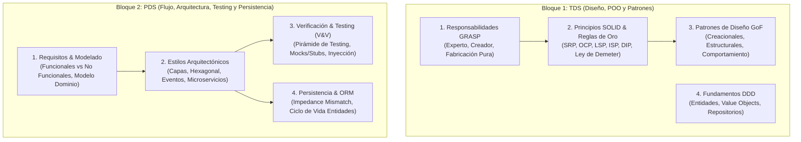

# 📐 Capa 2: Ingeniería del Software, Diseño y Ciclo de Vida (TDS & PDS)

Dividimos este nivel en los dos grandes bloques que has planteado, extrayendo los conceptos clave de tus notas de [[TDS_Tecnicas_Diseno_Software]] y [[PDS_Procesamiento_Diseno_Software]]:

---

## Bloque 1: Técnicas de Diseño de Software (TDS) — Asignación de Responsabilidades y Patrones

El objetivo de TDS es responder a: **¿Quién hace qué en el sistema y cómo se comunican los objetos para que el cambio de una pieza no rompa el resto?**

### 1.1 Asignación Estratégica de Responsabilidades: Patrones GRASP
Los patrones GRASP (*General Responsibility Assignment Software Patterns*) son la brújula mental para decidir en qué clase colocar cada método y dato:
* **Alta Cohesión & Bajo Acoplamiento:**
  * *Alta Cohesión:* Una clase debe hacer una sola cosa y hacerla bien. Métodos enfocados, comprensibles y fáciles de probar.
  * *Bajo Acoplamiento:* Reducir al mínimo las dependencias entre clases. Si la clase A cambia, la clase B no debería verse afectada.
* **Patrón Experto en Información (La regla de oro):** La responsabilidad de realizar una tarea debe recaer en la clase que posee la información necesaria para cumplirla (evita clases que solo sean estructuras de datos pasivas mientras otra clase externa hace todos sus cálculos).
* **Patrón Creador:** Cuándo la clase B debe instanciar a la clase A (si B contiene a A, B agrega a A, o B tiene los datos de inicialización de A).
* **Fabricación Pura (Pure Fabrication):** Cuando una responsabilidad no encaja de forma natural en ningún concepto del mundo real del dominio, creas una clase artificial para no romper la cohesión (ej. clases *Service*, *Repository*, *Mapper*, *Helper*).
* **Controlador:** El intermediario que recibe los eventos desde la interfaz de usuario o capa de transporte (API/CLI) y delega la ejecución en los objetos de negocio, evitando que la presentación toque el dominio directamente.

### 1.2 Principios SOLID y Mandatos Arquitectónicos
* **S (Single Responsibility Principle - SRP):** Una clase debe tener una única razón para cambiar.
* **O (Open/Closed Principle - OCP):** El software debe estar abierto a la extensión, pero cerrado a la modificación (añadir funcionalidad nueva creando nuevas clases o estrategias, no modificando código existente con `if-else` interminables).
* **L (Liskov Substitution Principle - LSP):** Una subclase debe poder sustituir a su clase base sin romper el comportamiento esperado del programa.
* **I (Interface Segregation Principle - ISP):** Es mejor tener muchas interfaces pequeñas y específicas que una interfaz gigante y sobrecargada. No obligues a una clase a implementar métodos vacíos que no necesita.
* **D (Dependency Inversion Principle - DIP):** Los módulos de alto nivel no deben depender de los módulos de bajo nivel; ambos deben depender de abstracciones (interfaces).
* **Mandatos de Oro adicionales:**
  * **Composición sobre Herencia:** La herencia acopla fuertemente las clases en tiempo de compilación; la composición permite cambiar comportamientos dinámicamente en tiempo de ejecución.
  * **Ley de Demeter ("No hables con extraños"):** Un método solo debe invocar a sus propios atributos o parámetros. Prohibido el encadenamiento excesivo (`a.getB().getC().getD().hacerAlgo()`), porque revela la estructura interna de todo el grafo de objetos.

### 1.3 Los Patrones de Diseño GoF (Los que de verdad importan en la industria)
No necesitas memorizar los 23 patrones de la Gang of Four, sino los 10 arquetipos de diseño universales:
* **Creacionales (Desacoplar la instanciación):**
  * **Factory Method & Abstract Factory:** Ocultar el uso del operador `new`, delegando la creación de familias de objetos a fábricas especializadas.
  * **Builder:** Construir objetos complejos paso a paso evitando constructores telescópicos con 8 parámetros confusos.
  * **Singleton:** Garantizar una única instancia (útil para pools de conexiones, pero ojo: debe usarse con cuidado porque introduce estado global y dificulta el testing).
* **Estructurales (Cómo componer clases dinámicamente):**
  * **Adaptador (Adapter):** Traducir una interfaz incompatible en otra que tu cliente espera (el enchufe universal para conectar librerías externas a tu código).
  * **Fachada (Facade):** Ofrecer una interfaz única y simplificada frente a un subsistema complejo lleno de clases.
  * **Decorador (Decorator):** Añadir responsabilidades a un objeto dinámicamente envolviéndolo en otra clase con la misma interfaz (ej. streams de I/O, middleware).
  * **Proxy:** Intermediario que controla el acceso a un objeto (clave para autenticación, *lazy loading*, caching o transacciones en bases de datos).
* **Comportamiento (Cómo colaboran y distribuyen tareas los objetos):**
  * **Strategy (Estrategia):** Encapsular algoritmos intercambiables tras una interfaz común para cambiar la lógica de cálculo en tiempo de ejecución.
  * **State (Estado):** Permitir que un objeto altere su comportamiento cuando cambia su estado interno (evita máquinas de estados plagadas de `switch-case`).
  * **Observer:** Suscripción y notificación 1-a-N cuando cambia el estado de un objeto (la base del patrón Event-Driven).
  * **Chain of Responsibility:** Pasar una petición a lo largo de una cadena de manejadores (ej. filtros de peticiones HTTP en un servidor backend).

### 1.4 Introducción a DDD (Domain-Driven Design)
* **Entidades:** Objetos con una identidad única y persistente en el tiempo (ej. un `Usuario` con su ID), aunque sus datos cambien.
* **Value Objects (Objetos de Valor):** Objetos inmutables definidos exclusivamente por sus atributos (ej. `Dinero(cantidad, moneda)` o `Direccion`). Si dos tienen los mismos datos, son idénticos. No tienen identidad propia.
* **Repositorios:** La abstracción que simula una colección en memoria para guardar y recuperar entidades sin que el dominio sepa qué base de datos hay debajo.

---

## Bloque 2: Procesamiento y Desarrollo de Software (PDS) — Flujo, Arquitectura y Calidad

PDS complementa el diseño centrándose en **el ciclo de vida completo de un sistema**, desde que se define el problema hasta que se valida en producción y se persisten los datos.

### 2.1 Requisitos y Modelado Conceptual
* **Requisitos Funcionales vs No Funcionales:**
  * *Funcionales:* Qué debe hacer el sistema (casos de uso, entradas/salidas, reglas de negocio).
  * *No Funcionales (Atributos de calidad):* Cómo debe comportarse el sistema bajo carga (latencia, rendimiento, disponibilidad, tolerancia a fallos, seguridad).
* **Casos de Uso vs Historias de Usuario:**
  * Casos de uso (formales, flujo básico y flujos alternativos de error, relaciones de inclusión y extensión).
  * Historias de usuario ("Como [rol], quiero [acción], para [beneficio]").
* **Modelado de Dominio:** Diferencia entre **Agregación** (las partes pueden existir de forma independiente al contenedor) y **Composición** (las partes mueren si el contenedor se destruye).

### 2.2 Estilos Arquitectónicos
La forma en que se estructuran los componentes y sus conectores a alto nivel:
* **Arquitectura en Capas (Layered / N-Tier):** Presentación $\to$ Lógica de Negocio $\to$ Acceso a Datos. Estructura clásica, pero propensa al acoplamiento si las capas superiores dependen directamente de las tablas de datos.
* **Arquitectura Hexagonal (Ports & Adapters) / Clean Architecture:**
  * El núcleo del dominio está en el centro y **no depende de nada**.
  * Se comunica con el mundo exterior mediante **Puertos** (interfaces).
  * Las bases de datos, APIs REST o frameworks externos son **Adaptadores** periféricos que se enchufan a esos puertos.
* **Arquitecturas Orientadas a Eventos:**
  * *Message Queues (Colas punto a punto):* Modelo *pull* con entrega garantizada, absorción de picos de carga.
  * *Pub/Sub (Publicador/Suscriptor):* Modelo *push* organizado por *topics*, desacoplamiento total en tiempo y espacio.
* **Monolito vs Microservicios:**
  * Monolito: Un único proceso en memoria; transacciones atómicas simples, despliegue conjunto.
  * Microservicios: Descomposición en servicios autónomos comunicados por red; despliegues independientes a costa de latencia de red, consistencia eventual y complejidad operativa.

### 2.3 Verificación, Validación y Testing Industrial (V&V)
* **Defectología básica:** Un programador comete un **Error humano**, que introduce un **Defecto/Bug** en el código fuente, el cual provoca un **Fallo observable** en tiempo de ejecución.
* **La Pirámide de Testing:**
  1. **Tests Unitarios:** En la base. Cientos o miles; prueban funciones o clases de forma ultra rápida y totalmente aislada.
  2. **Tests de Integración:** Prueban la interacción entre módulos reales (ej. repositorio conectándose contra una base de datos de pruebas).
  3. **Tests End-to-End (E2E) / Sistema:** Prueban flujos completos de usuario en entornos reales; lentos y más frágiles de mantener.
* **Testability y Dobles de Prueba (Test Doubles):**
  * Para probar una clase sin llamar a la base de datos real o a una API externa, necesitas **Inyección de Dependencias**.
  * **Stubs:** Devuelven respuestas prefijadas.
  * **Mocks:** Verifican el comportamiento (comprueban que se llamó al método esperado con los parámetros correctos).
  * **Fakes:** Implementaciones funcionales ligeras (ej. una base de datos simulada en memoria).
* **Criterios de Cobertura:** Cobertura de líneas, de ramas (*branch coverage*) y análisis de valores límite en particiones de equivalencia.

### 2.4 Persistencia y el Desfase Objeto-Relacional (Impedance Mismatch)
* **El Problema del Impedance Mismatch:** Los objetos en memoria forman un grafo rico con herencia, polimorfismo y referencias directas. Las bases de datos relacionales son tablas planas bidimensionales basadas en tuplas y claves foráneas.
* **ORMs (Mapeo Objeto-Relacional) y JPA/Hibernate:**
  * Automatizan la traducción entre clases y tablas (`@Entity`, `@Table`, `@Id`).
  * Mapeo de asociaciones: `@OneToOne`, `@OneToMany`, `@ManyToOne`, `@ManyToMany` gestionando la clave foránea (`@JoinColumn` y `mappedBy`).
  * Estrategias de herencia relacional: *Single Table* (una tabla única con nulos), *Joined Table* (tabla por clase con claves ajenas) o *Table per Class*.
* **El Ciclo de Vida de las Entidades en Persistencia:**
  * **Transient:** Creada con `new`, el framework no la conoce ni existe en base de datos.
  * **Persistent:** Gestionada por el contexto de persistencia / sesión activa; cualquier cambio en sus atributos generará un `UPDATE` automático al cerrar la transacción.
  * **Detached:** La sesión se cerró; el objeto sigue en memoria pero los cambios ya no se sincronizan con la base de datos.
  * **Removed:** Marcada para borrado físico (`DELETE`).

---

### 💡 Por qué esta capa es el puente perfecto

Si dominas este nivel:
1. Sabes cómo organizar el código para que sea **mantenible y testeable** (TDS).
2. Sabes cómo **diseñar sistemas, desacoplar componentes y manejar la persistencia** (PDS).

Ahora tenemos la base completa de la ingeniería de software:
* **Capa 0:** Silicio, Hardware y SO (Sustrato físico).
* **Capa 1:** Estructuras de Datos y Algoritmia (Eficiencia y complejidad).
* **Capa 2:** Ingeniería de Software, Diseño y Arquitectura (Mantenibilidad, testing y sistemas).

¿Tiene sentido esta estructuración de TDS/PDS para ti? Si estás de acuerdo, podemos dar el salto hacia el inicio del mundo de la Inteligencia Artificial: la **IA Simbólica, Búsqueda Heurística y Procesadores de Lenguaje** (con asignaturas como [[SSII_Sistemas_Inteligentes]] y [[CMP_Compiladores]]).