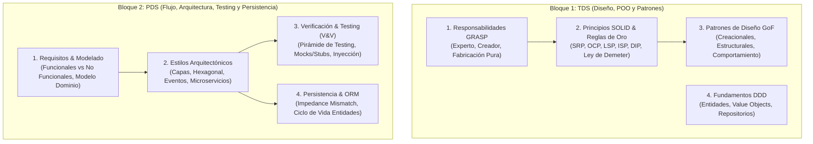

# 📐 Capa 2: Ingeniería del Software, Diseño y Ciclo de Vida (TDS & PDS)

Dividimos este nivel en los dos grandes bloques que has planteado, extrayendo los conceptos clave de tus notas de [[TDS_Tecnicas_Diseno_Software]] y [[PDS_Procesamiento_Diseno_Software]]:



---

## Bloque 1: Técnicas de Diseño de Software (TDS) — Asignación de Responsabilidades y Patrones

El objetivo primordial de TDS es responder con rigor metodológico a dos preguntas nucleares:
1. **¿En qué clase exacta debe vivir cada responsabilidad (datos y contratos)?**
2. **¿Cómo deben comunicarse y desacoplarse los objetos para que el sistema tolere cambios constantes de requisitos sin propagar regresiones en cascada?**

---

### 1.1 Asignación Estratégica de Responsabilidades: Patrones GRASP

Los patrones **GRASP** (*General Responsibility Assignment Software Patterns*), formulados por Craig Larman, no son diseños complejos de clases prefabricadas, sino los **principios mentales fundamentales** para asignar contratos y responsabilidades en el diseño orientado a objetos.

#### Taxonomía Canónica de la Responsabilidad
Toda responsabilidad asignada a una clase se clasifica formalmente en dos dimensiones:
- **Responsabilidades de Conocer (*Knowing*):**
  - Conocer sus propios datos privados encapsulados.
  - Conocer a objetos colaboradores conectados directamente (asociaciones).
  - Conocer datos derivados o calculados a partir de su propio estado.
- **Responsabilidades de Hacer (*Doing*):**
  - Realizar cálculos matemáticos o lógicos internos con sus datos.
  - Instanciar y crear nuevos objetos.
  - Iniciar y coordinar acciones o invocar servicios en otros objetos.
  - Controlar y sincronizar flujos de actividad entre múltiples colaboradores.

#### El Catálogo Canónico de los 9 Patrones GRASP

1. **Patrón Experto en Información (La Regla de Oro del Diseño):**
   - *Directriz:* Asignar la responsabilidad a la clase que posee la información necesaria para cumplirla.
   - *Justificación arquitectónica:* Si para calcular el importe total de una factura con impuestos una clase externa `ServicioFactura` tiene que pedirle línea por línea cada artículo a la clase `Factura`, se genera una clase de datos anémica (*Anemic Domain Model*) y un alto acoplamiento. La clase `Factura` es la experta: ella debe calcular su propio total.
   - *Consecuencia:* Máxima cohesión, datos y algoritmos residen juntos, y se protege la encapsulación.

2. **Patrón Creador (Las 5 Reglas Técnicas Canónicas de la UMU):**
   - *Problema:* ¿Quién debe ser el responsable de crear una nueva instancia de la clase `A`?
   - *Solución:* Asignar a la clase `B` la responsabilidad de instanciar `A` **si y solo si** se cumple alguna de las siguientes 5 condiciones técnicas (preferentemente varias de ellas):
     1. `B` es una **agregación** de objetos de `A`.
     2. `B` **contiene (composición)** por ciclo de vida objetos de `A`.
     3. `B` **registra** instancias de `A` (las almacena y cataloga).
     4. `B` hace un **uso específico o íntimo** de los objetos de `A`.
     5. `B` posee los **datos de inicialización** que se deben pasar al constructor de `A` al instanciarla.
   - *Ejemplo:* Una `Venta` crea sus propias `LineaVenta`, un `Pedido` crea sus `ItemPedido`. Un objeto externo nunca debe instanciar `LineaVenta` por su cuenta.

3. **Patrón Controlador (Frontera UI $\leftrightarrow$ Dominio):**
   - *Directriz:* Asignar la responsabilidad de recibir y manejar los eventos del sistema (procedentes de la UI, CLI o API REST) al primer objeto coordinador del dominio.
   - *Aislamiento estricto:* **Las clases del modelo de dominio jamás deben conocer ni acceder a la interfaz de usuario.** El Controlador actúa como el mediador puro.
   - *Tipos de Controlador:*
     - *Controlador Façade (del caso de uso):* Maneja todos los eventos asociados a un caso de uso concreto (ej. `ControladorRegistrarVenta`). Recomendado para no inflar una sola clase.
     - *Controlador Raíz (del sistema global):* Representa el sistema completo o dispositivo (ej. `SistemaTienda`). Útil en sistemas pequeños; se degrada en una God Class si el sistema crece.

4. **Fabricación Pura (*Pure Fabrication*):**
   - *Problema:* El Experto en Información a veces conduce a violar Alta Cohesión y Bajo Acoplamiento si forzamos a una entidad de negocio a hacer cosas como persistirse en SQL, serializarse en JSON o enviar correos. Una entidad del mundo real no se guarda a sí misma en base de datos.
   - *Solución:* Crear una clase artificial, que no existe en el dominio del problema del mundo real, diseñada exclusivamente para mantener la alta cohesión y el bajo acoplamiento técnico (ej. `EmpleadoRepository`, `EmailNotificationService`, `JsonSerializerMapper`).

5. **Bajo Acoplamiento (*Low Coupling*):**
   - *Directriz:* Asignar responsabilidades de forma que la dependencia entre módulos sea la menor posible.
   - *Las 4 Fuentes Técnicas de Acoplamiento entre Clase A y Clase B:*
     1. **Atributo:** `A` tiene un campo o atributo cuyo tipo es `B`.
     2. **Firma o cuerpo de método:** `A` tiene un método que recibe un parámetro de tipo `B`, declara una variable local de tipo `B`, o retorna un tipo `B`.
     3. **Herencia:** `A` es subclase directa o indirecta de `B`.
     4. **Implementación:** `A` implementa la interfaz `B`.
   - *Meta:* Reducir los acoplamientos a clases concretas e inestables; acoplarse únicamente a interfaces abstractas estables.

6. **Alta Cohesión (*High Cohesion*):**
   - *Directriz:* Mantener los objetos enfocados, comprensibles y manejables. Todas las responsabilidades de una clase deben estar estrechamente relacionadas con su propósito central.
   - *Métrica:* Una clase con baja cohesión hace demasiadas cosas no relacionadas, es difícil de reutilizar, difícil de probar y extremadamente frágil ante cambios.

7. **Polimorfismo (*Polymorphism*):**
   - *Directriz:* Cuando el comportamiento varía según el tipo o categoría de un concepto, asignar la responsabilidad a operaciones polimórficas en lugar de comprobar tipos con sentencias condicionales (`if (tipo == A)` o `switch(tipo)`).

8. **Indirección (*Indirection*):**
   - *Directriz:* Asignar la responsabilidad a un objeto intermediario para desacoplar dos componentes y evitar la dependencia directa (ej. Adaptadores, Proxies, Mediadores).

9. **Variación Protegida (*Protected Variations*):**
   - *Directriz:* Identificar los puntos del sistema propensos a variar o cambiar con el tiempo y envolverlos tras una interfaz estable y consistente. Es el principio conceptual raíz que sustenta a OCP y DIP.

---

### 1.2 Principios SOLID y Mandatos Arquitectónicos de Diseño

Los 5 principios formulados por Robert C. Martin ("Uncle Bob") y Bertrand Meyer establecen las reglas de estabilidad estructural del software modular:

#### 1. SRP — Single Responsibility Principle (Principio de Responsabilidad Única)
- **Definición formal:** *Una clase debe tener una, y solo una, razón para cambiar.*
- **Enfoque de Actores:** No significa "hacer una sola cosa" (eso es para funciones cortas). En arquitectura de clases, una razón para cambiar proviene de un **actor o stakeholder de negocio**:
  - Contabilidad (cambia cómo se calcula el IRPF/IVA).
  - Recursos Humanos (cambia el formato del reporte de empleados).
  - DBA/DevOps (cambia el esquema de PostgreSQL).
- **Violación clásica (God Class):** Una clase `Empleado` que contiene `calcularSueldoNeto()`, `generarReporteDesempenoPDF()` y `guardarEnBaseDatos()`. Un cambio en la BD pone en riesgo el cálculo de sueldos.
- **Solución:** Separar en `Empleado` (entidad pura), `CalculadoraNomina` (servicio financiero), `GeneradorReporteRRHH` y `EmpleadoRepository` (persistencia).

#### 2. OCP — Open/Closed Principle (Principio de Abierto/Cerrado)
- **Definición formal (Bertrand Meyer):** *Las entidades de software deben estar abiertas a la extensión, pero cerradas a la modificación.*
- **Mecanismo:** El comportamiento debe poder alterarse agregando nuevo código (nuevas clases o implementaciones), sin tocar ni una línea del código existente ya compilado, testeado y desplegado.
- **Técnica UMU:** Sustituir cascadas de `switch` o `if-else` sobre enumerados o tipos concretos por **interfaces polimórficas** (patrones *Strategy*, *Decorator* o *Factory Method*).

#### 3. LSP — Liskov Substitution Principle (Principio de Sustitución de Liskov)
- **Definición formal (Barbara Liskov):** *Si por cada objeto $o_1$ de tipo $S$ existe un objeto $o_2$ de tipo $T$ tal que para todos los programas $P$ definidos en términos de $T$, el comportamiento de $P$ permanece invariante cuando $o_1$ es sustituido por $o_2$, entonces $S$ es un subtipo de $T$.*
- **Fundamento en Diseño por Contrato (DbC):**
  - **Precondiciones:** El subtipo **no puede fortalecer** las precondiciones (no puede exigir más que el padre).
  - **Postcondiciones:** El subtipo **no puede debilitar** las postcondiciones (debe prometer al menos lo mismo que el padre).
  - **Invariantes:** Deben preservarse íntegramente en el subtipo.
- **El contraejemplo canónico (Cuadrado hereda de Rectángulo):**
  - Un `Rectangulo` tiene métodos mutadores independientes `setWidth(w)` y `setHeight(h)`. El contrato implícito es que modificar el ancho no altera la altura.
  - Si `Cuadrado` hereda de `Rectangulo`, al hacer `setWidth(5)` debe cambiar también la altura a 5 para no dejar de ser cuadrado.
  - Cualquier algoritmo cliente que reciba un `Rectangulo`, modifique su base esperando conservar su altura previa fallará estrepitosamente si se le pasa una instancia de `Cuadrado`. La herencia del mundo real no siempre cumple el subtipado de comportamiento en POO.

#### 4. ISP — Interface Segregation Principle (Principio de Segregación de Interfaces)
- **Definición formal:** *Los clientes no deben ser forzados a depender de interfaces que no utilizan.*
- **Evitar "Fat Interfaces":** No diseñes contratos omnipotentes con 20 métodos donde los clientes que solo necesitan imprimir se ven obligados a implementar métodos ficticios de fax, escaneo o grapado lanzando `UnsupportedOperationException`.
- **Solución:** Interfaces de rol (*Role Interfaces*) pequeñas, altamente cohesionadas (`Imprimible`, `Escaneable`, `Cerrable`).

#### 5. DIP — Dependency Inversion Principle (Principio de Inversión de Dependencias)
- **Definición formal:**
  1. *Los módulos de alto nivel no deben depender de módulos de bajo nivel. Ambos deben depender de abstracciones.*
  2. *Las abstracciones no deben depender de los detalles. Los detalles deben depender de las abstracciones.*
- **Inversión de Control (IoC):** En lugar de que la clase de negocio instancie su base de datos (`new MySqlDatabase()`), la clase de negocio declara una interfaz abstracta (`FacturaRepository`) que necesita consumir, y la infraestructura concreta le inyecta la implementación por constructor.

#### Mandatos Estratégicos de Oro Adicionales
- **Ley de Demeter (LoD — "No hables con extraños"):**
  - Un método $M$ de un objeto $O$ sólo debe llamar a métodos de:
    1. El propio objeto $O$ (`this`).
    2. Los parámetros formales pasados al método $M$.
    3. Cualquier objeto instanciado dentro de $M$.
    4. Los atributos directos de $O$.
  - *Prohibición:* Romper el encapsulamiento con encadenamiento de getters de más de un nivel (`pedido.getCliente().getDireccion().getCiudad().getCodigoPostal()`). Esto acopla al cliente a la topología interna del grafo completo de objetos. Usa el principio *"Tell, Don't Ask"* delegando la acción directamente.
- **Favorecer la Composición frente a la Herencia de Clases:**
  - La herencia es una relación *"Es-un"* estática y de caja blanca: expone los detalles internos de la superclase a la subclase y causa problemas de clases base frágiles.
  - La composición es una relación *"Tiene-un"* dinámica y de caja negra: ensambla componentes a través de interfaces sin conocer sus entrañas, permitiendo alterar el comportamiento en tiempo de ejecución.
- **Principio de Acceso Uniforme (Bertrand Meyer):**
  - Todos los servicios de un módulo deben estar disponibles a través de una notación sintáctica uniforme, que no traicione si están implementados como un atributo almacenado en memoria física o como una función calculada en tiempo real.

---

### 1.3 Los Patrones de Diseño GoF (Gang of Four) — Taxonomía y Trade-offs Técnicos

Publicados por Gamma, Helm, Johnson y Vlissides (1994), los 23 patrones se organizan en tres categorías según su intención:

```mermaid
graph TD
    GOF["Patrones de Diseño GoF (23)"]
    GOF --> CREA["Creacionales\n(Mecanismos de Instanciación)"]
    GOF --> ESTR["Estructurales\n(Composición de Clases y Objetos)"]
    GOF --> COMP["De Comportamiento\n(Algoritmos y Asignación de Tareas)"]

    CREA --> FM["Factory Method (Herencia / Reflexión)"]
    CREA --> AF["Abstract Factory (Familias de Productos)"]
    CREA --> BL["Builder (Construcción Paso a Paso)"]
    CREA --> SG["Singleton (Instancia Única)"]

    ESTR --> AD["Adapter (Integración 1 a 1)"]
    ESTR --> FC["Facade (Simplificación 1 a N)"]
    ESTR --> CP["Composite (Árboles Parte-Todo)"]
    ESTR --> DC["Decorator (Extensión Dinámica)"]
    ESTR --> PX["Proxy (Control de Acceso / Carga Perezosa)"]

    COMP --> ST["Strategy (Intercambio del CÓMO)"]
    COMP --> SE["State (Comportamiento según Estado QUÉ)"]
    COMP --> CM["Command (Undo/Redo con Historial)"]
    COMP --> OB["Observer (Suscripción Pub/Sub 1 a N)"]
    COMP --> CR["Chain of Responsibility (Canal de Receptores)"]
```



#### A. Patrones Creacionales (Desacoplar la Instanciación)

1. **Factory Method (Método de Fábrica):**
   - *Intención:* Define una interfaz para crear un objeto, pero delega en las subclases la decisión de qué clase concreta instanciar.
   - *Técnica Avanzada TDS UMU (Reflexión Dinámica):* Para evitar crear una subclase creadora por cada nuevo producto, se utiliza instanciación reflexiva:
     ```java
     // Sintaxis canónica robusta (Java 9+):
     Producto p = (Producto) Class.forName(claseProducto)
                                  .getDeclaredConstructor()
                                  .newInstance();
     ```
     *(Nota: `Class.newInstance()` está formalmente depreciado desde Java 9 por ocultar excepciones de constructor).*
2. **Abstract Factory (Fábrica Abstracta):**
   - *Intención:* Provee una interfaz para crear familias de objetos relacionados o dependientes (ej. Botones, Scrollbars y Ventanas compatibles con estilo Windows o estilo macOS) sin especificar sus clases concretas.
3. **Builder (Constructor):**
   - *Intención:* Separa la construcción de un objeto complejo de su representación, permitiendo que el mismo proceso construya representaciones diferentes.
   - *Resuelve:* Evita constructores telescópicos con 8 argumentos donde la mitad son pasados como `null`.
4. **Singleton (Instancia Única):**
   - *Intención:* Garantiza que una clase tenga una única instancia en todo el runtime y provee un punto de acceso global estático a ella.
   - *Trade-off Senior:* En arquitectura moderna se considera casi un code smell: introduce estado global mutable oculto, acopla componentes y dificulta el paralelismo y los tests unitarios. Se sustituye por inyección de dependencias con ciclo de vida `Singleton` gestionado por el contenedor de IoC.

#### B. Patrones Estructurales (Composición de Clases y Objetos)

1. **Adapter (Adaptador) vs Facade (Fachada) — La Distinción Canónica:**
   - **Adapter:** Resuelve la incompatibilidad entre **dos interfaces existentes predeterminadas (relación 1 a 1)**. Convierte la interfaz de una clase ajena o librería externa a la interfaz exacta que tu cliente ya exige.
   - **Facade:** Crea una **nueva interfaz unificada de alto nivel (relación 1 a muchos)** para simplificar el uso de un subsistema complejo compuesto por decenas de clases internas.
2. **Composite (Objeto Compuesto) — El Dilema de Diseño UMU:**
   - Permite tratar a objetos individuales (Hojas) y a composiciones jerárquicas (Nodos Compuestos) de manera completamente uniforme mediante una interfaz común `Componente`.
   - **Dilema Transparencia vs Seguridad:**
     - *Transparencia:* Los métodos de añadir/eliminar hijos (`add(c)`, `remove(c)`) se declaran en la interfaz base `Componente`. Cualquier cliente puede invocar `add()` sobre cualquier nodo sin castear. *Coste:* Las `Hojas` no tienen hijos, por lo que deben lanzar una excepción en runtime si alguien llama a `add()`.
     - *Seguridad:* Los métodos `add()` y `remove()` solo se declaran en la clase `Composite`. Las `Hojas` no tienen estos métodos, por lo que el compilador detecta errores antes de ejecutar. *Coste:* Se pierde el trato polimórfico uniforme y el cliente se ve obligado a hacer `instanceof` o downcasting.
3. **Decorator (Decorador) vs Strategy (Estrategia):**
   - *Decorator:* Añade responsabilidades dinámicamente envolviendo al objeto en capas concéntricas con la misma interfaz (ej. streams de Java `new GZIPOutputStream(new BufferedOutputStream(new FileOutputStream(f)))`). Evita la **explosión combinatoria de subclases** (ej. café con leche, con caramelo, descafeinado...).
   - *Regla de Oro TDS:* Si el objeto base no es "ligero" (tiene mucho estado o lógica pesada interna), el decorador resulta ineficiente y debe preferirse el patrón **Strategy**.
4. **Proxy (Apoderado / Intermediario):**
   - Proporciona un sustituto para controlar el acceso al objeto real:
     - *Virtual Proxy:* Carga perezosa (*Lazy Loading*) de objetos pesados en memoria (ej. imágenes de alta resolución).
     - *Protection Proxy:* Control de permisos y autorización según el rol del usuario.
     - *Remote Proxy:* Representación local de un objeto remoto en otra máquina/proceso (ej. gRPC, RMI).

#### C. Patrones de Comportamiento (Colaboración e Interacción Dinámica)

1. **Strategy (Estrategia) vs State (Estado) — El "Cómo" vs el "Qué":**
   - Aunque su diagrama UML estructural es prácticamente idéntico (un Contexto que delega en una interfaz polimórfica), su intención es radicalmente opuesta:
     - **Strategy:** Modela **"el CÓMO"**. El cliente elige conscientemente un algoritmo entre una familia intercambiable (ej. ordenar con Quicksort vs Mergesort; calcular ruta en mapa con camino más rápido vs más corto). Las estrategias no cambian el estado interno del contexto ni se conocen entre sí.
     - **State:** Modela **"el QUÉ según el estado"**. El objeto parece cambiar de clase cuando su estado interno muta (ej. un `Pedido` en estado `Borrador`, `Pagado`, `Enviado` o `Cancelado`). Los métodos de acción se comportan según el estado actual, y el propio estado o el contexto disparan las transiciones automáticas.
2. **Command (Comando) y el Soporte Canónico de Undo/Redo (UMU):**
   - Encapsula una solicitud como un objeto independiente, conteniendo el receptor, el método a invocar y sus parámetros.
   - *En Java moderno:* Las expresiones lambda reemplazan los usos triviales de `Command`.
   - *Implementación Estricta para Deshacer/Rehacer (Undo / Redo):* Requiere imperativamente:
     1. Un **Command Manager / Invoker** que gestione la ejecución y orqueste las pilas.
     2. Una **Lista de Historia (o Pila de Undo)** que almacene **copias de respaldo (mementos)** del estado previo antes de aplicar la mutación sobre el receptor para garantizar que `undo()` sea determinista e idempotente.
3. **Observer (Publicador / Suscriptor):**
   - Acoplamiento abstracto uno a muchos. Cuando el sujeto cambia de estado, notifica automáticamente a todos los observadores registrados.
   - *Modelo Push vs Pull:* En *Push*, el sujeto envía los datos del cambio dentro del mensaje; en *Pull*, el sujeto solo emite la señal y los observadores llaman a los getters del sujeto para consultar el nuevo estado.
4. **Iterator (Iterador Interno vs Externo):**
   - *Iterador Externo:* El cliente gobierna el bucle manualmente llamando a `hasNext()` y `next()`.
   - *Iterador Interno:* El iterador gobierna el recorrido del flujo; **requiere obligatoriamente closures o funciones lambda** pasadas por parámetro para ejecutar la acción sobre cada elemento (ej. `list.forEach(item -> ...)`).
5. **Chain of Responsibility (Cadena de Responsabilidad):**
   - Desacopla al emisor de una petición de sus receptores, encadenando objetos receptores en serie hasta que uno de ellos la maneja o la propaga al siguiente (base de los middlewares HTTP en Express/Koa y los filtros `SecurityFilterChain` en Spring Boot).

---

### 1.4 Fundamentos de DDD (Domain-Driven Design)

Eric Evans formaliza la arquitectura del software a partir de la riqueza del modelo del dominio y el lenguaje ubicuo (*Ubiquitous Language*):

1. **Entidades:**
   - Objetos que no se definen por sus atributos, sino por un hilo de continuidad y una **identidad única persistente** a lo largo de todo su ciclo de vida (un `Usuario` con ID `usr-9812` sigue siendo el mismo usuario aunque cambie su nombre, teléfono y contraseña).
2. **Value Objects (Objetos de Valor):**
   - Objetos **inmutables** (declarados con campos `final` o `readonly`) sin identidad propia, definidos exclusivamente por la combinación de sus valores.
   - Si dos instancias tienen los mismos atributos, son exactamente iguales (`equals() == true`).
   - *Auto-validación:* Validan sus invariantes en el constructor. No puede existir un Value Object con estado corrupto (ej. `Dinero(monto, divisa)`, `EmailAddress(rawString)`, `CoordenadaGPS(lat, lon)`).
3. **Servicios de Dominio:**
   - Lógica de negocio pura que involucra a múltiples entidades o no pertenece de forma natural al ciclo de vida de ninguna de ellas (ej. `ServicioTransferenciaFondos` transfiriendo saldo entre dos cuentas bancarias).
4. **Ciclo de Vida de los Objetos en DDD:**
   - **Agregados (Aggregates):** Conjunto cohesionado de entidades y objetos de valor tratados como una unidad atómica para la consistencia transaccional. Cada agregado tiene una única **Entidad Raíz (*Aggregate Root*)**; los objetos externos solo pueden referenciar a la raíz, nunca a entidades internas del agregado.
   - **Factorías (Factories):** Encapsulan la instanciación de agregados complejos garantizando que se cumplan todas las invariantes iniciales de golpe.
   - **Repositorios (Repositories):** Proporcionan la ilusión de una colección en memoria de agregados de dominio, abstrayendo por completo los detalles físicos del motor de base de datos o el ORM.

---

## Bloque 2: Procesamiento y Desarrollo de Software (PDS) — Flujo, Arquitectura y Calidad

PDS complementa el diseño centrándose en **el ciclo de vida completo de un sistema**, desde que se define el problema hasta que se valida en producción y se persisten los datos.

### 2.1 Requisitos y Modelado Conceptual
* **Requisitos Funcionales vs No Funcionales:**
  * *Funcionales:* Qué debe hacer el sistema (casos de uso, entradas/salidas, reglas de negocio).
  * *No Funcionales (Atributos de calidad):* Cómo debe comportarse el sistema bajo carga (latencia, rendimiento, disponibilidad, tolerancia a fallos, seguridad).
* **Casos de Uso vs Historias de Usuario:**
  * Casos de uso (formales, flujo básico y flujos alternativos de error, relaciones de inclusión y extensión).
  * Historias de usuario ("Como [rol], quiero [acción], para [beneficio]").
* **Modelado de Dominio:** Diferencia entre **Agregación** (las partes pueden existir de forma independiente al contenedor) y **Composición** (las partes mueren si el contenedor se destruye).

### 2.2 Estilos Arquitectónicos
La forma en que se estructuran los componentes y sus conectores a alto nivel:
* **Arquitectura en Capas (Layered / N-Tier):** Presentación $\to$ Lógica de Negocio $\to$ Acceso a Datos. Estructura clásica, pero propensa al acoplamiento si las capas superiores dependen directamente de las tablas de datos.
* **Arquitectura Hexagonal (Ports & Adapters) / Clean Architecture:**
  * El núcleo del dominio está en el centro y **no depende de nada**.
  * Se comunica con el mundo exterior mediante **Puertos** (interfaces).
  * Las bases de datos, APIs REST o frameworks externos son **Adaptadores** periféricos que se enchufan a esos puertos.
* **Arquitecturas Orientadas a Eventos:**
  * *Message Queues (Colas punto a punto):* Modelo *pull* con entrega garantizada, absorción de picos de carga.
  * *Pub/Sub (Publicador/Suscriptor):* Modelo *push* organizado por *topics*, desacoplamiento total en tiempo y espacio.
* **Monolito vs Microservicios:**
  * Monolito: Un único proceso en memoria; transacciones atómicas simples, despliegue conjunto.
  * Microservicios: Descomposición en servicios autónomos comunicados por red; despliegues independientes a costa de latencia de red, consistencia eventual y complejidad operativa.

### 2.3 Verificación, Validación y Testing Industrial (V&V)
* **Defectología básica:** Un programador comete un **Error humano**, que introduce un **Defecto/Bug** en el código fuente, el cual provoca un **Fallo observable** en tiempo de ejecución.
* **La Pirámide de Testing:**
  1. **Tests Unitarios:** En la base. Cientos o miles; prueban funciones o clases de forma ultra rápida y totalmente aislada.
  2. **Tests de Integración:** Prueban la interacción entre módulos reales (ej. repositorio conectándose contra una base de datos de pruebas).
  3. **Tests End-to-End (E2E) / Sistema:** Prueban flujos completos de usuario en entornos reales; lentos y más frágiles de mantener.
* **Testability y Dobles de Prueba (Test Doubles):**
  * Para probar una clase sin llamar a la base de datos real o a una API externa, necesitas **Inyección de Dependencias**.
  * **Stubs:** Devuelven respuestas prefijadas.
  * **Mocks:** Verifican el comportamiento (comprueban que se llamó al método esperado con los parámetros correctos).
  * **Fakes:** Implementaciones funcionales ligeras (ej. una base de datos simulada en memoria).
* **Criterios de Cobertura:** Cobertura de líneas, de ramas (*branch coverage*) y análisis de valores límite en particiones de equivalencia.

### 2.4 Persistencia y el Desfase Objeto-Relacional (Impedance Mismatch)
* **El Problema del Impedance Mismatch:** Los objetos en memoria forman un grafo rico con herencia, polimorfismo y referencias directas. Las bases de datos relacionales son tablas planas bidimensionales basadas en tuplas y claves foráneas.
* **ORMs (Mapeo Objeto-Relacional) y JPA/Hibernate:**
  * Automatizan la traducción entre clases y tablas (`@Entity`, `@Table`, `@Id`).
  * Mapeo de asociaciones: `@OneToOne`, `@OneToMany`, `@ManyToOne`, `@ManyToMany` gestionando la clave foránea (`@JoinColumn` y `mappedBy`).
  * Estrategias de herencia relacional: *Single Table* (una tabla única con nulos), *Joined Table* (tabla por clase con claves ajenas) o *Table per Class*.
* **El Ciclo de Vida de las Entidades en Persistencia:**
  * **Transient:** Creada con `new`, el framework no la conoce ni existe en base de datos.
  * **Persistent:** Gestionada por el contexto de persistencia / sesión activa; cualquier cambio en sus atributos generará un `UPDATE` automático al cerrar la transacción.
  * **Detached:** La sesión se cerró; el objeto sigue en memoria pero los cambios ya no se sincronizan con la base de datos.
  * **Removed:** Marcada para borrado físico (`DELETE`).

---

### 💡 Por qué esta capa es el puente perfecto

Si dominas este nivel:
1. Sabes cómo organizar el código para que sea **mantenible y testeable** (TDS).
2. Sabes cómo **diseñar sistemas, desacoplar componentes y manejar la persistencia** (PDS).

Ahora tenemos la base completa de la ingeniería de software:
* **Capa 0:** Silicio, Hardware y SO (Sustrato físico).
* **Capa 1:** Estructuras de Datos y Algoritmia (Eficiencia y complejidad).
* **Capa 2:** Ingeniería de Software, Diseño y Arquitectura (Mantenibilidad, testing y sistemas).

¿Tiene sentido esta estructuración de TDS/PDS para ti? Si estás de acuerdo, podemos dar el salto hacia el inicio del mundo de la Inteligencia Artificial: la **IA Simbólica, Búsqueda Heurística y Procesadores de Lenguaje** (con asignaturas como [[SSII_Sistemas_Inteligentes]] y [[CMP_Compiladores]]).