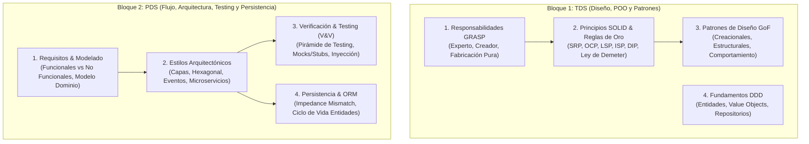
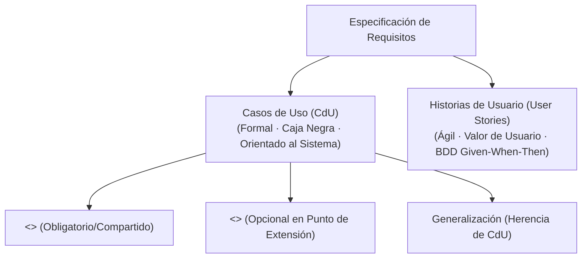
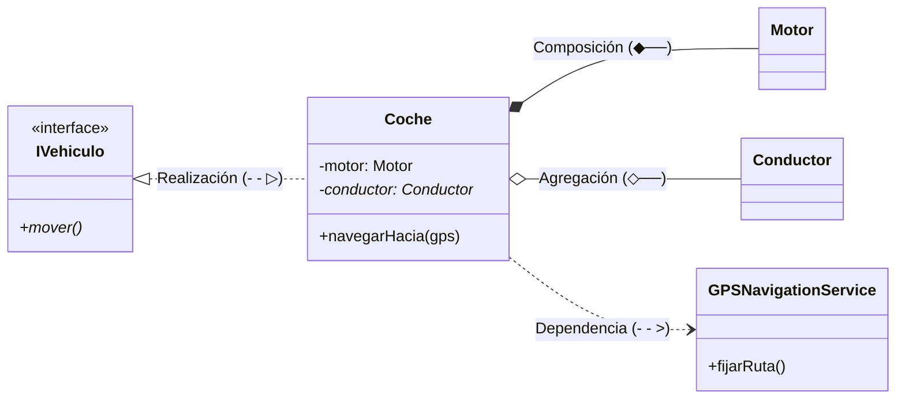
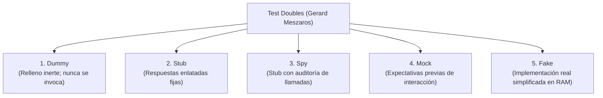
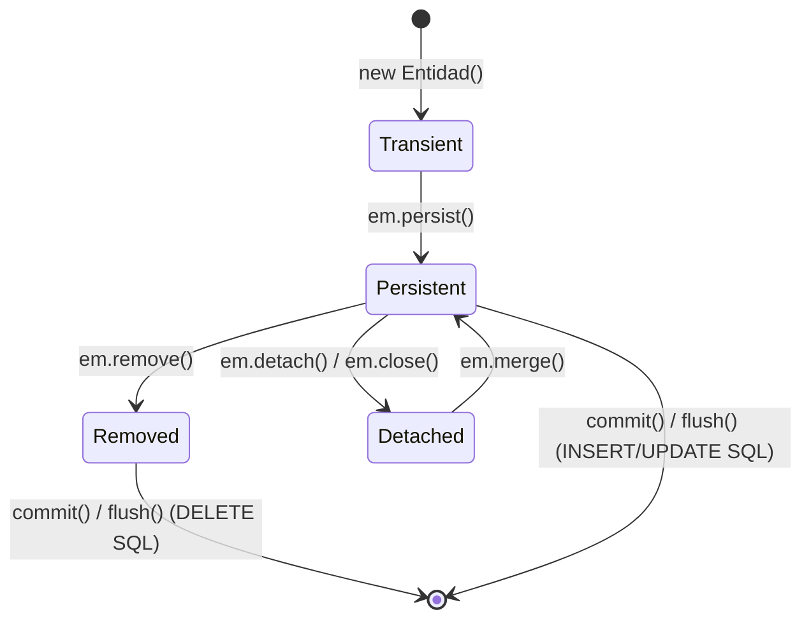

# 📐 Capa 2: Ingeniería del Software, Diseño y Ciclo de Vida (TDS & PDS)

Dividimos este nivel en los dos grandes bloques que has planteado, extrayendo los conceptos clave de tus notas de [[TDS_Tecnicas_Diseno_Software]] y [[PDS_Procesamiento_Diseno_Software]]:



---

## Bloque 1: Técnicas de Diseño de Software (TDS) — Asignación de Responsabilidades y Patrones

El objetivo primordial de TDS es responder con rigor metodológico a dos preguntas nucleares:
1. **¿En qué clase exacta debe vivir cada responsabilidad (datos y contratos)?**
2. **¿Cómo deben comunicarse y desacoplarse los objetos para que el sistema tolere cambios constantes de requisitos sin propagar regresiones en cascada?**

---

### 1.1 Asignación Estratégica de Responsabilidades: Patrones GRASP

Los patrones **GRASP** (*General Responsibility Assignment Software Patterns*), formulados por Craig Larman, no son diseños complejos de clases prefabricadas, sino los **principios mentales fundamentales** para asignar contratos y responsabilidades en el diseño orientado a objetos.

#### Taxonomía Canónica de la Responsabilidad
Toda responsabilidad asignada a una clase se clasifica formalmente en dos dimensiones:
- **Responsabilidades de Conocer (*Knowing*):**
  - Conocer sus propios datos privados encapsulados.
  - Conocer a objetos colaboradores conectados directamente (asociaciones).
  - Conocer datos derivados o calculados a partir de su propio estado.
- **Responsabilidades de Hacer (*Doing*):**
  - Realizar cálculos matemáticos o lógicos internos con sus datos.
  - Instanciar y crear nuevos objetos.
  - Iniciar y coordinar acciones o invocar servicios en otros objetos.
  - Controlar y sincronizar flujos de actividad entre múltiples colaboradores.

#### El Catálogo Canónico de los 9 Patrones GRASP

1. **Patrón Experto en Información (La Regla de Oro del Diseño):**
   - *Directriz:* Asignar la responsabilidad a la clase que posee la información necesaria para cumplirla.
   - *Justificación arquitectónica:* Si para calcular el importe total de una factura con impuestos una clase externa `ServicioFactura` tiene que pedirle línea por línea cada artículo a la clase `Factura`, se genera una clase de datos anémica (*Anemic Domain Model*) y un alto acoplamiento. La clase `Factura` es la experta: ella debe calcular su propio total.
   - *Consecuencia:* Máxima cohesión, datos y algoritmos residen juntos, y se protege la encapsulación.

2. **Patrón Creador (Las 5 Reglas Técnicas Canónicas de la UMU):**
   - *Problema:* ¿Quién debe ser el responsable de crear una nueva instancia de la clase `A`?
   - *Solución:* Asignar a la clase `B` la responsabilidad de instanciar `A` **si y solo si** se cumple alguna de las siguientes 5 condiciones técnicas (preferentemente varias de ellas):
     1. `B` es una **agregación** de objetos de `A`.
     2. `B` **contiene (composición)** por ciclo de vida objetos de `A`.
     3. `B` **registra** instancias de `A` (las almacena y cataloga).
     4. `B` hace un **uso específico o íntimo** de los objetos de `A`.
     5. `B` posee los **datos de inicialización** que se deben pasar al constructor de `A` al instanciarla.
   - *Ejemplo:* Una `Venta` crea sus propias `LineaVenta`, un `Pedido` crea sus `ItemPedido`. Un objeto externo nunca debe instanciar `LineaVenta` por su cuenta.

3. **Patrón Controlador (Frontera UI $\leftrightarrow$ Dominio):**
   - *Directriz:* Asignar la responsabilidad de recibir y manejar los eventos del sistema (procedentes de la UI, CLI o API REST) al primer objeto coordinador del dominio.
   - *Aislamiento estricto:* **Las clases del modelo de dominio jamás deben conocer ni acceder a la interfaz de usuario.** El Controlador actúa como el mediador puro.
   - *Tipos de Controlador:*
     - *Controlador Façade (del caso de uso):* Maneja todos los eventos asociados a un caso de uso concreto (ej. `ControladorRegistrarVenta`). Recomendado para no inflar una sola clase.
     - *Controlador Raíz (del sistema global):* Representa el sistema completo o dispositivo (ej. `SistemaTienda`). Útil en sistemas pequeños; se degrada en una God Class si el sistema crece.

4. **Fabricación Pura (*Pure Fabrication*):**
   - *Problema:* El Experto en Información a veces conduce a violar Alta Cohesión y Bajo Acoplamiento si forzamos a una entidad de negocio a hacer cosas como persistirse en SQL, serializarse en JSON o enviar correos. Una entidad del mundo real no se guarda a sí misma en base de datos.
   - *Solución:* Crear una clase artificial, que no existe en el dominio del problema del mundo real, diseñada exclusivamente para mantener la alta cohesión y el bajo acoplamiento técnico (ej. `EmpleadoRepository`, `EmailNotificationService`, `JsonSerializerMapper`).

5. **Bajo Acoplamiento (*Low Coupling*):**
   - *Directriz:* Asignar responsabilidades de forma que la dependencia entre módulos sea la menor posible.
   - *Las 4 Fuentes Técnicas de Acoplamiento entre Clase A y Clase B:*
     1. **Atributo:** `A` tiene un campo o atributo cuyo tipo es `B`.
     2. **Firma o cuerpo de método:** `A` tiene un método que recibe un parámetro de tipo `B`, declara una variable local de tipo `B`, o retorna un tipo `B`.
     3. **Herencia:** `A` es subclase directa o indirecta de `B`.
     4. **Implementación:** `A` implementa la interfaz `B`.
   - *Meta:* Reducir los acoplamientos a clases concretas e inestables; acoplarse únicamente a interfaces abstractas estables.

6. **Alta Cohesión (*High Cohesion*):**
   - *Directriz:* Mantener los objetos enfocados, comprensibles y manejables. Todas las responsabilidades de una clase deben estar estrechamente relacionadas con su propósito central.
   - *Métrica:* Una clase con baja cohesión hace demasiadas cosas no relacionadas, es difícil de reutilizar, difícil de probar y extremadamente frágil ante cambios.

7. **Polimorfismo (*Polymorphism*):**
   - *Directriz:* Cuando el comportamiento varía según el tipo o categoría de un concepto, asignar la responsabilidad a operaciones polimórficas en lugar de comprobar tipos con sentencias condicionales (`if (tipo == A)` o `switch(tipo)`).

8. **Indirección (*Indirection*):**
   - *Directriz:* Asignar la responsabilidad a un objeto intermediario para desacoplar dos componentes y evitar la dependencia directa (ej. Adaptadores, Proxies, Mediadores).

9. **Variación Protegida (*Protected Variations*):**
   - *Directriz:* Identificar los puntos del sistema propensos a variar o cambiar con el tiempo y envolverlos tras una interfaz estable y consistente. Es el principio conceptual raíz que sustenta a OCP y DIP.

---

### 1.2 Principios SOLID y Mandatos Arquitectónicos de Diseño

Los 5 principios formulados por Robert C. Martin ("Uncle Bob") y Bertrand Meyer establecen las reglas de estabilidad estructural del software modular:

#### 1. SRP — Single Responsibility Principle (Principio de Responsabilidad Única)
- **Definición formal:** *Una clase debe tener una, y solo una, razón para cambiar.*
- **Enfoque de Actores:** No significa "hacer una sola cosa" (eso es para funciones cortas). En arquitectura de clases, una razón para cambiar proviene de un **actor o stakeholder de negocio**:
  - Contabilidad (cambia cómo se calcula el IRPF/IVA).
  - Recursos Humanos (cambia el formato del reporte de empleados).
  - DBA/DevOps (cambia el esquema de PostgreSQL).
- **Violación clásica (God Class):** Una clase `Empleado` que contiene `calcularSueldoNeto()`, `generarReporteDesempenoPDF()` y `guardarEnBaseDatos()`. Un cambio en la BD pone en riesgo el cálculo de sueldos.
- **Solución:** Separar en `Empleado` (entidad pura), `CalculadoraNomina` (servicio financiero), `GeneradorReporteRRHH` y `EmpleadoRepository` (persistencia).

#### 2. OCP — Open/Closed Principle (Principio de Abierto/Cerrado)
- **Definición formal (Bertrand Meyer):** *Las entidades de software deben estar abiertas a la extensión, pero cerradas a la modificación.*
- **Mecanismo:** El comportamiento debe poder alterarse agregando nuevo código (nuevas clases o implementaciones), sin tocar ni una línea del código existente ya compilado, testeado y desplegado.
- **Técnica UMU:** Sustituir cascadas de `switch` o `if-else` sobre enumerados o tipos concretos por **interfaces polimórficas** (patrones *Strategy*, *Decorator* o *Factory Method*).

#### 3. LSP — Liskov Substitution Principle (Principio de Sustitución de Liskov)
- **Definición formal (Barbara Liskov):** *Si por cada objeto $o_1$ de tipo $S$ existe un objeto $o_2$ de tipo $T$ tal que para todos los programas $P$ definidos en términos de $T$, el comportamiento de $P$ permanece invariante cuando $o_1$ es sustituido por $o_2$, entonces $S$ es un subtipo de $T$.*
- **Fundamento en Diseño por Contrato (DbC):**
  - **Precondiciones:** El subtipo **no puede fortalecer** las precondiciones (no puede exigir más que el padre).
  - **Postcondiciones:** El subtipo **no puede debilitar** las postcondiciones (debe prometer al menos lo mismo que el padre).
  - **Invariantes:** Deben preservarse íntegramente en el subtipo.
- **El contraejemplo canónico (Cuadrado hereda de Rectángulo):**
  - Un `Rectangulo` tiene métodos mutadores independientes `setWidth(w)` y `setHeight(h)`. El contrato implícito es que modificar el ancho no altera la altura.
  - Si `Cuadrado` hereda de `Rectangulo`, al hacer `setWidth(5)` debe cambiar también la altura a 5 para no dejar de ser cuadrado.
  - Cualquier algoritmo cliente que reciba un `Rectangulo`, modifique su base esperando conservar su altura previa fallará estrepitosamente si se le pasa una instancia de `Cuadrado`. La herencia del mundo real no siempre cumple el subtipado de comportamiento en POO.

#### 4. ISP — Interface Segregation Principle (Principio de Segregación de Interfaces)
- **Definición formal:** *Los clientes no deben ser forzados a depender de interfaces que no utilizan.*
- **Evitar "Fat Interfaces":** No diseñes contratos omnipotentes con 20 métodos donde los clientes que solo necesitan imprimir se ven obligados a implementar métodos ficticios de fax, escaneo o grapado lanzando `UnsupportedOperationException`.
- **Solución:** Interfaces de rol (*Role Interfaces*) pequeñas, altamente cohesionadas (`Imprimible`, `Escaneable`, `Cerrable`).

#### 5. DIP — Dependency Inversion Principle (Principio de Inversión de Dependencias)
- **Definición formal:**
  1. *Los módulos de alto nivel no deben depender de módulos de bajo nivel. Ambos deben depender de abstracciones.*
  2. *Las abstracciones no deben depender de los detalles. Los detalles deben depender de las abstracciones.*
- **Inversión de Control (IoC):** En lugar de que la clase de negocio instancie su base de datos (`new MySqlDatabase()`), la clase de negocio declara una interfaz abstracta (`FacturaRepository`) que necesita consumir, y la infraestructura concreta le inyecta la implementación por constructor.

#### Mandatos Estratégicos de Oro Adicionales
- **Ley de Demeter (LoD — "No hables con extraños"):**
  - Un método $M$ de un objeto $O$ sólo debe llamar a métodos de:
    1. El propio objeto $O$ (`this`).
    2. Los parámetros formales pasados al método $M$.
    3. Cualquier objeto instanciado dentro de $M$.
    4. Los atributos directos de $O$.
  - *Prohibición:* Romper el encapsulamiento con encadenamiento de getters de más de un nivel (`pedido.getCliente().getDireccion().getCiudad().getCodigoPostal()`). Esto acopla al cliente a la topología interna del grafo completo de objetos. Usa el principio *"Tell, Don't Ask"* delegando la acción directamente.
- **Favorecer la Composición frente a la Herencia de Clases:**
  - La herencia es una relación *"Es-un"* estática y de caja blanca: expone los detalles internos de la superclase a la subclase y causa problemas de clases base frágiles.
  - La composición es una relación *"Tiene-un"* dinámica y de caja negra: ensambla componentes a través de interfaces sin conocer sus entrañas, permitiendo alterar el comportamiento en tiempo de ejecución.
- **Principio de Acceso Uniforme (Bertrand Meyer):**
  - Todos los servicios de un módulo deben estar disponibles a través de una notación sintáctica uniforme, que no traicione si están implementados como un atributo almacenado en memoria física o como una función calculada en tiempo real.

---

### 1.3 Los Patrones de Diseño GoF (Gang of Four) — Taxonomía y Trade-offs Técnicos

Publicados por Gamma, Helm, Johnson y Vlissides (1994), los 23 patrones se organizan en tres categorías según su intención:

```mermaid
graph TD
    GOF["Patrones de Diseño GoF (23)"]
    GOF --> CREA["Creacionales\n(Mecanismos de Instanciación)"]
    GOF --> ESTR["Estructurales\n(Composición de Clases y Objetos)"]
    GOF --> COMP["De Comportamiento\n(Algoritmos y Asignación de Tareas)"]

    CREA --> FM["Factory Method (Herencia / Reflexión)"]
    CREA --> AF["Abstract Factory (Familias de Productos)"]
    CREA --> BL["Builder (Construcción Paso a Paso)"]
    CREA --> SG["Singleton (Instancia Única)"]

    ESTR --> AD["Adapter (Integración 1 a 1)"]
    ESTR --> FC["Facade (Simplificación 1 a N)"]
    ESTR --> CP["Composite (Árboles Parte-Todo)"]
    ESTR --> DC["Decorator (Extensión Dinámica)"]
    ESTR --> PX["Proxy (Control de Acceso / Carga Perezosa)"]

    COMP --> ST["Strategy (Intercambio del CÓMO)"]
    COMP --> SE["State (Comportamiento según Estado QUÉ)"]
    COMP --> CM["Command (Undo/Redo con Historial)"]
    COMP --> OB["Observer (Suscripción Pub/Sub 1 a N)"]
    COMP --> CR["Chain of Responsibility (Canal de Receptores)"]
```



#### A. Patrones Creacionales (Desacoplar la Instanciación)

1. **Factory Method (Método de Fábrica):**
   - *Intención:* Define una interfaz para crear un objeto, pero delega en las subclases la decisión de qué clase concreta instanciar.
   - *Técnica Avanzada TDS UMU (Reflexión Dinámica):* Para evitar crear una subclase creadora por cada nuevo producto, se utiliza instanciación reflexiva:
     ```java
     // Sintaxis canónica robusta (Java 9+):
     Producto p = (Producto) Class.forName(claseProducto)
                                  .getDeclaredConstructor()
                                  .newInstance();
     ```
     *(Nota: `Class.newInstance()` está formalmente depreciado desde Java 9 por ocultar excepciones de constructor).*
2. **Abstract Factory (Fábrica Abstracta):**
   - *Intención:* Provee una interfaz para crear familias de objetos relacionados o dependientes (ej. Botones, Scrollbars y Ventanas compatibles con estilo Windows o estilo macOS) sin especificar sus clases concretas.
3. **Builder (Constructor):**
   - *Intención:* Separa la construcción de un objeto complejo de su representación, permitiendo que el mismo proceso construya representaciones diferentes.
   - *Resuelve:* Evita constructores telescópicos con 8 argumentos donde la mitad son pasados como `null`.
4. **Singleton (Instancia Única):**
   - *Intención:* Garantiza que una clase tenga una única instancia en todo el runtime y provee un punto de acceso global estático a ella.
   - *Trade-off Senior:* En arquitectura moderna se considera casi un code smell: introduce estado global mutable oculto, acopla componentes y dificulta el paralelismo y los tests unitarios. Se sustituye por inyección de dependencias con ciclo de vida `Singleton` gestionado por el contenedor de IoC.

#### B. Patrones Estructurales (Composición de Clases y Objetos)

1. **Adapter (Adaptador) vs Facade (Fachada) — La Distinción Canónica:**
   - **Adapter:** Resuelve la incompatibilidad entre **dos interfaces existentes predeterminadas (relación 1 a 1)**. Convierte la interfaz de una clase ajena o librería externa a la interfaz exacta que tu cliente ya exige.
   - **Facade:** Crea una **nueva interfaz unificada de alto nivel (relación 1 a muchos)** para simplificar el uso de un subsistema complejo compuesto por decenas de clases internas.
2. **Composite (Objeto Compuesto) — El Dilema de Diseño UMU:**
   - Permite tratar a objetos individuales (Hojas) y a composiciones jerárquicas (Nodos Compuestos) de manera completamente uniforme mediante una interfaz común `Componente`.
   - **Dilema Transparencia vs Seguridad:**
     - *Transparencia:* Los métodos de añadir/eliminar hijos (`add(c)`, `remove(c)`) se declaran en la interfaz base `Componente`. Cualquier cliente puede invocar `add()` sobre cualquier nodo sin castear. *Coste:* Las `Hojas` no tienen hijos, por lo que deben lanzar una excepción en runtime si alguien llama a `add()`.
     - *Seguridad:* Los métodos `add()` y `remove()` solo se declaran en la clase `Composite`. Las `Hojas` no tienen estos métodos, por lo que el compilador detecta errores antes de ejecutar. *Coste:* Se pierde el trato polimórfico uniforme y el cliente se ve obligado a hacer `instanceof` o downcasting.
3. **Decorator (Decorador) vs Strategy (Estrategia):**
   - *Decorator:* Añade responsabilidades dinámicamente envolviendo al objeto en capas concéntricas con la misma interfaz (ej. streams de Java `new GZIPOutputStream(new BufferedOutputStream(new FileOutputStream(f)))`). Evita la **explosión combinatoria de subclases** (ej. café con leche, con caramelo, descafeinado...).
   - *Regla de Oro TDS:* Si el objeto base no es "ligero" (tiene mucho estado o lógica pesada interna), el decorador resulta ineficiente y debe preferirse el patrón **Strategy**.
4. **Proxy (Apoderado / Intermediario):**
   - Proporciona un sustituto para controlar el acceso al objeto real:
     - *Virtual Proxy:* Carga perezosa (*Lazy Loading*) de objetos pesados en memoria (ej. imágenes de alta resolución).
     - *Protection Proxy:* Control de permisos y autorización según el rol del usuario.
     - *Remote Proxy:* Representación local de un objeto remoto en otra máquina/proceso (ej. gRPC, RMI).

#### C. Patrones de Comportamiento (Colaboración e Interacción Dinámica)

1. **Strategy (Estrategia) vs State (Estado) — El "Cómo" vs el "Qué":**
   - Aunque su diagrama UML estructural es prácticamente idéntico (un Contexto que delega en una interfaz polimórfica), su intención es radicalmente opuesta:
     - **Strategy:** Modela **"el CÓMO"**. El cliente elige conscientemente un algoritmo entre una familia intercambiable (ej. ordenar con Quicksort vs Mergesort; calcular ruta en mapa con camino más rápido vs más corto). Las estrategias no cambian el estado interno del contexto ni se conocen entre sí.
     - **State:** Modela **"el QUÉ según el estado"**. El objeto parece cambiar de clase cuando su estado interno muta (ej. un `Pedido` en estado `Borrador`, `Pagado`, `Enviado` o `Cancelado`). Los métodos de acción se comportan según el estado actual, y el propio estado o el contexto disparan las transiciones automáticas.
2. **Command (Comando) y el Soporte Canónico de Undo/Redo (UMU):**
   - Encapsula una solicitud como un objeto independiente, conteniendo el receptor, el método a invocar y sus parámetros.
   - *En Java moderno:* Las expresiones lambda reemplazan los usos triviales de `Command`.
   - *Implementación Estricta para Deshacer/Rehacer (Undo / Redo):* Requiere imperativamente:
     1. Un **Command Manager / Invoker** que gestione la ejecución y orqueste las pilas.
     2. Una **Lista de Historia (o Pila de Undo)** que almacene **copias de respaldo (mementos)** del estado previo antes de aplicar la mutación sobre el receptor para garantizar que `undo()` sea determinista e idempotente.
3. **Observer (Publicador / Suscriptor):**
   - Acoplamiento abstracto uno a muchos. Cuando el sujeto cambia de estado, notifica automáticamente a todos los observadores registrados.
   - *Modelo Push vs Pull:* En *Push*, el sujeto envía los datos del cambio dentro del mensaje; en *Pull*, el sujeto solo emite la señal y los observadores llaman a los getters del sujeto para consultar el nuevo estado.
4. **Iterator (Iterador Interno vs Externo):**
   - *Iterador Externo:* El cliente gobierna el bucle manualmente llamando a `hasNext()` y `next()`.
   - *Iterador Interno:* El iterador gobierna el recorrido del flujo; **requiere obligatoriamente closures o funciones lambda** pasadas por parámetro para ejecutar la acción sobre cada elemento (ej. `list.forEach(item -> ...)`).
5. **Chain of Responsibility (Cadena de Responsabilidad):**
   - Desacopla al emisor de una petición de sus receptores, encadenando objetos receptores en serie hasta que uno de ellos la maneja o la propaga al siguiente (base de los middlewares HTTP en Express/Koa y los filtros `SecurityFilterChain` en Spring Boot).

---

### 1.4 Fundamentos de DDD (Domain-Driven Design)

Eric Evans formaliza la arquitectura del software a partir de la riqueza del modelo del dominio y el lenguaje ubicuo (*Ubiquitous Language*):

1. **Entidades:**
   - Objetos que no se definen por sus atributos, sino por un hilo de continuidad y una **identidad única persistente** a lo largo de todo su ciclo de vida (un `Usuario` con ID `usr-9812` sigue siendo el mismo usuario aunque cambie su nombre, teléfono y contraseña).
2. **Value Objects (Objetos de Valor):**
   - Objetos **inmutables** (declarados con campos `final` o `readonly`) sin identidad propia, definidos exclusivamente por la combinación de sus valores.
   - Si dos instancias tienen los mismos atributos, son exactamente iguales (`equals() == true`).
   - *Auto-validación:* Validan sus invariantes en el constructor. No puede existir un Value Object con estado corrupto (ej. `Dinero(monto, divisa)`, `EmailAddress(rawString)`, `CoordenadaGPS(lat, lon)`).
3. **Servicios de Dominio:**
   - Lógica de negocio pura que involucra a múltiples entidades o no pertenece de forma natural al ciclo de vida de ninguna de ellas (ej. `ServicioTransferenciaFondos` transfiriendo saldo entre dos cuentas bancarias).
4. **Ciclo de Vida de los Objetos en DDD:**
   - **Agregados (Aggregates):** Conjunto cohesionado de entidades y objetos de valor tratados como una unidad atómica para la consistencia transaccional. Cada agregado tiene una única **Entidad Raíz (*Aggregate Root*)**; los objetos externos solo pueden referenciar a la raíz, nunca a entidades internas del agregado.
   - **Factorías (Factories):** Encapsulan la instanciación de agregados complejos garantizando que se cumplan todas las invariantes iniciales de golpe.
   - **Repositorios (Repositories):** Proporcionan la ilusión de una colección en memoria de agregados de dominio, abstrayendo por completo los detalles físicos del motor de base de datos o el ORM.

---

## Bloque 2: Procesamiento y Desarrollo de Software (PDS) — Flujo, Arquitectura y Calidad

PDS complementa el diseño centrándose en **el ciclo de vida completo de la ingeniería del software**, desde la elicitación rigurosa del problema hasta la arquitectura de sistemas distribuidos, la verificación industrial (V&V) y el almacenamiento persistente.

---

### 2.1 Requisitos de Software (PDS Tema 2)

La ingeniería de requisitos transforma las necesidades ambiguas y dispersas de los usuarios en especificaciones verificables y contrastables.

#### Factores de Calidad del Software (PDS Tema 1)
- **Factores Externos (visibles para el usuario/cliente en producción):**
  - *Corrección:* Grado en que el software satisface su especificación formal.
  - *Fiabilidad:* Capacidad de mantener un rendimiento especificado a lo largo del tiempo.
  - *Eficiencia:* Uso óptimo de hardware, memoria y ciclos de CPU.
  - *Robustez:* Comportamiento admisible y degradación elegante ante situaciones anómalas no previstas.
  - *Portabilidad:* Facilidad para transferir el sistema entre distintos entornos de hardware y SO.
- **Factores Internos (visibles para los ingenieros de mantenimiento):**
  - *Inteligibilidad:* Facilidad para comprender la estructura del código y su intención.
  - *Mantenibilidad / Modificabilidad:* Coste y esfuerzo requerido para corregir defectos o adaptar el sistema a nuevas normativas.
  - *Adaptabilidad / Extensibilidad:* Facilidad para incorporar nuevas funcionalidades sin alterar la arquitectura.
  - *Reutilización:* Capacidad de aprovechar componentes en proyectos futuros.

#### Tipos y Criterios de Calidad de los Requisitos
- **Requisitos Funcionales (FR):** Servicios que el sistema debe proveer, transformaciones de datos, entradas y salidas esperadas bajo un modelo de caja negra.
- **Requisitos No Funcionales (NFR / Atributos de Calidad):** Restricciones de rendimiento, disponibilidad (ej. 99.95%), latencia (ej. $p99 < 150\text{ ms}$), seguridad física (*safety*) y de datos (*security*), o normativas legales (RGPD). **Regla de oro:** Todo NFR debe incluir una métrica cuantificable y un procedimiento de verificación objetivo; de lo contrario, no es un requisito, es un deseo.
- **Criterios de Calidad Individuales:** Necesario, libre de detalles de implementación tecnológica, no ambiguo, consistente, completo, singular, viable, trazable y verificable.

#### Especificación Formal: Casos de Uso vs Historias de Usuario



##### 1. Estructura y Plantilla Canónica de un Caso de Uso (CdU)
Un Caso de Uso describe una secuencia de interacciones entre un actor y el sistema para entregar un resultado observable de valor bajo un modelo estricto de caja negra.

| Campo de Plantilla | Definición | Ejemplo Canónico (CdU-01: Alquilar Vehículo) |
| :--- | :--- | :--- |
| **ID & Nombre** | Identificador único y verbo en infinitivo | **CdU-01:** Alquilar Vehículo |
| **Actor Principal** | Quien inicia y persigue el objetivo | Cliente Registrado |
| **Actores Secundarios** | Sistemas de apoyo necesarios | Pasarela de Pago (Stripe), Servicio Notificaciones Email |
| **Precondición** | Estado exigido antes de iniciar | Cliente autenticado en el sistema y con carnet de conducir validado. |
| **Flujo Básico (Happy Path)** | Secuencia principal numerada de éxito | 1. Cliente selecciona categoría de vehículo y rango de fechas.<br/>2. Sistema comprueba disponibilidad y calcula tarifa desglosada.<br/>3. Sistema **incluye** `CdU-04 (Autenticar y Cobrar Fianza)`.<br/>4. Sistema bloquea el vehículo en flota y emite localizador.<br/>5. Sistema envía confirmación por email. |
| **Flujos Alternativos** | Excepciones o bifurcaciones condicionales | **2a. Sin flota disponible:**<br/>&nbsp;&nbsp;2a.1 Sistema informa de indisponibilidad y ofrece modelos similares de categoría superior.<br/>**3a. Pago rechazado por la pasarela:**<br/>&nbsp;&nbsp;3a.1 Sistema notifica error bancario y solicita tarjeta alternativa. |
| **Postcondición** | Estado garantizado al terminar con éxito | Vehículo reservado en BD, fianza retenida en pasarela y contrato emitido. |

##### 2. Estructura y Plantilla de una Historia de Usuario (User Story)
Enfoque conversacional propio de metodologías ágiles (Scrum/Kanban) centrado en el valor para el usuario:
- **Estructura Clásica:**
  $$\text{"Como } [\text{rol/actor}], \text{ quiero } [\text{capacidad/acción}], \text{ para } [\text{beneficio de negocio}].\text{"}$$
- **Criterios de Aceptación (BDD — Given / When / Then):**
  - **Dado que (*Given*):** El contexto o estado inicial previo.
  - **Cuando (*When*):** La acción ejecutada por el usuario.
  - **Entonces (*Then*):** El resultado observable esperado.
- *Ejemplo:*
  > **Como** conductor registrado,  
  > **quiero** recibir el contrato de alquiler en formato PDF firmado en mi email,  
  > **para** tener constancia legal en mi móvil sin tener que imprimir hojas físicas.  
  >  
  > **Criterios de Aceptación:**  
  > • *Dado que* la fianza del alquiler ha sido autorizada correctamente,  
  > • *Cuando* el sistema confirma la reserva,  
  > • *Entonces* se genera el PDF criptográficamente firmado y se envía por SMTP en menos de 10 segundos.

##### 3. Tabla Comparativa de Diferencias: Casos de Uso vs Historias de Usuario

| Criterio | Caso de Uso (CdU) | Historia de Usuario (US) |
| :--- | :--- | :--- |
| **Enfoque Principal** | Orientado al sistema y al contrato funcional global. | Orientado al usuario y al valor directo de negocio. |
| **Nivel de Formalidad** | Alto (plantilla estructurada, flujos alternativos exhaustivos). | Ligero y conversacional (tarjeta de conversación + criterios). |
| **Granularidad** | Media-Alta (cubre un proceso de negocio de principio a fin). | Fina (planificable para completarse en un único sprint de 1-2 semanas). |
| **Relaciones Formales** | Posee relaciones UML nativas (`<<include>>`, `<<extend>>`, herencia). | No tiene relaciones formales (se organizan por Épicas y Temas). |
| **Criterios de Validación** | Flujos alternativos y postcondiciones del contrato. | Criterios de Aceptación ejecutables (Cucumber / BDD). |

##### 4. Relaciones entre Casos de Uso (UML)
- **Inclusión (`<<include>>`):** El caso de uso base incorpora **obligatoriamente** el comportamiento del caso incluido. Si el caso incluido falla, el caso base no puede completarse. Se utiliza para factorizar secuencias repetitivas comunes (ej. *Realizar Transferencia* `<<include>>` *Verificar Saldo*).
- **Extensión (`<<extend>>`):** El caso de uso auxiliar incorpora comportamiento **opcional o condicional** al caso base en puntos específicos llamados *Puntos de Extensión*. El caso base no depende del extendido y puede completarse sin él (ej. *Contratar Conductor Adicional* `<<extend>>` *Alquilar Coche*).
- **Generalización (`──▷`):** Permite que un caso de uso hijo herede los pasos y actores de un caso de uso abstracto padre, sobreescribiendo o especializando partes del flujo.

---

### 2.2 Modelado de Software y Modelo de Dominio (PDS Tema 3)

El Modelo de Dominio es una representación visual de las clases conceptuales u objetos del mundo real en el problema de interés (**no son clases de software ni esquemas de base de datos**). El modelado de software se separa conceptualmente de la fase de requisitos para capturar la semántica pura del dominio antes de abordar la arquitectura del sistema.

##### Componentes del Modelo Conceptual
1. **Clases Conceptuales:** Representan entidades del dominio real. Poseen *Símbolo* (gráfico en la caja), *Intensión* (definición de sus propiedades) y *Extensión* (conjunto de todas sus instancias).
2. **Atributos:** Datos primitivos necesarios. **Regla de Oro UMU:** *Nunca se modelan atributos como claves ajenas (FKs) ni punteros técnicos*. Las relaciones entre conceptos se modelan exclusivamente mediante líneas de asociación.
3. **Multiplicidades:** Definen cuántas instancias pueden relacionarse ($1$, $0..1$, $*$, $1..*$).

##### Cómo se Dibuja Cada Relación UML y su Semántica de Ciclo de Vida



| Tipo de Relación | Símbolo Gráfico UML | Semántica | Ciclo de Vida de las Partes | Representación en Memoria (C++ / Java / TS) |
| :--- | :---: | :--- | :--- | :--- |
| **Dependencia** | `- - - >`<br/>(Flecha discontinua) | *"Usa un"* efímero | Ninguno. No hay propiedad estructural. | Parámetro formal en la firma de un método o variable local temporal. |
| **Asociación** | `──>`<br/>(Línea continua) | *"Conoce a"* / colabora | Independiente. Ambas entidades existen y se gestionan por separado. | Referencia o puntero de instancia como atributo de clase (`Cliente*`). |
| **Agregación** | `◇──`<br/>(Rombo blanco en el todo) | *"Tiene un"*<br/>(Todo-Parte débil) | **Independiente:** Si el todo se destruye, las partes **sobreviven**. | Puntero compartido (`std::shared_ptr`) o referencias a objetos externos. |
| **Composición** | `◆──`<br/>(Rombo negro en el todo) | *"Formado por"*<br/>(Todo-Parte fuerte) | **Dependiente:** Si el todo se destruye, las partes **se destruyen con él**. | Instancia por valor directo dentro del contenedor o puntero único (`std::unique_ptr`) liberado en destructor. |
| **Generalización** | `──▷`<br/>(Triángulo hueco continuo) | *"Es un"* (Herencia) | Subclase comparte 100% de la identidad y estructura de la superclase. | Herencia estática (`class Coche extends Vehiculo`). |
| **Realización** | `- - ▷`<br/>(Triángulo hueco discontinuo)| *"Implementa contrato"* | La clase concreta garantiza los contratos de la interfaz abstracta. | Implementación de interfaz (`class Coche implements IVehiculo`). |

##### Ejemplo Canónico Unificado en Código (Coche y Dominio Automovilístico)

```cpp
// 1. REALIZACIÓN (- - ▷): Interfaz pura sin implementación
class IVehiculo {
public:
    virtual void mover() = 0;
    virtual ~IVehiculo() = default;
};

// 2. COMPOSICIÓN (◆──): Motor ligado de por vida al Coche
class Motor {
public:
    void arrancar() { /* inyecta combustible */ }
};

// 3. AGREGACIÓN (◇──): Conductor existe independientemente de si conduce este coche
class Conductor {
private:
    string nombre;
public:
    Conductor(const string& n) : nombre(n) {}
};

// SERVICIO EXTERNO (Para Dependencia)
class GPSNavigationService {
public:
    void fijarRuta(const string& destino) { /* calcula satélite */ }
};

// CLASE PRINCIPAL QUE INTEGRA LAS 4 RELACIONES:
class Coche : public IVehiculo { // Realización
private:
    Motor motor;                  // COMPOSICIÓN: por valor (si Coche muere en el desguace, motor muere con él)
    Conductor* conductorAsignado; // AGREGACIÓN: puntero no exclusivo (si Coche explota, el conductor sobrevive)

public:
    Coche() : conductorAsignado(nullptr) {}

    void asignarConductor(Conductor* c) {
        this->conductorAsignado = c;
    }

    // DEPENDENCIA (- - >): GPS solo se recibe como parámetro puntual en este método; no es atributo de Coche
    void navegarHacia(GPSNavigationService& gps, const string& destino) {
        gps.fijarRuta(destino); // "Usa un" servicio temporalmente
    }

    void mover() override {
        motor.arrancar();
    }
};
```

---

### 2.3 Arquitectura y Diseño de Software: TODOS los Estilos Arquitectónicos Juntos (PDS Tema 4)

Un estilo arquitectónico define una familia de sistemas en términos de un patrón de organización estructural: componentes, conectores y restricciones de interacción.

#### Tabla Comparativa Exhaustiva de Estilos Arquitectónicos (PDS UMU)

| Estilo Arquitectónico | Descripción & Filosofía | Componentes | Conectores | Ventajas Principales | Desventajas / Riesgos | Casos de Uso Clásicos |
| :--- | :--- | :--- | :--- | :--- | :--- | :--- |
| **1. Capas (Layered / N-Tier)** | Estructura jerárquica donde cada capa ofrece servicios a la superior y posee una responsabilidad única (UI -> Dominio -> Datos). | Capas lógicas cerradas/abiertas y módulos internos. | Llamadas a procedimientos/métodos síncronos en memoria. | Reutilización, estandarización y reducción de dependencias. | Acoplamiento en cascada ante cambios y pasarelas ociosas (*Sinkhole anti-pattern*). | Aplicaciones empresariales clásicas, MVC. |
| **2. Hexagonal (Puertos & Adaptadores)** | Aísla el núcleo de negocio de la tecnología exterior. Dominio declara Puertos; infraestructura implementa Adaptadores. | Dominio puro, Casos de Uso, Puertos de Entrada/Salida, Adaptadores Driving/Driven. | Invocación polimórfica mediante Inversión de Dependencias (DIP). | Testeabilidad 100% aislada en memoria; frameworks y BD intercambiables. | Mayor número de clases, mapeos explícitos DTO/Entidad e indirección. | Microservicios con lógica de negocio rica, DDD, finanzas. |
| **3. Microkernel (Basado en Plugins)** | Núcleo minimalista y estable que provee el ciclo de vida básico y se extiende dinámicamente mediante plug-ins independientes. | Núcleo central (Microkernel) y Plug-ins (extensiones). | APIs internas de plug-ins, eventos o memoria compartida. | Alta modularidad, extensibilidad en tiempo de ejecución y aislamiento de fallos. | El núcleo debe ser ultra estable; complejidad en coordinación de plugins. | Visual Studio Code, Obsidian, Eclipse, kernels de SO. |
| **4. Eventos: Colas de Mensajes** | Arquitectura orientada a mensajes punto a punto con entrega ordenada en modo *pull*. Un solo consumidor por mensaje. | Productores, Consumidores y Colas en el broker. | Mensajería asíncrona (AMQP, Redis Queues, AWS SQS). | Desacoplamiento temporal y espacial total; absorción de picos (*load leveling*). | Complejidad operativa; consistencia eventual y necesidad de idempotencia. | Procesamiento asíncrono pesado (vídeos, emails, webhooks). |
| **5. Eventos: Publicar/Suscribir (Pub/Sub)** | Desacopla la comunicación emitiendo eventos en modo *push* sobre topics. Múltiples suscriptores independientes reciben copias. | Publicadores, Broker de eventos/topics y múltiples Suscriptores. | Protocolos de eventos en streaming (Apache Kafka, AWS SNS, NATS). | Escalabilidad horizontal extrema; comunicación reactiva 1 a N en tiempo real. | Dificultad para trazar el flujo global; orden garantizado solo por partición. | Telemetría IoT, sistemas reactivos (EDA), analítica en streaming. |
| **6. Pipes and Filters (Tuberías y Filtros)** | Procesamiento en flujo unidireccional de datos donde una serie de filtros autónomos transforman datos recibidos por tuberías. | Filtros (nodos de cómputo y transformación sin estado global). | Tuberías / Pipes (canales unidireccionales que enlazan salida con entrada). | Composición funcional sencilla, alta reutilización y paralelismo natural. | El rendimiento global queda acotado por el filtro más lento (cuello de botella). | Compiladores (Léxico -> Sintáctico -> Semántico), pipelines ETL, Unix bash. |
| **7. Cliente - Servidor** | Comunicación asimétrica síncrona/asíncrona donde clientes localizan al servidor y solicitan recursos; el servidor responde. | Clientes ligeros/pesados y Servidor centralizado. | Peticiones (*Request*) y Respuestas (*Reply*) sobre TCP/HTTP. | Centralización de datos y seguridad; mantenimiento y evolución sencilla. | Servidor como punto único de fallo; cuello de botella ante sobrecarga. | Web tradicional, APIs REST estándar, bases de datos relacionales. |
| **8. Microservicios vs Monolito Modular** | Monolito: único proceso ejecutable en memoria.<br/>Microservicios: servicios autónomos desplegados en procesos y máquinas independientes. | Servicios independientes con Bounded Context frente al proceso único del monolito. | APIs de red ligeras (REST, gRPC) y brokers de mensajería. | Autonomía de despliegue por equipo; escalado horizontal selectivo y tolerancia a fallos. | Latencia de red, serialización, fallos parciales, consistencia eventual y coste DevOps. | Monolito para equipos pequeños; Microservicios para organizaciones grandes maduras. |

---

#### Diseño de APIs REST, Idempotencia y Modelo de Madurez de Richardson

- **Niveles de Madurez de Richardson:**
  - *Nivel 0 (The Swamp of POX):* Un solo endpoint y verbo (`POST /api`) actuando como RPC remoto.
  - *Nivel 1 (Recursos):* URIs independientes para cada recurso (`/usuarios`, `/pedidos/102`).
  - *Nivel 2 (Verbos HTTP Estándar y Códigos de Estado):* Uso estricto de la semántica de la RFC:
    - **Idempotencia Formal:** Una operación es idempotente si ejecutarla $N$ veces consecutivas genera **el mismo estado final en el servidor** que ejecutarla una única vez.
      - `GET`: **Seguro e Idempotente**. Solo lectura; nunca muta estado.
      - `PUT`: **Idempotente**. Reemplaza completamente el recurso en una URI conocida. Si se repite, el recurso queda en el mismo estado.
      - `DELETE`: **Idempotente**. Elimina el recurso. La primera llamada lo suprime (200/204); llamadas sucesivas no alteran el estado (devuelven 404 o 204, pero el recurso sigue borrado).
      - `POST`: **NO Idempotente**. Crea un nuevo recurso subordinado. Ejecutarlo $N$ veces creará $N$ registros distintos con diferentes identificadores.
      - `PATCH`: Modificación parcial; no necesariamente idempotente por especificación RFC.
    - **Códigos de Estado Clave:**
      - `200 OK` (éxito con contenido), `201 Created` (recurso creado con cabecera `Location`), `204 No Content` (éxito sin cuerpo).
      - `400 Bad Request` (sintaxis corrupta), `401 Unauthorized` (falta autenticación), `403 Forbidden` (autenticado pero sin permisos suficientes), `404 Not Found`, `409 Conflict` (conflicto de concurrencia/estado), `422 Unprocessable Entity` (error de validación de esquema en Pydantic/JSON Schema).
      - `500 Internal Server Error`, `502 Bad Gateway`, `503 Service Unavailable`.
  - *Nivel 3 (HATEOAS — Hypermedia As The Engine Of Application State):* Las respuestas incluyen hipervínculos dinámicos (`links`) indicando las transiciones de estado válidas que el cliente puede ejecutar a continuación.

---

### 2.4 Verificación, Validación y Testing Industrial (V&V) (PDS Tema 5)

- **Verificación vs Validación:**
  - *Verificación:* "¿Estamos construyendo el producto **correctamente**?" (Alineación con la especificación técnica y las normas de diseño).
  - *Validación:* "¿Estamos construyendo el producto **correcto**?" (Satisfacción real de las necesidades del cliente y usuarios finales).
- **Cadena Formal de Defectología (PDS Tema 5):**
  $$\text{Error Humano (Mental)} \xrightarrow{\text{introduce}} \text{Defecto / Bug (en código)} \xrightarrow{\text{ejecuta en runtime}} \text{Fallo Observable (violación de especificación)}$$

#### Técnicas de Prueba y Cobertura
- **Pruebas de Caja Negra (Funcionales):** Diseñadas exclusivamente a partir de la especificación sin inspeccionar el código fuente.
  - *Partición de Equivalencia:* División del dominio de entrada en clases válidas e inválidas donde cualquier valor representa a todo el conjunto.
  - *Análisis de Valores Límite:* Evaluar los extremos de cada partición (ej. para un rango $[1, 100]$, probar $0, 1, 2, 99, 100, 101$).
- **Pruebas de Caja Blanca (Estructurales):** Diseñadas analizando el grafo de control del código fuente.
  - *Cobertura de Sentencias/Líneas:* Porcentaje de líneas ejecutadas.
  - *Cobertura de Ramas (Branch Coverage):* Garantiza que cada bifurcación `if/else` y `switch` se evalúe a verdadero y a falso al menos una vez.
  - *MC/DC (Modified Condition Decision Coverage):* Criterio riguroso exigido en software crítico (aeronáutica DO-178C y medicina). Demuestra que cada condición booleana individual afecta de manera independiente al resultado final de una decisión compuesta.

#### La Taxonomía Formal de los 5 Test Doubles (Gerard Meszaros)

Para aislar el Sistema Bajo Prueba (SUT) sin invocar bases de datos reales, pasarelas de pago o APIs de terceros, se utiliza la Inyección de Dependencias para sustituir dependencias por **Dobles de Prueba**:



1. **Dummy (Maniquí):**
   - Objeto que se pasa exclusivamente para satisfacer las restricciones del compilador en firmas de métodos que exigen parámetros no nulos. **Nunca se invoca ningún método de él.**
2. **Stub (Respuesta Enlatada):**
   - Proporciona respuestas fijas y preprogramadas a las llamadas realizadas durante la prueba. No contiene lógica ni verifica interacciones; simplemente alimenta al SUT con datos controlados (ej. `ClockStub` devolviendo siempre `"2026-10-25 10:00:00"`).
3. **Spy (Espía):**
   - Es un Stub que, además de devolver respuestas preprogramadas, **registra métricas internas de invocación** (número de veces llamado, argumentos exactos recibidos, orden de ejecución) para poder realizar aserciones al final del test (ej. verificar que `notificador.enviar()` se invocó exactamente una vez).
4. **Mock (Simulador con Expectativas):**
   - Objeto preprogramado con **expectativas estrictas de comportamiento**. Sabe de antemano qué llamadas debe recibir, en qué orden y con qué parámetros. Si una llamada inesperada ocurre o no se cumple el protocolo previsto, el test falla automáticamente durante la verificación del mock.
5. **Fake (Simulador Funcional Ligero):**
   - Posee una **implementación funcional real y completa**, pero no apta para producción por limitaciones de rendimiento o persistencia (ej. `InMemoryUserRepository` usando un `Map` en RAM en lugar de conectar con PostgreSQL). Permite ejecutar cientos de tests de casos de uso por segundo de forma totalmente determinista.

---

### 2.5 Persistencia, Ciclo de Vida JPA y SQL vs NoSQL (PDS Tema 6)

#### El Desfase Objeto-Relacional (Impedance Mismatch)
Surge de las diferencias ontológicas entre el paradigma OO y el relacional:
1. *Granularidad:* Los objetos pueden tener clases compuestas ricas (`Direccion`, `Dinero`), mientras las tablas relacionales son planas y exigen tipos primitivos escalares.
2. *Herencia:* El modelo relacional no soporta herencia de tipos de forma nativa.
3. *Identidad:* En POO la identidad es igualdad de referencia en memoria (`o1 == o2`) o de valores (`equals()`); en SQL es la Clave Primaria (PK).
4. *Navegación de Asociaciones:* En POO las referencias son unidireccionales o bidireccionales en memoria; en SQL las asociaciones se resuelven mediante claves ajenas (FK) y costosas operaciones `JOIN`.

#### Ciclo de Vida de los Objetos en JPA / Hibernate
Las entidades transitan por **4 estados finitos** bajo el control del `EntityManager`:



1. **Transient (Nuevo):**
   - Instanciado con `new`. No tiene identificador de base de datos (`@Id`) ni está registrado en el contexto de persistencia.
2. **Persistent / Managed (Gestionado):**
   - Asociado al `EntityManager` y con ID asignado.
   - **Dirty Checking Automático:** Cualquier modificación sobre los atributos de la entidad es detectada por el framework; al ejecutar `commit()` o `flush()`, se emitirá automáticamente la sentencia `UPDATE` correspondiente sin necesidad de invocar métodos de guardado manual.
3. **Detached (Desconectado):**
   - Posee ID de base de datos, pero el contexto de persistencia se ha cerrado (`em.close()`) o se ha desvinculado explícitamente (`em.detach()`). Las mutaciones en memoria ya no se sincronizan con la base de datos a menos que se invoque `em.merge()`.
4. **Removed (Marcado para Eliminación):**
   - Programado para supresión física. Al sincronizar con la base de datos, se ejecuta la sentencia `DELETE FROM ... WHERE id = ?`.

#### Estrategias de Herencia en JPA (`@Inheritance`)
- **`SINGLE_TABLE` (Tabla Única):**
  - Todas las clases de la jerarquía se almacenan en una única tabla con una columna discriminadora (`DTYPE`).
  - *Ventaja:* Consultas polimórficas ultra rápidas sin JOINs.
  - *Desventaja:* Las columnas exclusivas de las subclases deben ser `nullable`, perdiendo restricciones de integridad.
- **`JOINED` (Tabla de Unión / Específica):**
  - Tabla base para atributos comunes y tablas hijas para cada subclase vinculadas por FK.
  - *Ventaja:* Esquema relacional normalizado y campos no nulos respetados.
  - *Desventaja:* Requiere operaciones `JOIN` continuas para recuperar instancias polimórficas.
- **`TABLE_PER_CLASS` (Tabla por Clase):**
  - Cada subclase concreta tiene su propia tabla independiente con todos los atributos duplicados.
  - *Desventaja:* Consultas polimórficas requieren operaciones `UNION` computacionalmente caras.

#### El Bug N+1 en ORM y su Solución
Ocurre cuando se recupera una colección de $N$ registros con una consulta inicial, y luego el ORM ejecuta perezosamente (*Lazy Loading*) una consulta SQL secundaria independiente por cada uno de los $N$ registros para cargar sus colecciones relacionadas:
$$\text{Total consultas} = 1 + N$$
*Solución Canónica:* Emplear **Carga Ansiosa (*Eager Loading*)** mediante sentencias **`JOIN FETCH`** en JPQL o APIs de criteria (`SELECT u FROM User u JOIN FETCH u.pedidos`), recuperando todo el grafo en un único viaje de red a la base de datos.

#### Bases de Datos Relacionales (SQL / ACID) vs NoSQL (BASE & CAP)

| Criterio | Relacionales (SQL) | No Relacionales (NoSQL) |
| :--- | :--- | :--- |
| **Modelo de Datos** | Tablas bidimensionales normalizadas (*Schema-on-write* estricto). | Documentos, Clave-Valor, Columnas, Grafos, Vectores (*Schema-on-read* dinámico). |
| **Garantías de Transacción** | **ACID** (Atomicidad, Consistencia, Aislamiento, Durabilidad) estricto. | **BASE** (Basically Available, Soft-state, Eventual consistency). |
| **Relaciones & JOINs** | Nativas y altamente optimizadas con Claves Primarias y Ajenas. | Inexistentes o caras; se prioriza la **desnormalización** y el anidamiento. |
| **Escalabilidad** | Principalmente **Vertical** (Scale-Up: más CPU/RAM). Sharding manual complejo. | Diseñadas para **Escalabilidad Horizontal** nativa (Scale-Out: clúster de cientos de nodos). |
| **Teorema CAP** | Priorizan **Consistencia + Disponibilidad (CA)** local, o CP con replicación síncrona. | Optan mayoritariamente por **AP** (Alta Disponibilidad ante Partición) o CP parametrizable. |
| **Familias Líderes** | PostgreSQL, MySQL, SQLite, Oracle. | MongoDB (Doc), Redis (K-V), Cassandra (Col), Neo4j (Grafo), Qdrant (Vectorial). |

- **Las 5 Familias NoSQL en Arquitectura Moderna:**
  1. *Documentales (MongoDB, CouchDB):* Almacenamiento semiestructurado en documentos JSON/BSON. Perfectas para e-commerce, catálogos, auditorías y APIs donde los recursos se consultan de golpe.
  2. *Clave-Valor (Redis, DynamoDB):* Acceso en tiempo constante $O(1)$. Caché ultrarrápida en memoria RAM, almacenamiento de sesiones JWT y control de tasa (*Rate Limiting*).
  3. *Familias de Columnas Anchas / Wide-Column (Apache Cassandra, ScyllaDB):* Agrupación de columnas dinámicas sobre disco particionado. Clave para series temporales, eventos de telemetría y Big Data con escrituras masivas concurrentes.
  4. *Bases de Datos de Grafos (Neo4j, Amazon Neptune):* Modelado directo de nodos, aristas y propiedades. Permiten recorrer relaciones profundas (*traversals*) en $O(1)$ por salto sin operaciones JOIN. Indispensables en redes sociales, detección de fraude financiero y motores de recomendación.
  5. *Bases de Datos Vectoriales (Qdrant, Milvus, Pinecone):* Almacenan embeddings densos y proporcionan índices HNSW para búsqueda de vecinos más cercanos (*Approximate Nearest Neighbors - ANN*) mediante distancia Coseno o Euclídea. Piedra angular de arquitecturas de Inteligencia Artificial y pipelines **RAG** (*Retrieval-Augmented Generation*).

---

### 💡 Por qué esta capa es el puente perfecto

Si dominas este nivel:
1. Sabes cómo organizar el código para que sea **mantenible y testeable** (TDS).
2. Sabes cómo **diseñar sistemas, desacoplar componentes y manejar la persistencia** (PDS).

Ahora tenemos la base completa de la ingeniería de software:
* **Capa 0:** Silicio, Hardware y SO (Sustrato físico).
* **Capa 1:** Estructuras de Datos y Algoritmia (Eficiencia y complejidad).
* **Capa 2:** Ingeniería de Software, Diseño y Arquitectura (Mantenibilidad, testing y sistemas).

¿Tiene sentido esta estructuración de TDS/PDS para ti? Si estás de acuerdo, podemos dar el salto hacia el inicio del mundo de la Inteligencia Artificial: la **IA Simbólica, Búsqueda Heurística y Procesadores de Lenguaje** (con asignaturas como [[SSII_Sistemas_Inteligentes]] y [[CMP_Compiladores]]).