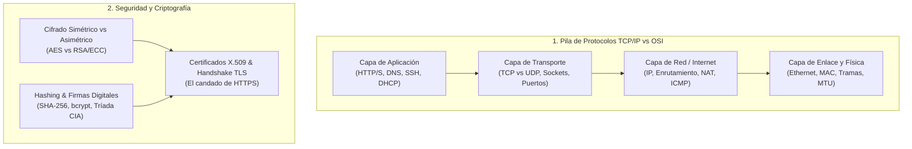

# 🌐 Capa 3: Redes de Computadores, Protocolos y Seguridad de Comunicaciones

Al igual que con la Capa 0, dejamos de lado el "ruido de certificación de telecomunicaciones" (cálculo de atenuación de fibra óptica, subnetting manual complejo en binario de examen o configuración de routers Cisco) y nos quedamos con los **conceptos no negociables para un ingeniero de software moderno**:

---

## Bloque 1: El Modelo de Capas y el Flujo de Datos

El diseño de redes se basa en la **abstracción por capas** mediante el proceso de **Encapsulación**:

### 1.1 Modelo OSI (7 capas teóricas) vs Modelo TCP/IP (4 capas prácticas)
El modelo OSI es un estándar conceptual académico de 7 niveles (Física, Enlace, Red, Transporte, Sesión, Presentación, Aplicación). En el mundo real, **Internet funciona exclusivamente con la arquitectura TCP/IP**, que colapsa las tres superiores en una sola:

| Capa TCP/IP | Unidad de Información (PDU) | Responsabilidad Principal | Protocolos Clave |
| :--- | :--- | :--- | :--- |
| **4. Aplicación** | Datos / Mensaje | Lógica de usuario y formato de los datos | HTTP, HTTPS, DNS, DHCP, SSH |
| **3. Transporte** | **Segmento** (TCP) / Datagrama (UDP) | Comunicación extremo a extremo entre procesos (puertos) | TCP, UDP, QUIC |
| **2. Red (Internet)** | **Paquete** | Direccionamiento lógico y enrutamiento entre redes distintas | IPv4, IPv6, ICMP, ARP |
| **1. Enlace / Física** | **Trama (Frame)** / Bits | Envío físico de señales entre interfaces de la misma red local | Ethernet, Wi-Fi, MAC |

### 1.2 Encapsulación y Desencapsulación
* Cuando tu software envía un JSON por red, viaja hacia abajo:
  $$\text{Datos (JSON)} \to [\text{Cabecera TCP} \mid \text{Datos}] \to [\text{Cabecera IP} \mid \text{Segmento TCP}] \to [\text{Cabecera Ethernet} \mid \text{Paquete IP} \mid \text{FCS}]$$
* En cada salto, cada capa añade su propia cabecera (*header*) con metadatos y en destino la retira.
* **MTU (Maximum Transmission Unit):** El tamaño máximo de una trama física (en Ethernet casi siempre son **1500 bytes**). Si un paquete IP supera la MTU, tiene que ser fragmentado en múltiples paquetes, lo cual penaliza severamente el rendimiento.

---

## Bloque 2: Capa de Red e Internet (Direccionamiento y Enrutamiento)

Aquí se resuelve: **¿Cómo llega un paquete desde tu máquina hasta un servidor en la otra punta del planeta?**

### 2.1 Protocolo IP (IPv4 vs IPv6)
* **Direcciones IPv4 (32 bits, 4 octetos ej. `192.168.1.1`):**
  * **IPs Públicas:** Enrutables en todo Internet, únicas en el mundo.
  * **IPs Privadas (RFC 1918):** Solo válidas dentro de una red local interna (`10.0.0.0/8`, `172.16.0.0/12`, `192.168.0.0/16`).
  * **Loopback (`127.0.0.1` / `localhost`):** La máquina se envía paquetes a sí misma sin tocar la tarjeta de red externa.
* **Máscaras de Subred y Notación CIDR (ej. `/24`):**
  * La máscara divide los 32 bits de la IP en: **[Bits de Red $\mid$ Bits de Host]**.
  * Un `/24` significa que los primeros 24 bits definen la red (`255.255.255.0`), dejando $2^8 = 256$ direcciones para máquinas en esa subred (254 útiles, descontando red y broadcast).
* **NAT (Network Address Translation):**
  * Como las direcciones IPv4 se agotaron, tu router doméstico o el balanceador de un data center tiene 1 sola IP pública.
  * Mediante NAT/PAT (*Port Address Translation*), el router reescribe las cabeceras de los paquetes: mapea peticiones de muchas IPs privadas internas usando puertos efímeros diferentes sobre su única IP pública externa.

### 2.2 Protocolos Auxiliares que Sostienen la Red
* **DHCP (Dynamic Host Configuration Protocol):** Protocolo automático de bienvenida. Cuando una máquina se conecta a una red, emite una petición por broadcast solicitando configuración. El servidor DHCP le asigna automáticamente: una IP libre, la máscara de subred, la puerta de enlace (Gateway) y los servidores DNS.
* **ARP (Address Resolution Protocol):** La IP es una dirección lógica, pero los cables y switches solo entienden direcciones físicas **MAC (Media Access Control, 48 bits grabados en la tarjeta)**. ARP pregunta por broadcast: *"¿Quién tiene la IP 192.168.1.50? Que me diga su dirección MAC"*.
* **ICMP (Internet Control Message Protocol):** Protocolo de diagnóstico y control de errores. No transporta datos de usuario. Es la base del comando `ping` (mensajes Echo Request / Echo Reply) y `traceroute` (aprovechando el decremento del campo **TTL - Time To Live** en cada router intermedio para descubrir la ruta de saltos).

---

## Bloque 3: Capa de Transporte (TCP vs UDP y la Abstracción de Sockets)

Si la Capa IP conecta máquinas, la Capa de Transporte **conecta procesos concretos dentro de esas máquinas**.

### 3.1 Puertos y la Abstracción de Socket
* **Qué es un Puerto:** Un número de 16 bits ($0$ a $65535$) que actúa como buzón de entrega para un proceso.
  * *Puertos Reservados / Well-Known ($0 - 1023$):* Requieren permisos de administrador (`80` HTTP, `443` HTTPS, `22` SSH, `53` DNS).
  * *Puertos Efímeros ($49152 - 65535$):* Puertos aleatorios que el SO asigna a tu navegador o cliente para iniciar peticiones salientes.
* **Socket:** La abstracción definitiva del SO para la comunicación de red. Una conexión queda definida universalmente por una tupla de 5 elementos:
  $$\text{Conexión} = (\text{Protocolo}, \text{IP Origen}, \text{Puerto Origen}, \text{IP Destino}, \text{Puerto Destino})$$

### 3.2 TCP (Transmission Control Protocol) — Fiable y Conectado
Diseñado para cuando **no puedes perder ni un solo byte** (páginas web, APIs, transferencias de archivos, bases de datos):
* **Orientado a Conexión (Three-Way Handshake):**
  1. Cliente envía `SYN` (sincronizar número de secuencia $X$).
  2. Servidor responde `SYN-ACK` (confirma $X+1$ y propone su secuencia $Y$).
  3. Cliente responde `ACK` (confirma $Y+1$). La conexión queda establecida.
* **Garantías de TCP:**
  * **Entrega en orden:** Los segmentos tienen números de secuencia. Si llegan desordenados, el receptor los reorganiza en su buffer antes de entregarlos al software.
  * **Confiabilidad:** Cada paquete recibido se confirma con un `ACK`. Si el emisor no recibe el ACK tras un tiempo (*Retransmission Timeout*), lo vuelve a enviar.
  * **Control de Flujo (Ventana Deslizante / Flow Control):** El receptor le dice al emisor cuánto espacio le queda en su buffer (`Window Size`) para evitar que lo ahogue enviándole datos más rápido de lo que puede procesar.
  * **Control de Congestión:** Si la red intermedia de routers empieza a perder paquetes, TCP reduce drásticamente su velocidad de transmisión (*Slow Start*, *Congestion Avoidance*) para no colapsar la infraestructura.

### 3.3 UDP (User Datagram Protocol) — Rápido y Sin Estado
Diseñado para cuando **la velocidad y la baja latencia importan más que la pérdida de paquetes ocasionales**:
* Sin conexión previa, sin apretón de manos, sin confirmaciones (ACKs), sin retransmisiones y sin control de flujo. Envía datagramas independientes directamente.
* **Casos de uso reales:** Streaming en directo de vídeo/audio (perder un frame de vídeo no justifica congelar la pantalla esperando su retransmisión), videojuegos online (la posición del jugador hace 200 ms ya no sirve), consultas rápidas de DNS y métricas masivas (telemetría/StatsD).
* *Dato clave moderno:* El nuevo protocolo **HTTP/3** abandonó TCP y funciona sobre **QUIC**, que está construido encima de **UDP** para evitar los bloqueos de conexión de TCP.

---

## Bloque 4: Capa de Aplicación y la Web (DNS, HTTP y Servidores)

### 4.1 DNS (Domain Name System)
* La libreta de direcciones jerárquica y distribuida de Internet. Traduce `api.ejemplo.com` a una IP comprensible por routers.
* **Estructura Jerárquica:**
  1. Servidores Raíz (Root `.` servers).
  2. Servidores TLD (Top-Level Domain: `.com`, `.es`, `.org`).
  3. Servidores Autoritativos (los que guardan los registros reales de tu dominio).
* **Tipos de Registros DNS esenciales:**
  * `A`: Apunta un dominio a una dirección IPv4.
  * `AAAA`: Apunta un dominio a una dirección IPv6.
  * `CNAME`: Alias canónico (un nombre apunta a otro nombre, ej. `www` $\to$ `ejemplo.com`).
  * `MX`: Servidores de correo para ese dominio.
  * `TXT`: Texto arbitrario (usado para verificar propiedad y seguridad de correo SPF/DKIM).
* **TTL (Time to Live):** Tiempo en segundos que los routers y clientes pueden guardar en su caché local la respuesta DNS antes de volver a preguntar al servidor autoritativo.

### 4.2 HTTP / HTTPS (Hypertext Transfer Protocol)
El protocolo sobre el que descansa el 99% de las aplicaciones web y APIs modernas:
* **Estructura de una petición:**
  * *Start Line:* Método (`GET`, `POST`, `PUT`, `DELETE`, `PATCH`) + Ruta (`/v1/users`) + Versión (`HTTP/1.1`).
  * *Headers:* Metadatos clave-valor (`Host`, `User-Agent`, `Authorization`, `Content-Type: application/json`).
  * *Body:* El payload de datos (opcional, en POST/PUT/PATCH).
* **Códigos de Estado HTTP fundamentales:**
  * `2xx` Éxito (`200 OK`, `201 Created`, `204 No Content`).
  * `3xx` Redirección (`301 Moved Permanently`, `304 Not Modified` para cachés).
  * `4xx` Error del Cliente (`400 Bad Request`, `401 Unauthorized` [no autenticado], `403 Forbidden` [autenticado pero sin permisos], `404 Not Found`, `429 Too Many Requests` [rate limiting]).
  * `5xx` Error del Servidor (`500 Internal Server Error`, `502 Bad Gateway` [el reverse proxy no pudo hablar con tu app], `503 Service Unavailable`, `504 Gateway Timeout`).

### 4.3 Infraestructura de Servidores: Reverse Proxies y Balanceadores
* En producción real, tu aplicación (Node.js, FastAPI, Spring Boot) nunca se expone directamente a Internet en el puerto 80/443.
* Se coloca delante un **Reverse Proxy** (Nginx, Caddy, Cloudflare, AWS ALB):
  * Recibe todo el tráfico exterior en los puertos 80 y 443.
  * Hace la **Terminación TLS** (descifra el HTTPS para que tu aplicación interna reciba HTTP plano sin consumir ciclos de CPU en criptografía).
  * Distribuye la carga entre varias instancias de tu backend (**Load Balancing**: Round Robin, Least Connections).
  * Bloquea ataques DDoS y peticiones maliciosas antes de que toquen tu código.

---

## Bloque 5: Criptografía Básica y Seguridad de Comunicaciones

No necesitas ser matemático ni criptógrafo, pero sí entender cómo se protegen los datos en tránsito y en reposo:

### 5.1 La Tríada CIA (Confidentiality, Integrity, Availability)
* **Confidencialidad:** Solo el receptor legítimo puede leer los datos (se logra con **Cifrado**).
* **Integridad:** Los datos no han sido modificados ni alterados por el camino (se logra con **Hashing** y **Firmas**).
* **Disponibilidad:** El sistema responde cuando se necesita (se protege con redundancia y mitigación de caídas/DDoS).

### 5.2 Hashing vs Cifrado
* **Hashing (Unidireccional):** Tomas una entrada de cualquier tamaño y produces una huella fija irreversible: $f(\text{mensaje}) = \text{hash}$.
  * *No se puede descifrar.* Si dos entradas idénticas dan el mismo hash, garantiza integridad (ej. SHA-256).
  * *Contraseñas:* **Nunca** se guardan en texto claro ni con SHA-256 simple; se usan funciones lentas con *Salt* diseñadas contra fuerza bruta (bcrypt, Argon2).
* **Cifrado (Bidireccional):** Con una clave se cifra el mensaje y con una clave se descifra.

### 5.3 Cifrado Simétrico vs Asimétrico
* **Cifrado Simétrico (Clave Secreta Compartida):**
  * La **misma clave** cifra y descifra (ej. **AES-256**, ChaCha20).
  * Extremadamente rápido y eficiente en consumo de CPU.
  * *El gran problema:* ¿Cómo compartes la clave secreta con un usuario al otro lado del mundo sin que nadie la intercepte por el camino?
* **Cifrado Asimétrico (Par de Claves Pública y Privada):**
  * Tienes dos claves matemáticamente vinculadas (ej. **RSA**, **ECC / Curvas Elípticas**):
    * **Clave Pública:** La conoce todo el mundo. Sirve para que cualquiera te cifre un mensaje.
    * **Clave Privada:** Solo tú la tienes en secreto. Es la única capaz de descifrar ese mensaje.
  * También sirve para **Firmas Digitales**: Si cifras algo con tu clave privada, cualquiera puede comprobar con tu clave pública que fuiste tú quien lo firmó y nadie más.
  * *Desventaja:* Es matemáticamente muy costoso y lento para transferir grandes volúmenes de datos.

### 5.4 Cómo funciona HTTPS en la realidad (El Handshake TLS)
HTTPS resuelve el problema de seguridad combinando lo mejor del cifrado asimétrico y el simétrico en un apretón de manos elegante:
1. **Certificado X.509:** Cuando entras a `https://banco.com`, el servidor te entrega su certificado digital, firmado por una **Autoridad de Certificación (CA)** reconocida que tu sistema operativo ya tiene preinstalada en su almacén de confianza. Esto demuestra que el servidor es quien dice ser.
2. **Intercambio Seguro de Claves (Criptografía Asimétrica):** Mediante algoritmos como Diffie-Hellman / ECDHE, el cliente y el servidor negocian una **clave secreta temporal de sesión** a la vista de todo el mundo, pero sin que ningún espía pueda deducirla.
3. **Comunicación de Datos (Criptografía Simétrica):** Una vez acordada esa clave secreta efímera, todo el tráfico HTTP posterior se cifra usando **AES simétrico**, garantizando máxima velocidad, confidencialidad total e integridad.

---

### 🗺️ El Mapa Acumulado hasta ahora

Con esta pieza colocada, la base troncal de ingeniería queda perfectamente cerrada:

1. **Capa 0: Silicio, Arquitectura y Sistema Operativo** (Cómo funciona una máquina individual por dentro).
2. **Capa 1: Estructuras de Datos y Algoritmia** (Cómo procesar datos eficientemente en memoria).
3. **Capa 2: Ingeniería del Software, Diseño y Ciclo de Vida** (Cómo estructurar código mantenible, patrones, tests y persistencia).
4. **Capa 3: Redes, Protocolos y Seguridad** (Cómo conectar esa máquina y ese software con el resto del mundo).

Ahora que la infraestructura y el software están 100% cubiertos: ¿Pasamos a la **Capa 4**, donde arranca formalmente la Inteligencia Artificial con los enfoques clásicos y simbólicos (**IA Simbólica, Búsqueda Heurística, Espacio de Estados, Sistemas Basados en Reglas y Lógica Difusa** de [[SSII_Sistemas_Inteligentes]])?