# 🏭 Capa 4: Factoría de Software & Selección Tecnológica

```mermaid
graph TD
    subgraph TAXONOMIA ["1. Taxonomía Técnica Fundamental"]
        LANG["Lenguaje\n(Sintaxis/Gramática: JS, Python, Go)"] --> ENG["Motor / Engine\n(V8, CPython, HotSpot)"]
        ENG --> RUN["Runtime / Entorno\n(Node.js, Browser, JVM)\n+ APIs de SO (Disco, Red)"]
        RUN --> FW["Framework vs Biblioteca\n(Inversión de Control: IoC)"]
    end

    subgraph ARQUITECTURA ["2. Anatomía de un Sistema Completo"]
        FRONT["Frontend\n(Cliente: UI, DOM, React/Vue)"]
        API["Capa de Transporte / APIs\n(REST, GraphQL, gRPC, WebSockets, SSE)"]
        BACK["Backend\n(Servidor: Lógica Negocio, Runtimes)"]
        PERS["Persistencia / Bases de Datos\n(SQL ACID vs NoSQL Documental vs Cache Redis vs Vectorial)"]
        FRONT --> API --> BACK --> PERS
    end

    subgraph SELECCION ["3. Criterios de Decisión (Trade-offs)"]
        CASE["Caso de Uso del Proyecto"] --> DECISION{"Matriz de Decisión\n(Factoría de Software)"}
        DECISION --> S1["TypeScript / Node (I/O intensivo, Web)"]
        DECISION --> S2["Python / FastAPI (IA, Data, RAG)"]
        DECISION --> S3["Go / Rust (Latencia ultra-baja, CPU)"]
    end
```

---

## Bloque 1: Desmitificando los Conceptos Troncales (Taxonomía Estricta)

En la industria hay una enorme confusión de términos comerciales. Como documentas en tu nota [[Taxonomia_y_Clasificacion_Tecnologica]], la distinción técnica exacta es esta:

### 1.1 Lenguaje vs Motor (Engine) vs Runtime (Entorno de Ejecución)
* **Lenguaje:** Es solo una **especificación escrita en un papel** (la gramática, tipos y reglas aprobadas por un comité, como el estándar ECMAScript o ISO C++). El lenguaje no ejecuta nada por sí mismo.
* **Motor (Engine):** El programa de bajo nivel que lee el código fuente o bytecode y lo compila/interpreta a instrucciones binarias que la CPU física (Capa 0) entiende.
  * *Ejemplos:* **V8** (el motor de Google en C++), **JavaScriptCore** (Apple/WebKit), **CPython** (el intérprete de Python en C), **HotSpot** (la máquina virtual de Java).
* **Entorno de Ejecución (Runtime):** La capa completa que **envuelve al motor** y le inyecta APIs para hablar con el sistema operativo (acceso a disco, sockets de red, temporizadores) o con la pantalla (DOM del navegador).
  * *El caso desmitificado de Node.js:* 
    * JavaScript es el *lenguaje*.
    * **V8** es el *motor* que compila el JS a código máquina.
    * **libuv** es la biblioteca en C que maneja el Event-Loop y las llamadas asíncronas no bloqueantes al SO (Capa 0).
    * **Node.js** es el **Runtime** completo que une V8 + libuv + APIs de servidor (`fs` para leer archivos, `http` para crear sockets).

### 1.2 Compilado (AOT) vs Interpretado vs Bytecode/JIT
* **Compilación Ahead-of-Time (AOT - C++, Rust, Go):** El código se traduce directamente a binario del procesador antes de ejecutarse. Cero sobrecarga en ejecución, máxima velocidad, pero el binario resultante solo funciona en esa arquitectura concreta de CPU/SO.
* **Bytecode + Máquina Virtual (Java / Python):** El código se compila a un formato intermedio independiente de la plataforma (bytecode `.class` o `.pyc`). Una máquina virtual (JVM o CPython) lo ejecuta instrucción a instrucción.
* **Compilación Just-In-Time (JIT - V8, JVM HotSpot):** La máquina virtual detecta qué partes del código se ejecutan muchas veces (*hot paths*) y las compila a código máquina nativo **al vuelo en memoria RAM** mientras el programa corre, logrando velocidades cercanas al código nativo.

### 1.3 Biblioteca (Library) vs Framework: Inversión de Control (IoC)
La diferencia arquitectónica no es el tamaño, sino **quién tiene el volante del programa**:
* **Biblioteca (Tu código manda):** Tú tienes el control del flujo del programa y llamas a la biblioteca como una herramienta utilitaria cuando la necesitas (ej. `axios`, `lodash`, `zod`, `pydantic`).
* **Framework (El framework manda - Inversión de Control / IoC):** El framework es el dueño del ciclo de vida y dicta la arquitectura. El framework invoca a tu código rellenando "huecos" mediante controladores, middlewares o hooks que tú defines (ej. Spring Boot, Django, FastAPI, NestJS, Next.js).

---

## Bloque 2: Anatomía de un Sistema Completo

### 2.1 Frontend vs Backend vs Full-Stack
* **Frontend (Entorno Cliente):** Se ejecuta en el dispositivo del usuario (navegador web, teléfono móvil).
  * *Responsabilidad:* Renderizar la interfaz de usuario (UI), capturar eventos de usuario, gestionar estado visual y consumir APIs.
  * *Restricción clave:* Es un **entorno hostil y no confiable**; cualquiera puede inspeccionar el código, manipular tokens o alterar variables. **Nunca** debe contener secretos, contraseñas o lógica de negocio crítica.
* **Backend (Entorno Servidor):** Se ejecuta en tus máquinas o en la nube bajo tu control directo.
  * *Responsabilidad:* Lógica de negocio pura, autenticación/autorización, validación estricta de datos, orquestación de procesos y acceso directo a bases de datos y sistemas externos.
* **Full-Stack:** El paradigma que unifica ambos mundos (como Next.js o Remix), permitiendo escribir cliente y servidor en el mismo repositorio usando el mismo lenguaje (TypeScript), difuminando la frontera mediante *Server Components* o *Server Actions*.

### 2.2 La Capa de Comunicación: Protocolos de APIs
Dependiendo de qué comuniques, eliges un protocolo de la Capa 3 diferente:
* **REST (Representational State Transfer):** El estándar de la industria sobre HTTP/1.1 y JSON. Basado en recursos y verbos HTTP (`GET /users`, `POST /orders`). Sencillo, cacheable, universal.
* **GraphQL:** Un único endpoint (`POST /graphql`) donde el cliente envía una query declarativa solicitando exactamente los campos que necesita. Elimina el *over-fetching* (descargar datos de más) y el *under-fetching* (hacer 5 llamadas para pintar una pantalla).
* **gRPC (Google Remote Procedure Call):**
  * Basado en **HTTP/2 multiplexado** y serialización binaria ultrarrápida con **Protocol Buffers (Protobuf)** en lugar de JSON.
  * Es la opción estándar para **comunicación interna entre microservicios** o sistemas de alta concurrencia por su latencia despreciable.
* **WebSockets vs Server-Sent Events (SSE):**
  * **WebSockets:** Conexión TCP persistente **bidireccional** a tiempo real (chat en vivo, juegos multijugador, trading financiero).
  * **Server-Sent Events (SSE):** Conexión HTTP persistente **unidireccional (servidor $\to$ cliente)**. Es más simple y ligero que WebSockets. *Dato clave:* Es el estándar exacto con el que todos los modelos de IA envían los tokens en streaming (*streaming responses*).

### 2.3 Persistencia y Tipos de Motores de Bases de Datos
Como vimos en PDS, la persistencia va mucho más allá de un simple fichero en disco:
* **Relacionales / SQL (PostgreSQL, MySQL, SQLite):**
  * Basadas en tablas, filas, columnas y claves foráneas con transacciones **ACID** (Atomicidad, Consistencia, Aislamiento, Durabilidad).
  * *Cuándo usar:* La opción por defecto para el 90% de aplicaciones. Indispensable cuando los datos tienen relaciones estructuradas y la consistencia financiera o de negocio es crítica.
* **NoSQL Documental (MongoDB):**
  * Almacenan documentos tipo JSON/BSON. No exigen esquemas rígidos en base de datos.
  * *Cuándo usar:* Catálogos con atributos muy variables, logs semiestructurados o prototipado rápido donde los datos no tienen relaciones complejas cruzadas.
* **En Memoria / Clave-Valor (Redis):**
  * Almacena datos directamente en la memoria RAM (Capa 0), persistiendo asíncronamente en disco.
  * *Cuándo usar:* Caché de alto rendimiento (evitar consultas repetidas a SQL), gestión de sesiones de usuario, contadores en tiempo real y colas de tareas con latencia sub-milisegundo.
* **Bases de Datos Vectoriales (Qdrant, Pinecone, Chroma):**
  * Motores especializados en almacenar vectores multidimensionales (embeddings) e indexarlos mediante algoritmos geométricos como **HNSW** (Hierarchical Navigable Small World).
  * *Cuándo usar:* Búsqueda por similitud semántica y sistemas de recuperación de información (RAG).

---

## Bloque 3: Criterios de Selección Tecnológica (La Brújula de la Factoría)

Para que tu sistema sea escalable, mantenible y siga los principios de *Clean Architecture*, en tu archivo [[Seleccion_Stack_por_Caso_Uso]] y en la práctica profesional se aplican estas reglas de oro:

| Necesidad del Proyecto | Stack Recomendado | Justificación de Ingeniería |
| :--- | :--- | :--- |
| **SaaS Web / Backend Empresarial B2B** | **TypeScript + Node (Fastify/NestJS) + PostgreSQL + Prisma/Drizzle** | Ecosistema masivo, tipado estricto extremo de extremo a extremo (Frontend-Backend), validación declarativa con Zod y persistencia relacional robusta. |
| **MVP Rápido / Freelance (<48h)** | **Next.js (Fullstack) + Tailwind + SQLite / Supabase** | Un solo repositorio, cero tiempo perdido configurando APIs intermedias separadas, máxima velocidad de iteración y despliegue instantáneo. |
| **Pipelines de Datos, IA y Agentes** | **Python + FastAPI + Pydantic + Qdrant / Redis** | Acceso nativo e indiscutible a todas las bibliotecas de IA (PyTorch, LangChain, Transformers, Ollama). FastAPI ofrece tipado moderno y alto rendimiento asíncrono. |
| **Microservicios de Red Masiva (<5ms latencia)** | **Go + gRPC + Redis + PostgreSQL** | Compilación nativa, bajísimo consumo de memoria RAM, concurrencia ligera mediante *goroutines* y comunicación binaria directa. |
| **Herramientas de Sistemas / Runtimes / Motores** | **Rust o C++ (CMake / Cargo)** | Control total del silicio y la memoria sin recolector de basura (Garbage Collector), determinismo temporal absoluto y máxima velocidad de CPU. |

### 🛡️ El Blindaje: Clean Architecture para no Hipotecar el Futuro
El mayor error al elegir un framework es acoplar tu lógica de negocio a él:
* Si usas FastAPI, Express o NestJS, **la lógica del dominio no debe importar nada del framework**.
* Siguiendo **Arquitectura Hexagonal (Puertos y Adaptadores)**:
  * El Dominio (Entidades y Casos de Uso) vive en el centro puro.
  * El Framework web (FastAPI/Express) es solo un *Adaptador de entrada*.
  * La Base de Datos (PostgreSQL/Prisma) es solo un *Adaptador de salida*.
* Si mañana decides cambiar de framework o de base de datos, tu lógica de negocio permanece intacta.

---

### 🧱 El Cierre del Bloque de Ingeniería Troncal

Con esta Capa 4, hemos completado toda la infraestructura de la informática clásica:
1. **Capa 0:** Silicio, Hardware y Sistema Operativo.
2. **Capa 1:** Estructuras de Datos y Algoritmia (AED1 & AED2).
3. **Capa 2:** Ingeniería de Software, Patrones y Ciclo de Vida (TDS & PDS).
4. **Capa 3:** Redes, Protocolos y Seguridad de Comunicaciones.
5. **Capa 4:** Factoría de Software, Runtimes, APIs y Selección de Stacks.
